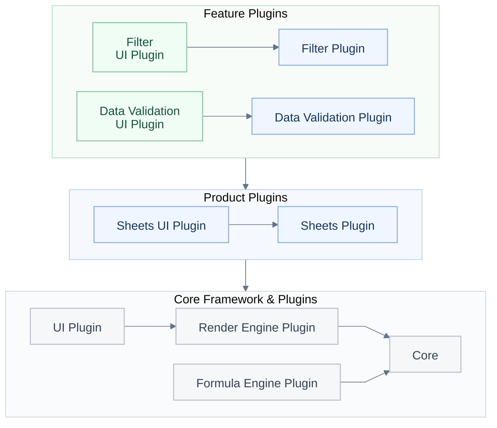
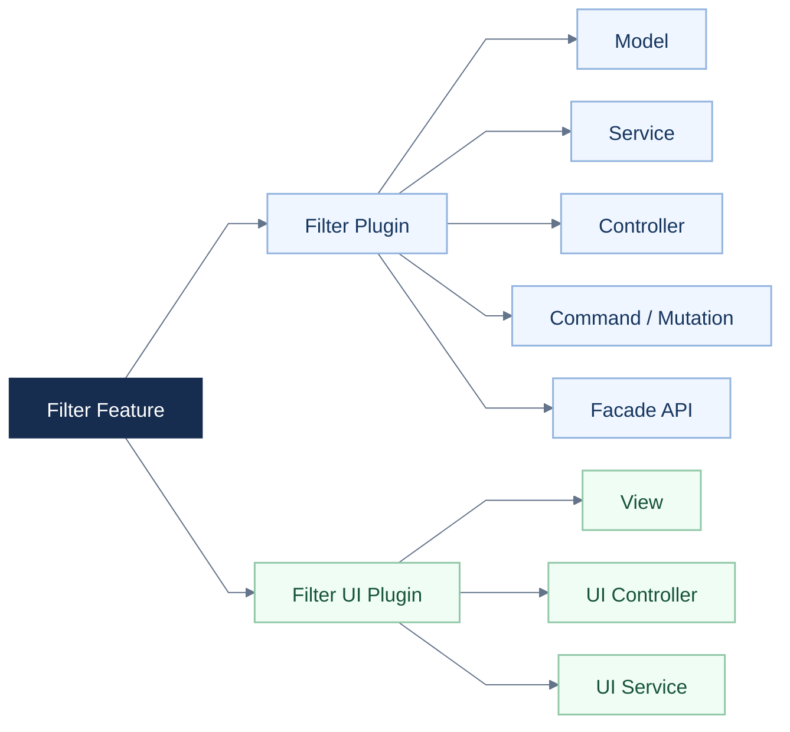
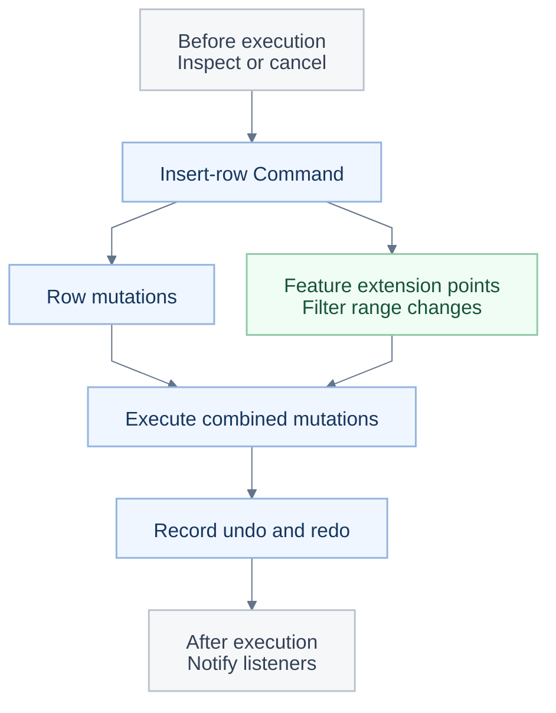

<a id="readme-top"></a>

<p align="center"></p>

<h1 align="center">Erstellen Sie Ihr eigenes KI-Büro mit Univer Office SDK.</h1>

<p align="center">Beginnen Sie mit den Open-Source-Versionen von Sheets und Docs und verbinden Sie anschließend Ihre eigene Anwendung oder Ihren Agenten.</p>

<p align="center"><a href="#quick-start">🚀 Schnellstart</a> · <a href="https://docs.univer.ai/">📚 Dokumentation</a> · <a href="https://univer.ai/compare/">⚖️ Funktionsvergleich</a> · <a href="https://univer.ai/">🌐 Website</a> · <a href="https://docs.univer.ai/showcase">🎮 Beispiele</a> · <a href="https://docs.univer.ai/reference/classes/univer">🔧 API-Referenz</a> · <a href="https://docs.univer.ai/blog">📝 Blog</a></p>

<p align="center"><a href="../../README.md">English</a> · <a href="../../docs/readme/fr-FR.md">Français</a> · <strong>Deutsch</strong> · <a href="../../docs/readme/es-ES.md">Español</a> · <a href="../../docs/readme/zh-CN.md">简体中文</a> · <a href="../../docs/readme/zh-TW.md">繁體中文</a> · <a href="../../docs/readme/ja-JP.md">日本語</a> · <a href="../../docs/readme/ko-KR.md">한국어</a></p>

<p align="center">
  <a href="https://github.com/dream-num/univer/releases"></a>
  <a href="../../LICENSE"></a>
  <a href="https://github.com/dream-num/univer/actions/workflows/build-packages.yml"></a>
  <a href="https://www.codefactor.io/repository/github/dream-num/univer/overview/dev"></a>
  <a href="https://codecov.io/gh/dream-num/univer"></a>
</p>

<p align="center">
  <a href="https://github.com/dream-num/univer"></a>
  <a href="https://github.com/dream-num/univer/graphs/contributors"></a>
  <a href="https://github.com/dream-num/univer/issues"></a>
  <a href="https://github.com/dream-num/univer/commits/dev/"></a>
</p>

<p align="center">
  <a href="https://discord.gg/z3NKNT6D2f"></a>
  <a href="https://twitter.com/univerhq"></a>
  <a href="https://opencollective.com/univer"></a>
</p>

<p align="center">
  <a href="https://trendshift.io/repositories/4376"></a>
</p>

<details>
<summary>Inhaltsverzeichnis</summary>

- [💡 Was ist Univer?](#what-is-univer)
  - [Open-Source-Funktionen](#open-source-capabilities)
- [🚀 Auf der Open-Source-Grundlage aufbauen](#what-you-can-build)
  - [Schnellstart: ein Open-Source-Tabelleneditor](#quick-start)
  - [Ihre Anwendung mit bearbeitbaren Inhalten verbinden](#connect-your-application-to-editable-content)
- [🏗️ Die Open-Source-Architektur erkunden](#open-source-architecture)
  - [Eigene Funktionen klar abgrenzen](#give-custom-features-clear-boundaries)
  - [Funktionsübergreifende Bearbeitung und Rückgängig/Wiederholen kombinieren](#compose-cross-feature-edits-and-undoredo)
  - [Anwendungen und Agenten über Facade-APIs und Ereignisse verbinden](#connect-applications-and-agents-through-facade-apis-and-events)
- [🧩 Ihre Anwendung mit Univer Office SDK erweitern](#open-source-and-commercial-extensions)
  - [Umfang und Lizenzierung](#scope-and-licensing)
- [🌐 Anwendungsmuster und Ökosystem](#application-patterns-and-ecosystem)
  - [Univer Workspace: eine Referenzanwendung für Office SDK](#univer-workspace-an-office-sdk-reference-application)
  - [CLI, Agentenintegrationen und Skills für Entwickler](#cli-agent-integrations-and-developer-skills)
- [📚 Dokumentation und Beiträge](#documentation-and-contributing)
  - [Laufzeitkompatibilität](#runtime-compatibility)
- [💬 Community](#community)
- [🔒 Sicherheit](#security)
- [❤️ Sponsoren](#sponsors)
- [📄 Lizenz](#license)

</details>

<a id="what-is-univer"></a>

## 💡 Was ist Univer?

<p align="center"></p>

**Univer** ist ein Office SDK zum Entwickeln von Office-Anwendungen innerhalb Ihres eigenen Produkts. Es bietet Menschen und bestehenden Agenten Funktionen zur Bearbeitung, Berechnung, Zusammenarbeit und Verarbeitung von Office-Dateien und nutzt dabei Ihre Daten und Berechtigungen. Die Produktfamilie umfasst Tabellenkalkulationen, Dokumente, Präsentationen, relationale Tabellen, Zeichenflächen und PDFs.

Univer Office SDK besteht aus drei Teilen:

- **Web SDK** bildet die Grundlage: Inhaltsmodelle, Bearbeitung, Rendering, Formelberechnung und Facade-APIs (APIs für die Anwendungsintegration). Kombinieren Sie seine Plugins zu einem eingebetteten Editor oder Ihrer eigenen Office-Anwendung. Inhaltsmodelle, Befehle und Berechnungen lassen sich auch für die Headless-Verarbeitung ohne interaktiven Editor wiederverwenden.
- **Server SDK** ergänzt Backend-Dienste für Zusammenarbeit in Echtzeit, Bearbeitungsverläufe sowie den Import und Export von Office-Dateien.
- **AI SDK** verbindet Office-Funktionen mit bestehenden Agenten und Workflows und bietet dafür Inhaltswerkzeuge sowie Integrationen für Ausführung und Prüfung.

**Dieses Repository stellt die Kernarchitektur und die Engine-Implementierungen des Web SDK unter Apache-2.0 bereit**: Inhaltsmodelle und Snapshot-Formate, Plugin- und Abhängigkeitsverwaltung, das Befehlssystem, Formel- und Rendering-Engines, Facade-APIs, die UI-Grundlage sowie die Bearbeitungsfunktionen von Sheets und Docs. Kommerzielle Web-SDK-Plugins, das Server SDK und kommerzielle AI-SDK-Erweiterungen werden separat vertrieben und lizenziert.

Agenten können dieselben Open-Source-APIs verwenden; Ihre Anwendung stellt das Modell und die Orchestrierung der Werkzeuge bereit. Das [Angebotsbeispiel](#connect-your-application-to-editable-content) zeigt Bearbeitung, Berechnung und Speicherung ohne Abhängigkeit vom AI SDK.

<a id="open-source-capabilities"></a>

### Open-Source-Funktionen

<div align="center" style="overflow-x: auto;">

<table align="center" style="display: table; width: auto; margin-left: auto; margin-right: auto;">
<thead>
<tr>
<th>Bereich</th>
<th>Ausgewählte Funktionen</th>
</tr>
</thead>
<tbody>
<tr>
<td><strong>Sheets · Bearbeitung und Layout</strong></td>
<td>Zellstile, verbundene Zellen, Rich Text in Zellen, fixierte Bereiche, frei positionierbare Bilder sowie Rückgängig/Wiederholen.</td>
</tr>
<tr>
<td><strong>Sheets · Daten und Berechnung</strong></td>
<td>Formeln, definierte Namen, Filter, Sortierung, Datenvalidierung, bedingte Formatierung, Hyperlinks, Kommentare sowie Suchen und Ersetzen.</td>
</tr>
<tr>
<td><strong>Docs</strong></td>
<td>Rich-Text-Bearbeitung, Absatzformatierung, Listen, Hyperlinks, Kommentare und Zeichnungsintegration.</td>
</tr>
</tbody>
</table>

</div>

Funktionen werden über Plugins und Presets zusammengestellt; der [Schnellstart](#quick-start) verwendet ausschließlich das **Sheets Core Preset**. Bilder benötigen die entsprechenden Zeichnungs-Plugins. Der [Funktionsvergleich](https://univer.ai/compare/) zeigt den genauen Umfang der Open-Source- und kommerziellen Funktionen.

Die folgenden Demos zeigen den größeren Funktionsumfang von **Univer Office SDK**, einschließlich kommerzieller Funktionen. Sie gehen über die standardmäßige Open-Source-Konfiguration hinaus; den jeweiligen Umfang erläutert der Abschnitt [Open Source und kommerzielle Erweiterungen](#open-source-and-commercial-extensions).

<div align="center" style="overflow-x: auto;">

<table align="center" style="display: table; width: auto; margin-left: auto; margin-right: auto;">
<tbody>
<tr>
  <td width="50%"><a href="https://univer.ai/demo/spreadsheets"></a></td>
  <td width="50%"><a href="https://univer.ai/demo/docs"></a></td>
</tr>
<tr>
  <td width="50%"><a href="https://univer.ai/demo/web-app"></a></td>
  <td width="50%"><a href="https://univer.ai/demo/universe"></a></td>
</tr>
<tr>
  <td width="50%"><a href="https://univer.ai/demo/slides"></a></td>
  <td width="50%"><a href="https://univer.ai/demo/relational-tables"></a></td>
</tr>
<tr>
  <td width="50%"><a href="https://univer.ai/demo/canvases"></a></td>
  <td width="50%"><a href="https://univer.ai/demo/pdf"></a></td>
</tr>
</tbody>
</table>

</div>

<p align="right"><a href="#readme-top"></a></p>

<a id="what-you-can-build"></a>

## 🚀 Auf der Open-Source-Grundlage aufbauen

<p align="center"></p>

<div align="center" style="overflow-x: auto;">

<table align="center" style="display: table; width: auto; margin-left: auto; margin-right: auto;">
<thead>
<tr>
<th>Ihr Ziel</th>
<th>Die Open-Source-Grundlage nutzen</th>
<th>Einstieg</th>
</tr>
</thead>
<tbody>
<tr>
<td><strong>Sheets oder Docs einbetten</strong></td>
<td>Ergänzen Sie Ihre Anwendung oder Ihr Agentenprodukt um eine bearbeitbare Office-Oberfläche und verbinden Sie Ihre Daten über Facade-APIs.</td>
<td><a href="#quick-start">Schnellstart</a></td>
</tr>
<tr>
<td><strong>Inhalte ohne Editor verarbeiten</strong></td>
<td>Verwenden Sie Inhalts-Plugins, Modelle, Befehle und Berechnungen in Node.js für Bearbeitung, Snapshots und automatisierte Aufgaben.</td>
<td><a href="https://docs.univer.ai/guides/sheets/getting-started/node">Headless-Leitfaden</a></td>
</tr>
<tr>
<td><strong>Eigene Funktionen oder Editoren entwickeln</strong></td>
<td>Nutzen Sie Engines, UI-Komponenten, Plugin-Grenzen, Dependency Injection sowie Befehls- und Undo-Systeme. Orientieren Sie sich an bestehenden Funktionen, um Sheets und Docs zu erweitern oder eigene Editoren zu entwickeln.</td>
<td><a href="#open-source-architecture">Open-Source-Architektur</a></td>
</tr>
</tbody>
</table>

</div>

**Bearbeitung und Rückgängig/Wiederholen über Funktionsgrenzen hinweg koordinieren.** Wird eine Zeile innerhalb eines Filterbereichs eingefügt, ändern sich sowohl der Basisinhalt als auch der Filterbereich. Beim Rückgängigmachen müssen beide wiederhergestellt werden. Jede Funktion liefert ihre eigenen Änderungen und Undo-Daten; der Befehl führt deren Ausführung und Verlauf zusammen. Die Architekturübersicht erläutert, wie sich solche Bearbeitungsabläufe erweitern lassen.

<a id="quick-start"></a>

### Schnellstart: ein Open-Source-Tabelleneditor

In einer Browseranwendung mit einem Bundler wie Vite:

```bash
pnpm add @univerjs/presets @univerjs/preset-sheets-core
```

Erstellen Sie den Container, bevor Sie Univer initialisieren:

```html
<div id="app" style="height: 100vh"></div>
```

```ts
import { UniverSheetsCorePreset } from '@univerjs/preset-sheets-core'
import UniverPresetSheetsCoreEnUS from '@univerjs/preset-sheets-core/locales/en-US'
import { createUniver, LocaleType, mergeLocales } from '@univerjs/presets'
import '@univerjs/preset-sheets-core/lib/index.css'

const { univerAPI } = createUniver({
  locale: LocaleType.EN_US,
  locales: {
    [LocaleType.EN_US]: mergeLocales(UniverPresetSheetsCoreEnUS),
  },
  presets: [
    UniverSheetsCorePreset({
      container: 'app',
    }),
  ],
})

univerAPI.createWorkbook({})
```

Ihre Seite enthält jetzt einen Tabelleneditor. Verwenden Sie das zurückgegebene `univerAPI`, um mit dessen Inhalt zu arbeiten. Dieses Beispiel nutzt Open-Source-Pakete und benötigt weder eine kommerzielle Univer-Lizenz noch das Server SDK.

Bewahren Sie bei Komponenten-Frameworks die von `createUniver` zurückgegebene `univer`-Instanz auf und rufen Sie beim Unmounten der Komponente `univer.dispose()` auf. Siehe [Lebenszyklus-Leitfaden](https://docs.univer.ai/guides/sheets/getting-started/lifecycle).

Presets stellen Plugins zusammen und registrieren deren Facade-APIs. Für die manuelle Steuerung finden Sie unten ein [Plugin-Mode-Beispiel](#manual-plugin-composition). Der [Installationsleitfaden](https://docs.univer.ai/guides/sheets/getting-started/installation) behandelt beide Modi, Peer-Abhängigkeiten und Framework-Integrationen.

Halten Sie zusammengehörige `@univerjs/*`-Pakete auf derselben Version. Kommerzielle Pakete müssen die passende Release-Reihe verwenden; unabhängig veröffentlichte Pakete wie Icons folgen ihren eigenen Kompatibilitätsangaben. Siehe [Richtlinie zur API-Stabilität](../../docs/API_STABILITY.md).

<a id="connect-your-application-to-editable-content"></a>

### Ihre Anwendung mit bearbeitbaren Inhalten verbinden

Facade-APIs bilden die Anwendungsschnittstelle zu Arbeitsmappen, Tabellenblättern und Bereichen. Führen Sie den Schnellstart fort, um ein Angebot auszufüllen, eine Menge aus dem Anwendungscode zu ändern und die neu berechnete Gesamtsumme auszulesen:

```ts
// Wait for formula controllers before editing a newly created workbook.
await new Promise<void>((resolve) => {
  if (univerAPI.getCurrentLifecycleStage() >= univerAPI.Enum.LifecycleStages.Steady) {
    resolve()
    return
  }
  const listener = univerAPI.addEvent(univerAPI.Event.LifeCycleChanged, ({ stage }) => {
    if (stage === univerAPI.Enum.LifecycleStages.Steady) {
      listener.dispose()
      resolve()
    }
  })
})

const workbook = univerAPI.getActiveWorkbook()!
const sheet = workbook.getActiveSheet()

sheet.getRange('A1:D4').setValues([
  ['Item', 'Quantity', 'Unit price', 'Amount'],
  ['Seats', 2, 25, '=B2*C2'],
  ['Support', 1, 100, '=B3*C3'],
  ['Total', '', '', '=SUM(D2:D3)'],
])

// An application control or agent can make the same edit.
sheet.getRange('B2').setValue(4)

univerAPI.getFormula().onCalculationResultApplied().then(() => {
  console.log(sheet.getRange('D4').getValue()) // 200
  localStorage.setItem('quotation', JSON.stringify(workbook.save()))
}).catch(console.error)
```

Editor und Anwendung arbeiten mit derselben Arbeitsmappe; Formeländerungen werden automatisch neu berechnet. `workbook.save()` gibt einen JSON-Snapshot zurück, der die Arbeitsmappe und die Daten ihrer registrierten Plugins enthält. Ihre Anwendung übernimmt die Persistenz; dieses Beispiel nutzt den Browserspeicher. Stellen Sie bei einem späteren Laden der Seite nach der Initialisierung den Snapshot wieder her, **anstatt eine leere Arbeitsmappe zu erstellen**:

```ts
const saved = localStorage.getItem('quotation')
if (saved) {
  univerAPI.createWorkbook(JSON.parse(saved))
}
```

Dieser Ablauf verwendet ausschließlich Open-Source-Pakete. Die Snapshot-Persistenz ist vom XLSX-Import und -Export getrennt; Letztere nutzen die separat vertriebenen Dateikonvertierungsfunktionen. Verwenden Sie öffentliche Facade-APIs für die Anwendungsintegration. Die folgenden Quellcodeverweise erläutern die interne Implementierung und die Erweiterungspunkte. Lesen Sie die [Richtlinie zur API-Stabilität](../../docs/API_STABILITY.md), bevor Sie sich auf einen Erweiterungspunkt verlassen.

<a id="manual-plugin-composition"></a>

<details>
<summary>Fortgeschritten: Plugins manuell zusammenstellen (Plugin Mode)</summary>

Verwenden Sie Plugin Mode, wenn Sie die Auswahl, Abhängigkeiten oder das Laden von Plugins genau steuern müssen. Das obige Preset übernimmt diese Zusammenstellung für Sie.

Diese alternative Initialisierung verwendet denselben `app`-Container und den Browser-Plugin-Stack des Sheets Core Presets ohne Worker. Verwenden Sie sie **anstelle der** Preset-Initialisierung und führen Sie anschließend dasselbe Angebotsbeispiel mit dem zurückgegebenen `univerAPI` aus.

```bash
pnpm add @univerjs/core @univerjs/design @univerjs/docs @univerjs/docs-ui \
  @univerjs/engine-formula @univerjs/engine-render @univerjs/network \
  @univerjs/sheets @univerjs/sheets-ui @univerjs/sheets-formula \
  @univerjs/sheets-formula-ui @univerjs/sheets-numfmt \
  @univerjs/sheets-numfmt-ui @univerjs/ui
```

```ts
import { LocaleType, mergeLocales, Univer } from '@univerjs/core'
import { FUniver } from '@univerjs/core/facade'
import DesignEnUS from '@univerjs/design/locale/en-US'
import { UniverDocsPlugin } from '@univerjs/docs'
import { UniverDocsUIPlugin } from '@univerjs/docs-ui'
import DocsUIEnUS from '@univerjs/docs-ui/locale/en-US'
import { UniverFormulaEnginePlugin } from '@univerjs/engine-formula'
import FormulaEnUS from '@univerjs/engine-formula/locale/en-US'
import { UniverRenderEnginePlugin } from '@univerjs/engine-render'
import { UniverNetworkPlugin } from '@univerjs/network'
import { UniverSheetsPlugin } from '@univerjs/sheets'
import SheetsEnUS from '@univerjs/sheets/locale/en-US'
import { UniverSheetsFormulaPlugin } from '@univerjs/sheets-formula'
import SheetsFormulaEnUS from '@univerjs/sheets-formula/locale/en-US'
import { UniverSheetsFormulaUIPlugin } from '@univerjs/sheets-formula-ui'
import SheetsFormulaUIEnUS from '@univerjs/sheets-formula-ui/locale/en-US'
import { UniverSheetsNumfmtPlugin } from '@univerjs/sheets-numfmt'
import { UniverSheetsNumfmtUIPlugin } from '@univerjs/sheets-numfmt-ui'
import SheetsNumfmtUIEnUS from '@univerjs/sheets-numfmt-ui/locale/en-US'
import { UniverSheetsUIPlugin } from '@univerjs/sheets-ui'
import SheetsUIEnUS from '@univerjs/sheets-ui/locale/en-US'
import { UniverUIPlugin } from '@univerjs/ui'
import UIEnUS from '@univerjs/ui/locale/en-US'
import '@univerjs/design/lib/index.css'
import '@univerjs/ui/lib/index.css'
import '@univerjs/docs-ui/lib/index.css'
import '@univerjs/sheets-ui/lib/index.css'
import '@univerjs/sheets-formula-ui/lib/index.css'
import '@univerjs/sheets-numfmt-ui/lib/index.css'
import '@univerjs/network/facade'
import '@univerjs/docs/facade'
import '@univerjs/docs-ui/facade'
import '@univerjs/engine-formula/facade'
import '@univerjs/sheets/facade'
import '@univerjs/ui/facade'
import '@univerjs/sheets-ui/facade'
import '@univerjs/sheets-formula/facade'
import '@univerjs/sheets-numfmt/facade'
import '@univerjs/sheets-formula-ui/facade'

const univer = new Univer({
  locale: LocaleType.EN_US,
  locales: {
    [LocaleType.EN_US]: mergeLocales(
      DesignEnUS,
      DocsUIEnUS,
      FormulaEnUS,
      SheetsEnUS,
      SheetsFormulaEnUS,
      SheetsFormulaUIEnUS,
      SheetsNumfmtUIEnUS,
      SheetsUIEnUS,
      UIEnUS,
    ),
  },
})

univer.registerPlugin(UniverNetworkPlugin)
univer.registerPlugin(UniverDocsPlugin)
univer.registerPlugin(UniverRenderEnginePlugin)
univer.registerPlugin(UniverUIPlugin, { container: 'app' })
univer.registerPlugin(UniverDocsUIPlugin)
univer.registerPlugin(UniverFormulaEnginePlugin)
univer.registerPlugin(UniverSheetsPlugin, {
  onlyRegisterFormulaRelatedMutations: false,
})
univer.registerPlugin(UniverSheetsUIPlugin, {
  protectedRangeShadow: true,
})
univer.registerPlugin(UniverSheetsNumfmtPlugin)
univer.registerPlugin(UniverSheetsNumfmtUIPlugin)
univer.registerPlugin(UniverSheetsFormulaPlugin)
univer.registerPlugin(UniverSheetsFormulaUIPlugin)

const univerAPI = FUniver.newAPI(univer)
univerAPI.createWorkbook({})
```

Die Docs-Plugins unterstützen die Rich-Text-Bearbeitung in Tabellenkalkulationen. Binden Sie beim Hinzufügen einer Funktion auch die zugehörigen Facade-Erweiterungen, Sprachpakete und UI-Stile ein. Geben Sie `univer` frei, wenn sein Container unmountet wird.

</details>

<p align="right"><a href="#readme-top"></a></p>

<a id="open-source-architecture"></a>

## 🏗️ Die Open-Source-Architektur erkunden

<p align="center"></p>

<a id="give-custom-features-clear-boundaries"></a>

### Eigene Funktionen klar abgrenzen

Univer organisiert Inhaltslogik und UI-Interaktion in getrennten Plugins. Funktions-Plugins verwalten Regeln und Inhaltsänderungen; UI-Plugins stellen die Oberfläche und die Benutzerinteraktionen bereit. Beispielsweise verwaltet `sheets-filter` Filterbereiche und -regeln, während `sheets-filter-ui` Panels, Menüs und Tastenkürzel bereitstellt.



**Abbildung 1: drei Plugin-Ebenen.** Funktions-Plugins bauen auf Produkt-Plugins auf, die das Kernframework und seine Plugins wiederverwenden. Gruppenpfeile zeigen Abhängigkeiten von der darunterliegenden Ebene. Core stellt Inhaltsmodelle, Befehle, Dependency Injection und die Lebenszyklusverwaltung bereit. Einige Plugins und Abhängigkeiten sind nicht dargestellt.

Neue Funktionen behalten ihre Regeln in eigenen Plugins und arbeiten über öffentliche Dienste, Befehle und definierte Erweiterungspunkte zusammen. UI-Plugins bauen auf gemeinsamen UI-Diensten und -Komponenten auf.

Abhängigkeiten sind auf zwei Ebenen explizit:

- **Zwischen Plugins:** `DependentOn` deklariert Plugin-Abhängigkeiten zur Laufzeit. Der Plugin-Dienst ordnet sie, und die Lebenszyklusphasen trennen die Registrierung von Abhängigkeiten, die Inhaltsinitialisierung und die UI-Initialisierung.
- **Innerhalb von Plugins:** Dependency Injection verbindet Controller und Dienste über deklarierte Abhängigkeiten. Unterstützte Überschreibungen ermöglichen es einer Anwendung, eine Implementierung zu ersetzen, einen Plattformdienst anzupassen oder ein Testdouble bereitzustellen. Instanzgebundene Injektoren trennen den Anwendungszustand verschiedener Univer-Instanzen.

Freigebbare Registrierungen ermöglichen außerdem das Aufräumen von Befehlen, Listenern, Komponenten und Icons, wenn ihr Besitzer freigegeben wird.

Das [Filter-Plugin](../../packages/sheets-filter/src/plugin.ts) und sein [UI-Plugin](../../packages/sheets-filter-ui/src/plugin.ts) zeigen diese Grenzen in funktionierendem Code.

<details>
<summary>Innerhalb einer Funktion: Model, Controller, Service und die UI-Grundlage</summary>

Beim Filtern verantwortet `sheets-filter` die Inhaltslogik und `sheets-filter-ui` die UI-Interaktion. Jedes Modul hat eine klar umrissene Aufgabe.



**Abbildung 2: Codeorganisation. Pfeile bedeuten „enthält“.** Beide Plugins können Controllers und Services enthalten: Logik-Controllers koordinieren Inhaltsänderungen und verwandte Funktionen; UI-Controllers verbinden Menüs, Tastenkürzel und Interaktionen, während UI-Services den Panelzustand verwalten. Diese Aufgabenverteilung gibt neuen Funktionen eine einheitliche Struktur für Implementierung und Tests.

Die UI-Grundlage folgt derselben Aufteilung. **`@univerjs/design`** liefert gemeinsame Komponenten und Stile, **`@univerjs/ui`** bietet Dienste für die Arbeitsoberfläche wie Menüs, Tastenkürzel, Panels und Komponentenregistrierung, und **`@univerjs/icons`** liefert Icons. Eine Funktion registriert ihre Komponenten und Icons, ergänzt Menüs und bindet ihr Rendering über diese Erweiterungspunkte ein. Teams können ein Panel oder eine Toolbar-Funktion hinzufügen und dabei die UI-Infrastruktur der Anwendung wiederverwenden. Siehe [UI-Übersicht](https://docs.univer.ai/guides/sheets/ui/overview) und [Komponenten- und Icon-Registrierung](../../packages/sheets-filter-ui/src/controllers/components.controller.ts) des Filter-Plugins.

</details>

<a id="compose-cross-feature-edits-and-undoredo"></a>

### Funktionsübergreifende Bearbeitung und Rückgängig/Wiederholen kombinieren

Wenn beispielsweise Zeilen innerhalb eines Filterbereichs eingefügt werden, liefert das Filter-Plugin die entsprechende Bereichsänderung und die zugehörigen Undo-Daten. Der Zeilenbefehl kombiniert die Basisänderung mit den Änderungen der beteiligten Funktionen, führt sie aus und zeichnet ihre Undo-/Redo-Informationen gemeinsam auf. Die Funktion zum Einfügen von Zeilen kann den gemeinsamen Erweiterungsmechanismus nutzen, während das Filter-Plugin seine Regeln zur Bereichsaktualisierung selbst verantwortet.

Das Befehlssystem unterscheidet drei Arten von Aktionen:

- **Command** orchestriert eine fachliche Aktion und die dafür erforderlichen Änderungen.
- **Mutation** ändert in einem Snapshot gespeicherte Inhalte mit serialisierbaren Parametern.
- **Operation** ändert vorübergehenden Zustand, etwa ein geöffnetes Panel oder die Scrollposition.

**Eine gemeinsame Struktur für Rückgängig/Wiederholen.** Für eine rückgängig machbare Bearbeitung liefert die Funktionsimplementierung die vorwärts gerichteten und die entsprechenden inversen Mutationen. Der Command zeichnet sie über `IUndoRedoService` auf. Betrifft eine Aktion mehrere Funktionen, kann der Command deren Änderungen und Undo-Daten in einem einzigen Undo-/Redo-Eintrag zusammenfassen, sodass der Benutzer die vollständige Aktion rückgängig machen und wiederholen kann. Siehe [Befehle erweitern](https://docs.univer.ai/blog/custom-command).

Funktionen müssen weiterhin zusammenarbeiten. **Interceptors und Handler für Referenzbereiche geben dieser Zusammenarbeit einen definierten Ort.** An unterstützten Erweiterungspunkten steuern Plugins Prüfungen oder zugehörige Mutationen bei. Interceptor-Prioritäten bestimmen die Reihenfolge, sofern die API dies vorsieht.

<details>
<summary>Beispiel: Befehle, Callbacks, Funktionskoordination und Rückgängig/Wiederholen</summary>



Dieses Diagramm vereinfacht einen Ablauf zum Einfügen von Zeilen. Verschachtelte Befehlsausführungen haben eigene Callbacks; nicht alle Ereignisse und auch der separate Operation-Pfad sind dargestellt. Siehe [Zeilenbefehl](../../packages/sheets/src/commands/commands/insert-row-col.command.ts), [Filter-Controller](../../packages/sheets-filter/src/controllers/sheets-filter.controller.ts) und [Interceptor-Dienst](../../packages/sheets/src/services/sheet-interceptor/sheet-interceptor.service.ts).

</details>

Diese Grenzen ermöglichen eine praktische Teststrategie: Modelle und Dienste unabhängig testen, externe Abhängigkeiten über DI ersetzen und Regressionstests für kombinierte Aktionen sowie Rückgängig/Wiederholen ergänzen. Die [Tests des Filter-Controllers](../../packages/sheets-filter/src/controllers/__tests__/sheets-filter.controller.spec.ts) prüfen Zeilen- und Spaltenänderungen und deren Auswirkungen auf Filter.

<a id="connect-applications-and-agents-through-facade-apis-and-events"></a>

### Anwendungen und Agenten über Facade-APIs und Ereignisse verbinden

Das Repository enthält die Inhaltsmodelle, die Formel-Engine und die Canvas-Rendering- und Layout-Engine hinter den Editoren. Sie bilden gemeinsame Bausteine: Rich Text in Tabellenkalkulationen verwendet beispielsweise das Dokumentlayout und -rendering wieder. Eigene Funktionen können auf diesen Engines aufbauen, anstatt einen separaten Inhaltsstack zu implementieren. Lesen Sie mehr über die [Architektur der Formel-Engine](https://docs.univer.ai/blog/formula) und die [Architektur der Rendering-Engine](https://docs.univer.ai/blog/rendering).

Browsereditoren, Headless-Aufgaben in Node.js und passend zusammengestellte Worker können die entsprechenden Inhalts-Plugins, Modelle, Befehle und Berechnungen wiederverwenden. Siehe [Headless Univer](https://docs.univer.ai/guides/sheets/getting-started/node) und die [isomorphe Architektur](../../docs/ISOMORPHIC.md).

`ICommandService` stellt Ausführungs-Callbacks bereit, mit denen Plugins Befehle vor und nach ihrer Ausführung beobachten können. Facade-APIs kapseln die zugrunde liegenden Funktionen in Anwendungsobjekten wie `FWorkbook`, `FWorksheet` und `FRange`.

Jedes Plugin steuert eigene Facade-Erweiterungen, **typisierte Ereignisse über `univerAPI.Event`** und **Enums über `univerAPI.Enum`** bei. Anwendungscode kann Ereignisnamen und Konstanten über einen zentralen Einstiegspunkt finden, anstatt private Dienste zu importieren oder Zeichenketten zu wiederholen. Beispielsweise kann `BeforeCommandExecute` eine Ausführung prüfen und abbrechen; `CommandExecuted` meldet Ausführungen an Listener. Listener liefern freigebbare Objekte zurück; ein Abbruch ist möglich, wenn das jeweilige Ereignis ihn unterstützt.

Facade-Erweiterungen bleiben in ihren Funktionspaketen, damit eine Inhalts-API keine sachfremden UI-APIs einbinden muss. Siehe [Facade-Design](https://docs.univer.ai/blog/facade), [Befehls-Callbacks und Ereignisbrücke](../../packages/core/src/facade/f-univer.ts) sowie den [Enum-Einstiegspunkt](../../packages/core/src/facade/f-enum.ts).

Das Repository liefert funktionierende Implementierungen und Muster für deren Erweiterung. Die [Erläuterung der Filterimplementierung](https://docs.univer.ai/blog/anatomy) zeigt ein vollständiges Beispiel. Lesen Sie außerdem die [Richtlinie zur API-Stabilität](../../docs/API_STABILITY.md), bevor Sie sich auf einen Erweiterungspunkt verlassen.

<p align="right"><a href="#readme-top"></a></p>

<a id="open-source-and-commercial-extensions"></a>

## 🧩 Ihre Anwendung mit Univer Office SDK erweitern

<p align="center"></p>

Wenn Sie weitere direkt integrierbare Funktionen benötigen, kombinieren Sie die entsprechenden Module von **Univer Office SDK**: zusätzliche Inhaltstypen, erweiterte Bearbeitungs-Plugins, Zusammenarbeit, Dateikonvertierung und Agentenwerkzeuge. Sie erweitern dieselben Inhaltsmodelle, dieselbe Plugin-Architektur, dasselbe Befehlssystem und dasselbe Facade-Design wie oben beschrieben. So können Sie auf Ihrer bestehenden Integration aufbauen.

<div align="center" style="overflow-x: auto;">

<table align="center" style="display: table; width: auto; margin-left: auto; margin-right: auto;">
<thead>
<tr>
<th>Bestandteil</th>
<th>Erweiterung der Grundlage</th>
</tr>
</thead>
<tbody>
<tr>
<td><strong>Open-Source-Kern des Web SDK · dieses Repository</strong></td>
<td>Offene Modelle, Engines, Plugins, UI-Grundlagen sowie Sheets- und Docs-Funktionen mit den entsprechenden Headless-Inhaltsoperationen. Unter Apache-2.0 in kommerziellen Anwendungen nutzbar.</td>
</tr>
<tr>
<td><strong>Kommerzielle Web-SDK-Plugins</strong></td>
<td>Folgen den Mustern des Kerns für Plugins, Dependency Injection, Command/Mutation und Facade-Erweiterungen. Ergänzen Diagramme, Formen, Pivot-Tabellen, SmartArt und weitere Funktionen für die jeweiligen Inhaltstypen.</td>
</tr>
<tr>
<td><strong>Server SDK</strong></td>
<td>Erweitert dieselben Inhaltsmodelle und Mutationskonventionen um Zusammenarbeit in Echtzeit, Revisionsverläufe und Office-Dateikonvertierung. Integriert sich in Identität, Berechtigungen und Speicherung Ihrer Anwendung.</td>
</tr>
<tr>
<td><strong>AI-SDK-Erweiterungen</strong></td>
<td>Verwenden die Headless- und Facade-Funktionen des Web SDK für kombinierbare Node.js-APIs und CLI-Bausteine. Damit können Agenten Inhalte untersuchen, bearbeiten und prüfen, einschließlich Integrationen für Zusammenarbeit und Worktree-Prüfungen.</td>
</tr>
</tbody>
</table>

</div>

<a id="scope-and-licensing"></a>

### Umfang und Lizenzierung

- **Dieses Repository:** Apache-2.0-Pakete, die unter dieser Lizenz in kommerziellen Anwendungen verwendet werden können, einschließlich der offenen Headless-Inhaltsfunktionen.
- **Kommerzielle Erweiterungen:** Kommerzielle Web-SDK-Plugins, das Server SDK und AI-SDK-Funktionen über die Open-Source-Grundlage hinaus werden separat vertrieben und lizenziert. Die **Freemium**-Evaluierung enthält Wasserzeichen und Funktionseinschränkungen.
- **Referenzanwendungen:** Open-Source-Anwendungen wie Univer Workspace haben eigene Quellcodelizenzen. Ihre SDK-Abhängigkeiten behalten die jeweiligen Lizenzen.

Der [Funktionsvergleich](https://univer.ai/compare/) mit dem Filter **Open source only** zeigt den genauen Umfang. Kommerzielle Optionen finden Sie unter [Tarife und Lizenzierung](https://univer.ai/pricing/).

<details>
<summary>Wie gemeinsame Inhaltsmodelle Bearbeitung, Zusammenarbeit und Dateien verbinden</summary>

Diese Funktionen arbeiten mit serialisierbaren **Unit-Snapshots**, darunter `IWorkbookData` für Sheets, `IDocumentData` für Docs, `ISlideData` für Slides und `IBoardData` für Zeichenflächen (in der API **Boards** genannt). Diese Typen stammen aus dem Kern und den jeweiligen Produktpaketen. Die aktuellen Slides- und Boards-Funktionen sind separat vertriebene kommerzielle Produkte. Gemeinsame Unit-Konventionen ermöglichen Browsereditoren, Backend-Diensten und Agenten die Arbeit mit denselben Inhalten.

Befehle orchestrieren Bearbeitungen; **Mutations beschreiben Inhaltsänderungen**. Die Zusammenarbeit bündelt diese Mutationen in **Changesets**, wendet **Operational Transformation (OT)** auf gleichzeitige Änderungen an und verwaltet bestätigte Revisionen und Snapshots. Der Verlauf kann eine Revision aus einem Snapshot und den nachfolgenden Changesets rekonstruieren. Lesen Sie das [Design der Zusammenarbeit](https://docs.univer.ai/blog/ot) und die [Übersicht zum Collaboration SDK](https://docs.univer.ai/server/collaboration/overview).

**Exchange** bildet Office-Dateistrukturen auf Univer-Inhaltssnapshots ab und umgekehrt. Für OOXML-Formate wie **XLSX, DOCX und PPTX** liest es die Datei in die entsprechenden Sheet-, Doc- oder Slide-Daten ein und erzeugt beim Export die Dateidarstellung. Die konvertierten Inhalte können dieselben Abläufe für Bearbeitung, Berechnung, Zusammenarbeit und Agenten durchlaufen. Siehe [Import und Export von Office-Dateien](https://docs.univer.ai/server/import-export/node).

</details>

<details>
<summary>Wie das AI SDK Agenten dieselben Inhaltsfunktionen bereitstellt</summary>

Das AI SDK baut auf den **Headless-Inhaltsmodellen, Befehlen, Berechnungen und Facade-APIs** des Web SDK auf. Es stellt strukturierte TypeScript-APIs und optionale Commander-Presets bereit, die Anwendungen zu einer eigenen Office-CLI oder zu Agentenwerkzeugen zusammenstellen können.

- **Verstehen, entdecken und bearbeiten.** Die Inspektion liefert strukturierte Inhalte. API Reference hilft dem Agenten, die mit seinem SDK ausgelieferten Facade-Symbole und -Signaturen zu finden. Die Facade-Ausführung unterscheidet Lese- und Schreibmodi, erfasst Mutationen und arbeitet mit expliziter Synchronisierung und Commit-Ergebnissen. Siehe [Inhaltsoperationen](https://docs.univer.ai/ai/content-operations).
- **Das gerenderte Ergebnis prüfen.** Eine Render Runtime im Browser verwendet das Rendering des Web SDK für Screenshots. Die Layoutprüfung von Folien liefert strukturierte Befunde zu Problemen wie Text außerhalb der Seite oder überlappenden Texten und gibt dem Agenten damit eine Grundlage für einen weiteren Bearbeitungsdurchgang. Siehe [visuelle Prüfung](https://docs.univer.ai/ai/visual-inspection).
- **Entwürfe zur menschlichen Prüfung bearbeiten.** Mit den entsprechenden Funktionen für Zusammenarbeit und Web können Agenten einen isolierten Worktree-Entwurf über mehrere Runden bearbeiten und prüfen und ihn anschließend einem Menschen zum Prüfen, Zusammenführen oder erneuten Öffnen übergeben. Der Ablauf verwendet dieselben Snapshot-, Mutations- und Revisionskonventionen. Siehe [Worktree](https://docs.univer.ai/ai/worktree).

Bei wiederholten Aufrufen verwenden optionale [Worker-Pools und ein Daemon](https://docs.univer.ai/ai/runtime-architecture) bereits geladene Inhaltsinstanzen erneut und reduzieren wiederholte Initialisierungen. Ihre Anwendung verantwortet die übergeordnete CLI, Ziele, Autorisierung und Ausgabe. Wählen Sie im [Paketkatalog des AI SDK](https://docs.univer.ai/ai/packages) die benötigten Funktionen aus.

</details>

<p align="right"><a href="#readme-top"></a></p>

<a id="application-patterns-and-ecosystem"></a>

## 🌐 Anwendungsmuster und Ökosystem

<p align="center"></p>

<a id="univer-workspace-an-office-sdk-reference-application"></a>

### Univer Workspace: eine Referenzanwendung für Office SDK

Eine vollständige Referenzanwendung finden Sie in [Univer Workspace](https://github.com/dream-num/univer-workspace). Sie zeigt, wie sich die Editoren von Univer Office SDK, Zusammenarbeit, Dateifunktionen, bestehende Agenten und menschliche Prüfung zu einem selbst hostbaren Arbeitsbereich kombinieren lassen. Orientieren Sie sich beim Aufbau Ihrer eigenen Office-Anwendung oder Ihres Agentenarbeitsbereichs an diesen Integrationsmustern.

<div align="center" style="overflow-x: auto;">

<table align="center" style="display: table; width: auto; margin-left: auto; margin-right: auto;">
  <tr>
    <td width="50%" valign="top">
      <a href="https://space.univer.ai/"></a>
    </td>
    <td width="50%" valign="top">
      <a href="https://univer.ai/demo/web-app"></a>
    </td>
  </tr>
  <tr>
    <td width="50%" valign="top">
      <strong>Agenten und bearbeitbare Office-Inhalte</strong><br />
      Gespräche, Tabellenbearbeitung und Office-Inhalte in einem Arbeitsbereich vereinen.<br />
      <a href="https://space.univer.ai/">Workspace ausprobieren</a> · <a href="https://github.com/dream-num/univer-workspace">Workspace-Quellcode und Einrichtung</a>
    </td>
    <td width="50%" valign="top">
      <strong>Web App × Sheet · Experimentell</strong><br />
      Steuerelemente mit Zellen verbinden: Die App schreibt in die Tabelle, und Tabellenänderungen aktualisieren die App.<br />
      <a href="https://univer.ai/demo/web-app">Demo der tabellenbasierten App ausprobieren</a>
    </td>
  </tr>
</table>

</div>

Workspace ist Open Source; seine SDK-Abhängigkeiten unterliegen ihren jeweiligen Lizenzen. Die [Workspace-Übersicht](https://univer.ai/workspace/) erläutert verbundene Anwendungen und Prüfabläufe.

<p align="center"><a href="https://www.youtube.com/watch?v=1p-SMEiK6Kg"></a></p>

[Demo zur SDK-Integration ansehen](https://www.youtube.com/watch?v=1p-SMEiK6Kg)

<a id="cli-agent-integrations-and-developer-skills"></a>

### CLI, Agentenintegrationen und Skills für Entwickler

Dieselben SDK-Funktionen lassen sich auch in die Agenten und Werkzeuge einbinden, die Sie bereits nutzen:

<div align="center" style="overflow-x: auto;">

<table align="center" style="display: table; width: auto; margin-left: auto; margin-right: auto;">
<thead>
<tr>
<th>Projekt</th>
<th>Bereitgestellte Funktionen</th>
</tr>
</thead>
<tbody>
<tr>
<td><a href="https://github.com/dream-num/univer-cli">Univer CLI</a></td>
<td>Ein lokaler Arbeitsbereich über die Kommandozeile zum Erstellen, Bearbeiten, Untersuchen und Bereitstellen von Office-Inhalten.</td>
</tr>
<tr>
<td><a href="https://github.com/dream-num/dsh-univer-office">Univer Office for DeepSeek Harness</a></td>
<td>Verknüpfte Inhalte, Ergebnisprüfung, versionierte Änderungen und isolierte Zusammenarbeit mit Worktrees.</td>
</tr>
<tr>
<td><a href="https://github.com/dream-num/workbuddy-univer-office">Univer Office for WorkBuddy</a></td>
<td>Lokale Office-Integration, MCP-Vorschauen und Entwurfsprüfung. Entwicklervorschau.</td>
</tr>
<tr>
<td><a href="https://github.com/dream-num/openclaw-univer-office">Univer Office for OpenClaw</a></td>
<td>Werkzeuge zum Erstellen, Prüfen und Bereitstellen von Office-Inhalten.</td>
</tr>
<tr>
<td><a href="https://github.com/dream-num/univer-sdk-skills">Univer SDK Skills</a></td>
<td>Anleitungen, die Coding-Agenten bei der SDK-Integration, Plugin-Entwicklung und Implementierung von Backend-Workflows unterstützen.</td>
</tr>
</tbody>
</table>

</div>

Jedes Repository dokumentiert seine Einrichtung und SDK-Abhängigkeiten. Einstiegspunkte für Agenten finden Sie im [Ökosystem](https://univer.ai/ecosystem/); für eine eigene Integration nutzen Sie die [Dokumentation](https://docs.univer.ai/).

<p align="right"><a href="#readme-top"></a></p>

<a id="documentation-and-contributing"></a>

## 📚 Dokumentation und Beiträge

Vielen Dank an alle [Mitwirkenden](https://github.com/dream-num/univer/graphs/contributors), die Univer entwickeln und verbessern. Beiträge zu Engines, Plugins, Tests, Dokumentation und Beispielen sind willkommen.

<p align="center"><a href="https://docs.univer.ai/guides/sheets">🧩 Web SDK</a> · <a href="https://docs.univer.ai/server">🖥️ Server SDK</a> · <a href="https://docs.univer.ai/ai">🤖 AI SDK</a> · <a href="https://docs.univer.ai/reference/classes/univer">🔧 API-Referenz</a> · <a href="https://office.univer.ai/">🎮 Live-Demo</a></p>

<div align="center" style="overflow-x: auto;">

<table align="center" style="display: table; width: auto; margin-left: auto; margin-right: auto;">
  <tr>
    <th align="center"><br />Edge</th>
    <th align="center"><br />Firefox</th>
    <th align="center"><br />Chrome</th>
    <th align="center"><br />Safari</th>
    <th align="center"><br />Electron</th>
  </tr>
  <tr>
    <td align="center"><code>&gt;=88</code></td>
    <td align="center"><code>&gt;=90</code></td>
    <td align="center"><code>&gt;=88</code></td>
    <td align="center"><code>&gt;=14.1</code></td>
    <td align="center"><code>&gt;=12</code></td>
  </tr>
</table>

</div>

<p align="center">Univer wird mit Chrome 88 als Ziel kompiliert und strebt Kompatibilität mit den oben aufgeführten Versionen an.</p>

<a id="runtime-compatibility"></a>

### Laufzeitkompatibilität

- **Polyfills**: Univer benötigt `Intl.Segmenter`. Ergänzen Sie einen Polyfill wie `@formatjs/intl-segmenter`, wenn Ihr Zielbrowser oder Ihre Laufzeit diese Funktion nicht bereitstellt.
- **Build-Werkzeuge**: Wir empfehlen Vite, esbuild oder Webpack 5. Wenn Ihr Build-Werkzeug das Feld `exports` in `package.json` nicht unterstützt, wie häufig bei Webpack 4, können zusätzliche Pfadzuordnungen erforderlich sein.
- **React**: Die Ansichtsschicht von Univer basiert auf React 18, unterstützt React 18 und 19 und bietet minimale Kompatibilitätsunterstützung für React 16.9+ und 17.
- **Node.js-Laufzeit**: Headless Univer unterstützt Node.js `>=18.17.0`. Die Entwicklung dieses Monorepos erfordert Node.js `>=22.18`.

<details>
<summary>Entwicklung in diesem Repository</summary>

### Repository-Struktur

```text
.
├── packages/      Core packages, engines, document types, UI plugins, and feature plugins
├── examples/      All-in-one Vite workbench used for local browser development
├── common/        Shared internal tooling, storybook, and utilities
├── tests/         Additional integration test projects
└── docs/          Architecture notes, images, and repository-local documentation
```

Die README-Dateien der einzelnen Pakete liegen jeweils beim Paket unter [`packages/`](../../packages).

### Lokale Entwicklung

Voraussetzungen:

- Node.js `>=22.18`
- pnpm: Verwenden Sie die in `packageManager` in `package.json` angegebene Version.

```bash
git clone https://github.com/dream-num/univer.git
cd univer
pnpm install
pnpm dev
```

Nützliche Befehle:

<div align="center" style="overflow-x: auto;">

<table align="center" style="display: table; width: auto; margin-left: auto; margin-right: auto;">
<thead>
<tr>
<th>Befehl</th>
<th>Zweck</th>
</tr>
</thead>
<tbody>
<tr>
<td><code class="notranslate">pnpm dev</code></td>
<td>Die Entwicklungsumgebung für Sheets und Docs starten.</td>
</tr>
<tr>
<td><code class="notranslate">pnpm build</code></td>
<td>Workspace-Pakete mit Ausnahme der internen common-Pakete bauen.</td>
</tr>
<tr>
<td><code class="notranslate">pnpm test</code></td>
<td>Unit-Tests über Turbo ausführen.</td>
</tr>
<tr>
<td><code class="notranslate">pnpm typecheck</code></td>
<td>TypeScript-Prüfungen über Turbo ausführen.</td>
</tr>
<tr>
<td><code class="notranslate">pnpm lint</code></td>
<td>ESLint ausführen.</td>
</tr>
<tr>
<td><code class="notranslate">pnpm storybook:dev</code></td>
<td>Storybook für die Entwicklung von UI-Komponenten starten.</td>
</tr>
</tbody>
</table>

</div>

Lesen Sie [CONTRIBUTING.md](../../CONTRIBUTING.md), bevor Sie einen Pull Request eröffnen.

</details>

<details>
<summary>Referenzen zur Architektur und Mitarbeit</summary>

- [Repository-Pakete](../../packages), [Presets](../../presets) und [Beispiele](../../examples).
- [Isomorphes Univer entwickeln](../../docs/ISOMORPHIC.md).
- [Zur Facade API beitragen](../../docs/CONTRIBUTING-FACADE.md).
- [Richtlinie zur API-Stabilität](../../docs/API_STABILITY.md).
- [Namenskonventionen](../../docs/NAMING_CONVENTION.md) und [Speicherlecks beheben](../../docs/FIX_MEMORY_LEAK.md).
- [Architektur-Kurzfassungen](../../docs/tldr) und [Hinweise zu OLE-Anhängen](../../packages/drawing/docs/ole-attachments.md).

</details>

<p align="right"><a href="#readme-top"></a></p>

<a id="community"></a>

## 💬 Community

Stellen Sie Fragen in [GitHub Discussions](https://github.com/dream-num/univer/discussions), treten Sie [Discord](https://discord.gg/z3NKNT6D2f) bei und folgen Sie uns auf [X](https://twitter.com/univerhq) oder [YouTube](https://www.youtube.com/@dreamNum). Bitte lesen Sie den [Verhaltenskodex](../../CODE_OF_CONDUCT.md).

<p align="right"><a href="#readme-top"></a></p>

<a id="security"></a>

## 🔒 Sicherheit

Wenn Sie glauben, ein Sicherheitsproblem gefunden zu haben, folgen Sie bitte der [Sicherheitsrichtlinie](../../SECURITY.md).

<p align="right"><a href="#readme-top"></a></p>

<a id="sponsors"></a>

## ❤️ Sponsoren

Univer wird von der Community und Sponsoren unterstützt. Sie können das Projekt über [Open Collective](https://opencollective.com/univer) fördern.

<p>
  <a href="https://opencollective.com/univer/sponsor/0/website"></a>
</p>

<p>
  <a href="https://opencollective.com/univer/backer/0/website"></a>
  <a href="https://opencollective.com/univer/backer/1/website"></a>
  <a href="https://opencollective.com/univer/backer/2/website"></a>
  <a href="https://opencollective.com/univer/backer/3/website"></a>
  <a href="https://opencollective.com/univer/backer/4/website"></a>
  <a href="https://opencollective.com/univer/backer/5/website"></a>
  <a href="https://opencollective.com/univer/backer/6/website"></a>
</p>

<p align="right"><a href="#readme-top"></a></p>

<a id="license"></a>

## 📄 Lizenz

Copyright (c) 2021-present DreamNum Co., Ltd.

Die Open-Source-Pakete dieses Repositorys stehen unter der [Apache-2.0-Lizenz](../../LICENSE). Kommerzielle SDK-Module werden separat vertrieben und lizenziert.

<p align="right"><a href="#readme-top"></a></p>
