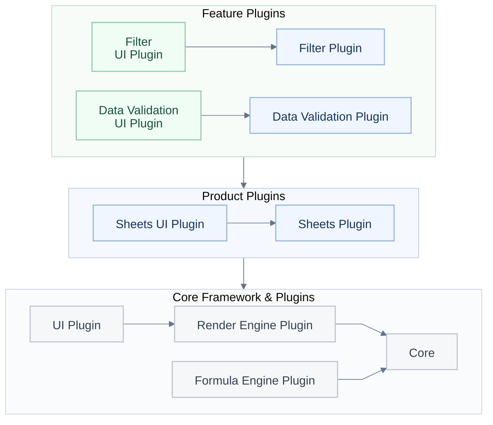
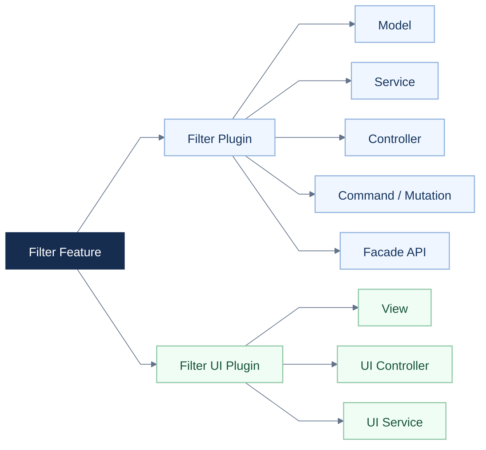
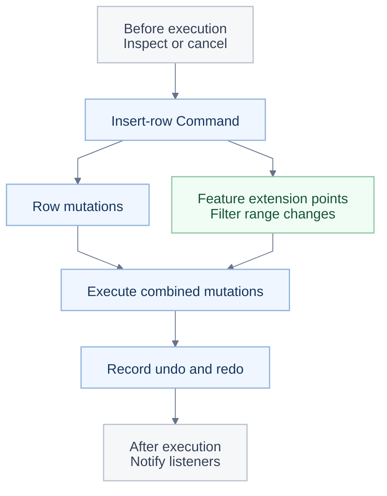

<a id="readme-top"></a>

<p align="center"></p>

<h1 align="center">Crea tu propia oficina con IA con Univer Office SDK.</h1>

<p align="center">Empieza con Sheets y Docs de código abierto y conecta tu propia aplicación o agente.</p>

<p align="center"><a href="#quick-start">🚀 Inicio rápido</a> · <a href="https://docs.univer.ai/">📚 Documentación</a> · <a href="https://univer.ai/compare/">⚖️ Comparación de funciones</a> · <a href="https://univer.ai/">🌐 Sitio web</a> · <a href="https://docs.univer.ai/showcase">🎮 Showcase</a> · <a href="https://docs.univer.ai/reference/classes/univer">🔧 API Reference</a> · <a href="https://docs.univer.ai/blog">📝 Blog</a></p>

<p align="center"><a href="../../README.md">English</a> · <a href="../../docs/readme/fr-FR.md">Français</a> · <a href="../../docs/readme/de-DE.md">Deutsch</a> · <strong>Español</strong> · <a href="../../docs/readme/zh-CN.md">简体中文</a> · <a href="../../docs/readme/zh-TW.md">繁體中文</a> · <a href="../../docs/readme/ja-JP.md">日本語</a> · <a href="../../docs/readme/ko-KR.md">한국어</a></p>

<p align="center">
  <a href="https://github.com/dream-num/univer/releases"></a>
  <a href="../../LICENSE"></a>
  <a href="https://github.com/dream-num/univer/actions/workflows/build-packages.yml"></a>
  <a href="https://www.codefactor.io/repository/github/dream-num/univer/overview/dev"></a>
  <a href="https://codecov.io/gh/dream-num/univer"></a>
</p>

<p align="center">
  <a href="https://github.com/dream-num/univer"></a>
  <a href="https://github.com/dream-num/univer/graphs/contributors"></a>
  <a href="https://github.com/dream-num/univer/issues"></a>
  <a href="https://github.com/dream-num/univer/commits/dev/"></a>
</p>

<p align="center">
  <a href="https://discord.gg/z3NKNT6D2f"></a>
  <a href="https://twitter.com/univerhq"></a>
  <a href="https://opencollective.com/univer"></a>
</p>

<p align="center">
  <a href="https://trendshift.io/repositories/4376"></a>
</p>

<details>
<summary>Índice</summary>

- [💡 ¿Qué es Univer?](#what-is-univer)
  - [Capacidades de código abierto](#open-source-capabilities)
- [🚀 Construye sobre la base de código abierto](#what-you-can-build)
  - [Inicio rápido: un editor de hojas de cálculo de código abierto](#quick-start)
  - [Conecta tu aplicación al contenido editable](#connect-your-application-to-editable-content)
- [🏗️ Explora la arquitectura de código abierto](#open-source-architecture)
  - [Define límites claros para las funciones personalizadas](#give-custom-features-clear-boundaries)
  - [Combina ediciones y deshacer/rehacer entre funciones](#compose-cross-feature-edits-and-undoredo)
  - [Conecta aplicaciones y agentes mediante APIs Facade y eventos](#connect-applications-and-agents-through-facade-apis-and-events)
- [🧩 Amplía tu aplicación con Univer Office SDK](#open-source-and-commercial-extensions)
  - [Alcance y licencias](#scope-and-licensing)
- [🌐 Patrones de aplicación y ecosistema](#application-patterns-and-ecosystem)
  - [Univer Workspace: una aplicación de referencia de Office SDK](#univer-workspace-an-office-sdk-reference-application)
  - [CLI, integraciones de agentes y skills para desarrolladores](#cli-agent-integrations-and-developer-skills)
- [📚 Documentación y contribuciones](#documentation-and-contributing)
  - [Compatibilidad en tiempo de ejecución](#runtime-compatibility)
- [💬 Comunidad](#community)
- [🔒 Seguridad](#security)
- [❤️ Patrocinadores](#sponsors)
- [📄 Licencia](#license)

</details>

<a id="what-is-univer"></a>

## 💡 ¿Qué es Univer?

<p align="center"></p>

**Univer** es un SDK de ofimática para crear aplicaciones de oficina dentro de tu propio producto. Ofrece edición, cálculo, colaboración y procesamiento de archivos de Office para personas y agentes existentes, con tus datos y permisos. La familia de productos abarca hojas de cálculo, documentos, presentaciones, tablas relacionales, lienzos y PDF.

Univer Office SDK consta de tres partes:

- **Web SDK** es la base: modelos de contenido, edición, renderizado, cálculo de fórmulas y APIs Facade (APIs orientadas a la aplicación). Combina sus plugins en un editor integrado o en tu propia aplicación de oficina y reutiliza los modelos de contenido, los comandos y el cálculo para el procesamiento Headless sin un editor interactivo.
- **Server SDK** añade servicios de backend para colaboración en tiempo real, historial de edición e importación y exportación de archivos de Office.
- **AI SDK** conecta las capacidades de Office con agentes y flujos de trabajo existentes mediante herramientas de contenido e integraciones de ejecución y revisión.

**Este repositorio proporciona la arquitectura central y las implementaciones de los motores de Web SDK bajo Apache-2.0**: modelos de contenido y formatos de instantáneas, gestión de plugins y dependencias, sistema de comandos, motores de fórmulas y renderizado, APIs Facade, infraestructura de UI y capacidades de edición de Sheets y Docs. Los plugins comerciales de Web SDK, Server SDK y las extensiones comerciales de AI SDK se distribuyen y licencian por separado.

Los agentes pueden utilizar las mismas APIs de código abierto; tu aplicación aporta el modelo y la orquestación de herramientas. El [ejemplo de presupuesto](#connect-your-application-to-editable-content) muestra cómo editar, calcular y guardar sin depender de AI SDK.

<a id="open-source-capabilities"></a>

### Capacidades de código abierto

<div align="center" style="overflow-x: auto;">

<table align="center" style="display: table; width: auto; margin-left: auto; margin-right: auto;">
<thead>
<tr>
<th>Área</th>
<th>Capacidades seleccionadas</th>
</tr>
</thead>
<tbody>
<tr>
<td><strong>Sheets · Edición y diseño</strong></td>
<td>Estilos de celda, celdas combinadas, texto enriquecido en celdas, paneles inmovilizados, imágenes flotantes y deshacer/rehacer.</td>
</tr>
<tr>
<td><strong>Sheets · Datos y cálculo</strong></td>
<td>Fórmulas, nombres definidos, filtrado, ordenación, validación de datos, formato condicional, hipervínculos, comentarios y búsqueda y reemplazo.</td>
</tr>
<tr>
<td><strong>Docs</strong></td>
<td>Edición de texto enriquecido, formato de párrafos, listas, hipervínculos, comentarios e integración de dibujos.</td>
</tr>
</tbody>
</table>

</div>

Las funciones se componen mediante plugins y presets; el [inicio rápido](#quick-start) utiliza únicamente el **preset Sheets Core**. Las imágenes requieren los plugins de dibujo correspondientes. Consulta la [comparación de funciones](https://univer.ai/compare/) para conocer la cobertura detallada de las opciones de código abierto y comerciales.

Las demos siguientes muestran el conjunto más amplio de **Univer Office SDK**, incluidas capacidades comerciales. Van más allá de la configuración de código abierto predeterminada; consulta el alcance en [código abierto y extensiones comerciales](#open-source-and-commercial-extensions).

<div align="center" style="overflow-x: auto;">

<table align="center" style="display: table; width: auto; margin-left: auto; margin-right: auto;">
<tbody>
<tr>
  <td width="50%"><a href="https://univer.ai/demo/spreadsheets"></a></td>
  <td width="50%"><a href="https://univer.ai/demo/docs"></a></td>
</tr>
<tr>
  <td width="50%"><a href="https://univer.ai/demo/web-app"></a></td>
  <td width="50%"><a href="https://univer.ai/demo/universe"></a></td>
</tr>
<tr>
  <td width="50%"><a href="https://univer.ai/demo/slides"></a></td>
  <td width="50%"><a href="https://univer.ai/demo/relational-tables"></a></td>
</tr>
<tr>
  <td width="50%"><a href="https://univer.ai/demo/canvases"></a></td>
  <td width="50%"><a href="https://univer.ai/demo/pdf"></a></td>
</tr>
</tbody>
</table>

</div>

<p align="right"><a href="#readme-top"></a></p>

<a id="what-you-can-build"></a>

## 🚀 Construye sobre la base de código abierto

<p align="center"></p>

<div align="center" style="overflow-x: auto;">

<table align="center" style="display: table; width: auto; margin-left: auto; margin-right: auto;">
<thead>
<tr>
<th>Tu objetivo</th>
<th>Cómo usar la base de código abierto</th>
<th>Por dónde empezar</th>
</tr>
</thead>
<tbody>
<tr>
<td><strong>Integrar Sheets o Docs</strong></td>
<td>Añade una superficie de edición de Office a tu aplicación o producto de agentes y conecta tus datos mediante las APIs Facade.</td>
<td><a href="#quick-start">Inicio rápido</a></td>
</tr>
<tr>
<td><strong>Procesar contenido sin un editor</strong></td>
<td>Reutiliza plugins de contenido, modelos, comandos y cálculo en Node.js para editar, trabajar con instantáneas y automatizar tareas.</td>
<td><a href="https://docs.univer.ai/guides/sheets/getting-started/node">Guía de Headless</a></td>
</tr>
<tr>
<td><strong>Desarrollar funciones o editores personalizados</strong></td>
<td>Reutiliza los motores, componentes de UI, límites entre plugins, inyección de dependencias y sistemas de comandos y deshacer. Sigue las funciones existentes para ampliar Sheets y Docs o desarrollar tus propios editores.</td>
<td><a href="#open-source-architecture">Arquitectura de código abierto</a></td>
</tr>
</tbody>
</table>

</div>

**Coordina las ediciones y deshacer/rehacer entre funciones.** Insertar una fila dentro de un rango de filtro modifica tanto el contenido base como el rango de filtro; deshacer debe restaurar ambos. Cada función aporta sus propios cambios y datos para deshacer, y el comando combina su ejecución e historial. El recorrido por la arquitectura explica cómo ampliar estos flujos de edición.

<a id="quick-start"></a>

### Inicio rápido: un editor de hojas de cálculo de código abierto

En una aplicación de navegador con un empaquetador como Vite:

```bash
pnpm add @univerjs/presets @univerjs/preset-sheets-core
```

Crea el contenedor antes de inicializar Univer:

```html
<div id="app" style="height: 100vh"></div>
```

```ts
import { UniverSheetsCorePreset } from '@univerjs/preset-sheets-core'
import UniverPresetSheetsCoreEnUS from '@univerjs/preset-sheets-core/locales/en-US'
import { createUniver, LocaleType, mergeLocales } from '@univerjs/presets'
import '@univerjs/preset-sheets-core/lib/index.css'

const { univerAPI } = createUniver({
  locale: LocaleType.EN_US,
  locales: {
    [LocaleType.EN_US]: mergeLocales(UniverPresetSheetsCoreEnUS),
  },
  presets: [
    UniverSheetsCorePreset({
      container: 'app',
    }),
  ],
})

univerAPI.createWorkbook({})
```

Tu página ya contiene un editor de hojas de cálculo. Usa el objeto `univerAPI` devuelto para trabajar con su contenido. Este ejemplo utiliza paquetes de código abierto y no necesita una licencia comercial de Univer ni Server SDK.

En frameworks de componentes, conserva la instancia de `univer` devuelta por `createUniver` y llama a `univer.dispose()` cuando se desmonte el componente. Consulta la [guía del ciclo de vida](https://docs.univer.ai/guides/sheets/getting-started/lifecycle).

Los presets componen plugins y registran sus APIs Facade. Para tener control manual, consulta el [ejemplo de Plugin Mode](#manual-plugin-composition) más abajo. La [guía de instalación](https://docs.univer.ai/guides/sheets/getting-started/installation) cubre ambos modos, las dependencias de pares y las integraciones con frameworks.

Mantén los paquetes coordinados `@univerjs/*` en la misma versión. Los paquetes comerciales deben usar la misma línea de versiones; los paquetes publicados de forma independiente, como los iconos, siguen su compatibilidad declarada. Consulta la [Política de estabilidad de la API](../../docs/API_STABILITY.md).

<a id="connect-your-application-to-editable-content"></a>

### Conecta tu aplicación al contenido editable

Las APIs Facade son la interfaz de la aplicación para libros, hojas y rangos. Continúa desde el inicio rápido para rellenar un presupuesto, actualizar una cantidad desde el código de la aplicación y leer el total recalculado:

```ts
// Wait for formula controllers before editing a newly created workbook.
await new Promise<void>((resolve) => {
  if (univerAPI.getCurrentLifecycleStage() >= univerAPI.Enum.LifecycleStages.Steady) {
    resolve()
    return
  }
  const listener = univerAPI.addEvent(univerAPI.Event.LifeCycleChanged, ({ stage }) => {
    if (stage === univerAPI.Enum.LifecycleStages.Steady) {
      listener.dispose()
      resolve()
    }
  })
})

const workbook = univerAPI.getActiveWorkbook()!
const sheet = workbook.getActiveSheet()

sheet.getRange('A1:D4').setValues([
  ['Item', 'Quantity', 'Unit price', 'Amount'],
  ['Seats', 2, 25, '=B2*C2'],
  ['Support', 1, 100, '=B3*C3'],
  ['Total', '', '', '=SUM(D2:D3)'],
])

// An application control or agent can make the same edit.
sheet.getRange('B2').setValue(4)

univerAPI.getFormula().onCalculationResultApplied().then(() => {
  console.log(sheet.getRange('D4').getValue()) // 200
  localStorage.setItem('quotation', JSON.stringify(workbook.save()))
}).catch(console.error)
```

El editor y tu aplicación trabajan sobre el mismo libro; los cambios en las fórmulas se recalculan automáticamente. `workbook.save()` devuelve una instantánea JSON que contiene el libro y los datos de sus plugins registrados. Tu aplicación se encarga de la persistencia; este ejemplo usa el almacenamiento del navegador. En una carga posterior de la página, después de la inicialización, restaura la instantánea **en lugar de crear un libro vacío**:

```ts
const saved = localStorage.getItem('quotation')
if (saved) {
  univerAPI.createWorkbook(JSON.parse(saved))
}
```

Este flujo utiliza únicamente paquetes de código abierto. La persistencia de instantáneas es independiente de la importación y exportación de XLSX, que utiliza capacidades de conversión de archivos distribuidas por separado. Usa las APIs Facade públicas para integrar tu aplicación; los enlaces al código fuente siguientes explican la implementación interna y los puntos de extensión. Consulta la [Política de estabilidad de la API](../../docs/API_STABILITY.md) antes de depender de un punto de extensión.

<a id="manual-plugin-composition"></a>

<details>
<summary>Avanzado: componer plugins manualmente (Plugin Mode)</summary>

Usa Plugin Mode cuando necesites un control preciso sobre la selección, las dependencias o la carga de plugins. El preset anterior se encarga de esta composición por ti.

Esta inicialización alternativa utiliza el mismo contenedor `app` y la pila de plugins de navegador del preset Sheets Core sin un Worker. Úsala **en lugar de** la inicialización con preset y después ejecuta el mismo ejemplo de presupuesto con el objeto `univerAPI` devuelto.

```bash
pnpm add @univerjs/core @univerjs/design @univerjs/docs @univerjs/docs-ui \
  @univerjs/engine-formula @univerjs/engine-render @univerjs/network \
  @univerjs/sheets @univerjs/sheets-ui @univerjs/sheets-formula \
  @univerjs/sheets-formula-ui @univerjs/sheets-numfmt \
  @univerjs/sheets-numfmt-ui @univerjs/ui
```

```ts
import { LocaleType, mergeLocales, Univer } from '@univerjs/core'
import { FUniver } from '@univerjs/core/facade'
import DesignEnUS from '@univerjs/design/locale/en-US'
import { UniverDocsPlugin } from '@univerjs/docs'
import { UniverDocsUIPlugin } from '@univerjs/docs-ui'
import DocsUIEnUS from '@univerjs/docs-ui/locale/en-US'
import { UniverFormulaEnginePlugin } from '@univerjs/engine-formula'
import FormulaEnUS from '@univerjs/engine-formula/locale/en-US'
import { UniverRenderEnginePlugin } from '@univerjs/engine-render'
import { UniverNetworkPlugin } from '@univerjs/network'
import { UniverSheetsPlugin } from '@univerjs/sheets'
import SheetsEnUS from '@univerjs/sheets/locale/en-US'
import { UniverSheetsFormulaPlugin } from '@univerjs/sheets-formula'
import SheetsFormulaEnUS from '@univerjs/sheets-formula/locale/en-US'
import { UniverSheetsFormulaUIPlugin } from '@univerjs/sheets-formula-ui'
import SheetsFormulaUIEnUS from '@univerjs/sheets-formula-ui/locale/en-US'
import { UniverSheetsNumfmtPlugin } from '@univerjs/sheets-numfmt'
import { UniverSheetsNumfmtUIPlugin } from '@univerjs/sheets-numfmt-ui'
import SheetsNumfmtUIEnUS from '@univerjs/sheets-numfmt-ui/locale/en-US'
import { UniverSheetsUIPlugin } from '@univerjs/sheets-ui'
import SheetsUIEnUS from '@univerjs/sheets-ui/locale/en-US'
import { UniverUIPlugin } from '@univerjs/ui'
import UIEnUS from '@univerjs/ui/locale/en-US'
import '@univerjs/design/lib/index.css'
import '@univerjs/ui/lib/index.css'
import '@univerjs/docs-ui/lib/index.css'
import '@univerjs/sheets-ui/lib/index.css'
import '@univerjs/sheets-formula-ui/lib/index.css'
import '@univerjs/sheets-numfmt-ui/lib/index.css'
import '@univerjs/network/facade'
import '@univerjs/docs/facade'
import '@univerjs/docs-ui/facade'
import '@univerjs/engine-formula/facade'
import '@univerjs/sheets/facade'
import '@univerjs/ui/facade'
import '@univerjs/sheets-ui/facade'
import '@univerjs/sheets-formula/facade'
import '@univerjs/sheets-numfmt/facade'
import '@univerjs/sheets-formula-ui/facade'

const univer = new Univer({
  locale: LocaleType.EN_US,
  locales: {
    [LocaleType.EN_US]: mergeLocales(
      DesignEnUS,
      DocsUIEnUS,
      FormulaEnUS,
      SheetsEnUS,
      SheetsFormulaEnUS,
      SheetsFormulaUIEnUS,
      SheetsNumfmtUIEnUS,
      SheetsUIEnUS,
      UIEnUS,
    ),
  },
})

univer.registerPlugin(UniverNetworkPlugin)
univer.registerPlugin(UniverDocsPlugin)
univer.registerPlugin(UniverRenderEnginePlugin)
univer.registerPlugin(UniverUIPlugin, { container: 'app' })
univer.registerPlugin(UniverDocsUIPlugin)
univer.registerPlugin(UniverFormulaEnginePlugin)
univer.registerPlugin(UniverSheetsPlugin, {
  onlyRegisterFormulaRelatedMutations: false,
})
univer.registerPlugin(UniverSheetsUIPlugin, {
  protectedRangeShadow: true,
})
univer.registerPlugin(UniverSheetsNumfmtPlugin)
univer.registerPlugin(UniverSheetsNumfmtUIPlugin)
univer.registerPlugin(UniverSheetsFormulaPlugin)
univer.registerPlugin(UniverSheetsFormulaUIPlugin)

const univerAPI = FUniver.newAPI(univer)
univerAPI.createWorkbook({})
```

Los plugins de Docs permiten editar texto enriquecido en hojas de cálculo. Al añadir una función, incluye sus extensiones Facade, paquetes de idioma y estilos de UI correspondientes. Libera `univer` cuando se desmonte su contenedor.

</details>

<p align="right"><a href="#readme-top"></a></p>

<a id="open-source-architecture"></a>

## 🏗️ Explora la arquitectura de código abierto

<p align="center"></p>

<a id="give-custom-features-clear-boundaries"></a>

### Define límites claros para las funciones personalizadas

Univer organiza la lógica de contenido y la interacción de UI en plugins separados. Los plugins de funciones gestionan las reglas y los cambios de contenido; los plugins de UI proporcionan la interfaz y las interacciones con el usuario. Por ejemplo, `sheets-filter` gestiona los rangos y las reglas de filtrado, mientras que `sheets-filter-ui` proporciona paneles, menús y atajos.



**Figura 1: tres capas de plugins.** Los plugins de funciones se apoyan en los plugins de producto, que reutilizan el framework central y sus plugins. Las flechas entre grupos muestran las dependencias de la capa inferior; Core proporciona modelos de contenido, comandos, inyección de dependencias y gestión del ciclo de vida. Se omiten algunos plugins y dependencias.

Las nuevas funciones mantienen sus reglas en sus propios plugins y cooperan mediante servicios públicos, comandos y puntos de extensión definidos. Los plugins de UI se basan en servicios y componentes de UI compartidos.

Las dependencias son explícitas en dos niveles:

- **Entre plugins:** `DependentOn` declara las dependencias de plugins en tiempo de ejecución. El servicio de plugins las ordena, y las etapas del ciclo de vida separan el registro de dependencias, la inicialización de contenido y la inicialización de UI.
- **Dentro de los plugins:** la inyección de dependencias conecta controladores y servicios mediante dependencias declaradas. Las sustituciones admitidas permiten a una aplicación reemplazar una implementación, adaptar un servicio de plataforma o proporcionar un doble de prueba. Los inyectores con ámbito de instancia mantienen separado el estado de la aplicación entre instancias de Univer.

El registro con disposables también permite limpiar comandos, listeners, componentes e iconos cuando se libera su propietario.

El [plugin de filtrado](../../packages/sheets-filter/src/plugin.ts) y su [plugin de UI](../../packages/sheets-filter-ui/src/plugin.ts) muestran estos límites en código real.

<details>
<summary>Dentro de una función: Model, Controller, Service e infraestructura de UI</summary>

En el filtrado, `sheets-filter` se encarga de la lógica de contenido y `sheets-filter-ui` de la interacción de UI. Cada módulo tiene una responsabilidad concreta.



**Figura 2: organización del código. Las flechas significan «contiene».** Ambos plugins pueden contener Controllers y Services: los Controllers de lógica coordinan los cambios de contenido y las funciones relacionadas; los Controllers de UI conectan menús, atajos e interacciones, y los Services de UI gestionan el estado de los paneles. Estas responsabilidades ofrecen a las nuevas funciones una estructura coherente para su implementación y pruebas.

La infraestructura de UI sigue la misma división. **`@univerjs/design`** aporta componentes y estilos compartidos, **`@univerjs/ui`** proporciona servicios del entorno de trabajo como menús, atajos, paneles y registro de componentes, y **`@univerjs/icons`** aporta iconos. Una función registra sus componentes e iconos, añade menús y conecta su renderizado mediante estos puntos de extensión. Los equipos pueden añadir un panel o una función a la barra de herramientas reutilizando la infraestructura de UI de la aplicación. Consulta la [descripción general de UI](https://docs.univer.ai/guides/sheets/ui/overview) y el [registro de componentes e iconos](../../packages/sheets-filter-ui/src/controllers/components.controller.ts) del plugin de filtrado.

</details>

<a id="compose-cross-feature-edits-and-undoredo"></a>

### Combina ediciones y deshacer/rehacer entre funciones

Por ejemplo, al insertar filas dentro de un rango de filtro, el plugin de filtrado aporta el cambio de rango correspondiente y sus datos para deshacer. El comando de filas combina la edición base y los cambios de las funciones participantes, los ejecuta y registra conjuntamente su información de deshacer/rehacer. La función de inserción de filas puede usar el mecanismo de extensión compartido mientras el plugin de filtrado conserva sus reglas de actualización de rangos.

El sistema de comandos distingue tres tipos de acción:

- **Command** orquesta una acción de negocio y los cambios que requiere.
- **Mutation** modifica contenido guardado en una instantánea, con parámetros serializables.
- **Operation** modifica estado transitorio, como un panel abierto o la posición de desplazamiento.

**Una estructura compartida para deshacer/rehacer.** Para una edición que se pueda deshacer, la implementación de la función aporta las mutaciones directas y las mutaciones inversas correspondientes, y el Command las registra mediante `IUndoRedoService`. Cuando una acción afecta a varias funciones, el Command puede combinar sus cambios y datos para deshacer en un único registro de deshacer/rehacer, para que el usuario pueda deshacer y rehacer la acción completa. Consulta [cómo ampliar los comandos](https://docs.univer.ai/blog/custom-command).

Las funciones siguen necesitando cooperar. **Los interceptores y los manejadores de rangos de referencia dan un lugar definido a esa cooperación.** En los puntos de extensión admitidos, los plugins aportan comprobaciones o mutaciones relacionadas; las prioridades de los interceptores controlan el orden cuando la API así lo define.

<details>
<summary>Ejemplo: comandos, callbacks, coordinación de funciones y deshacer/rehacer</summary>



Este diagrama simplifica un flujo de inserción de filas. Las ejecuciones de comandos anidados tienen sus propios callbacks; no muestra todos los eventos ni la ruta separada de Operation. Consulta el [comando de filas](../../packages/sheets/src/commands/commands/insert-row-col.command.ts), el [controlador de filtrado](../../packages/sheets-filter/src/controllers/sheets-filter.controller.ts) y el [servicio de interceptores](../../packages/sheets/src/services/sheet-interceptor/sheet-interceptor.service.ts).

</details>

Estos límites permiten una estrategia práctica de pruebas: probar modelos y servicios de forma independiente, sustituir dependencias externas mediante DI y añadir casos de regresión para acciones combinadas y deshacer/rehacer. Las [pruebas del controlador de filtrado](../../packages/sheets-filter/src/controllers/__tests__/sheets-filter.controller.spec.ts) ejercitan los cambios de filas y columnas y su efecto en el filtrado.

<a id="connect-applications-and-agents-through-facade-apis-and-events"></a>

### Conecta aplicaciones y agentes mediante APIs Facade y eventos

El repositorio incluye los modelos de contenido, el motor de fórmulas y el motor de renderizado y diseño en Canvas que utilizan los editores. Son elementos compartidos: el texto enriquecido en hojas de cálculo, por ejemplo, reutiliza el diseño y el renderizado de documentos. Las funciones personalizadas pueden basarse en estos motores en lugar de implementar una pila de contenido independiente. Lee sobre la [arquitectura del motor de fórmulas](https://docs.univer.ai/blog/formula) y la [arquitectura del motor de renderizado](https://docs.univer.ai/blog/rendering).

Los editores de navegador, las tareas Headless de Node.js y los Workers compuestos adecuadamente pueden reutilizar los plugins de contenido, modelos, comandos y cálculo correspondientes. Consulta [Headless Univer](https://docs.univer.ai/guides/sheets/getting-started/node) y la [arquitectura isomórfica](../../docs/ISOMORPHIC.md).

`ICommandService` expone callbacks de ejecución para que los plugins observen los comandos antes y después de ejecutarse. Las APIs Facade encapsulan las capacidades subyacentes en objetos de aplicación como `FWorkbook`, `FWorksheet` y `FRange`.

Cada plugin aporta sus propias extensiones Facade, **eventos tipados mediante `univerAPI.Event`** y **enumeraciones mediante `univerAPI.Enum`**. El código de la aplicación puede descubrir nombres de eventos y constantes desde un único punto de entrada, sin importar servicios privados ni repetir cadenas. Por ejemplo, `BeforeCommandExecute` puede inspeccionar y cancelar una ejecución; `CommandExecuted` notifica las ejecuciones a los listeners. Los listeners devuelven disposables, y la cancelación se aplica cuando el evento la admite.

Las extensiones Facade permanecen en los paquetes de sus funciones, de modo que una API de contenido no necesita incorporar APIs de UI ajenas. Consulta el [diseño de Facade](https://docs.univer.ai/blog/facade), los [callbacks de comandos y el puente de eventos](../../packages/core/src/facade/f-univer.ts) y el [punto de entrada de Enum](../../packages/core/src/facade/f-enum.ts).

El repositorio ofrece implementaciones de funciones y patrones para ampliarlas. Lee el [recorrido por la implementación del filtrado](https://docs.univer.ai/blog/anatomy) para ver un ejemplo completo, o la [Política de estabilidad de la API](../../docs/API_STABILITY.md) antes de depender de un punto de extensión.

<p align="right"><a href="#readme-top"></a></p>

<a id="open-source-and-commercial-extensions"></a>

## 🧩 Amplía tu aplicación con Univer Office SDK

<p align="center"></p>

Cuando necesites más capacidades listas para integrar, combina los módulos correspondientes de **Univer Office SDK**: tipos de contenido adicionales, plugins de edición avanzada, colaboración, conversión de archivos y herramientas para agentes. Amplían los mismos modelos de contenido, arquitectura de plugins, sistema de comandos y diseño de Facade presentados anteriormente, por lo que puedes aprovechar tu integración existente.

<div align="center" style="overflow-x: auto;">

<table align="center" style="display: table; width: auto; margin-left: auto; margin-right: auto;">
<thead>
<tr>
<th>Parte</th>
<th>Cómo amplía la base</th>
</tr>
</thead>
<tbody>
<tr>
<td><strong>Núcleo de Web SDK de código abierto · este repositorio</strong></td>
<td>Modelos, motores, plugins, infraestructura de UI y capacidades de Sheets y Docs de código abierto, con sus correspondientes operaciones Headless sobre contenido. Úsalos en aplicaciones comerciales bajo Apache-2.0.</td>
</tr>
<tr>
<td><strong>Plugins comerciales de Web SDK</strong></td>
<td>Siguen los patrones de Plugin, inyección de dependencias, Command/Mutation y extensión de Facade del núcleo. Añaden gráficos, formas, tablas dinámicas, SmartArt y otras funciones para los tipos de contenido correspondientes.</td>
</tr>
<tr>
<td><strong>Server SDK</strong></td>
<td>Amplía los mismos modelos de contenido y convenciones de mutaciones con colaboración en tiempo real, historial de revisiones y conversión de archivos de Office. Se integra con la identidad, los permisos y el almacenamiento de tu aplicación.</td>
</tr>
<tr>
<td><strong>Extensiones de AI SDK</strong></td>
<td>Reutilizan las capacidades Headless y Facade de Web SDK para proporcionar APIs de Node.js y componentes de CLI que se pueden combinar para que los agentes inspeccionen, editen y comprueben contenido, con integraciones de colaboración y revisión de Worktree.</td>
</tr>
</tbody>
</table>

</div>

<a id="scope-and-licensing"></a>

### Alcance y licencias

- **Este repositorio:** paquetes Apache-2.0 que se pueden usar en aplicaciones comerciales bajo esa licencia, incluidas las capacidades Headless de código abierto para contenido.
- **Extensiones comerciales:** los plugins comerciales de Web SDK, Server SDK y las capacidades de AI SDK que van más allá de la base de código abierto se distribuyen y licencian por separado. La evaluación **Freemium** incluye marcas de agua y límites de funciones.
- **Aplicaciones de referencia:** las aplicaciones de código abierto como Univer Workspace tienen sus propias licencias de código fuente. Sus dependencias del SDK conservan sus respectivas licencias.

Consulta la [comparación de funciones](https://univer.ai/compare/), incluido su filtro **Open source only**, para conocer la cobertura detallada, y los [planes y licencias](https://univer.ai/pricing/) para las opciones comerciales.

<details>
<summary>Cómo los modelos de contenido compartidos conectan la edición, la colaboración y los archivos</summary>

Estas capacidades trabajan con **instantáneas Unit** serializables, entre ellas `IWorkbookData` de Sheets, `IDocumentData` de Docs, `ISlideData` de Slides e `IBoardData` de los lienzos (llamados **Boards** en la API). Estos tipos proceden del núcleo y de los respectivos paquetes de producto; las capacidades actuales de Slides y Boards son productos comerciales distribuidos por separado. Las convenciones Unit compartidas permiten a los editores de navegador, servicios de backend y agentes trabajar con el mismo contenido.

Los comandos orquestan las ediciones; **las Mutations describen los cambios de contenido**. La colaboración agrupa esas mutaciones en **changesets**, aplica **transformación operacional (OT)** a los cambios concurrentes y gestiona las revisiones confirmadas y las instantáneas. El historial puede reconstruir una revisión a partir de una instantánea y los changesets posteriores. Lee el [diseño de colaboración](https://docs.univer.ai/blog/ot) y la [descripción general de Collaboration SDK](https://docs.univer.ai/server/collaboration/overview).

**Exchange** convierte las estructuras de archivos de Office en instantáneas de contenido de Univer y viceversa. Para formatos OOXML como **XLSX, DOCX y PPTX**, analiza el archivo y lo transforma en los datos de Sheet, Doc o Slide correspondientes, y genera la representación del archivo al exportar. El contenido convertido puede entrar en los mismos flujos de edición, cálculo, colaboración y agentes. Consulta la [importación y exportación de archivos de Office](https://docs.univer.ai/server/import-export/node).

</details>

<details>
<summary>Cómo AI SDK ofrece a los agentes las mismas capacidades de contenido</summary>

AI SDK se basa en los **modelos de contenido Headless, comandos, cálculo y APIs Facade** de Web SDK. Expone APIs TypeScript estructuradas y presets opcionales de Commander que las aplicaciones pueden combinar para crear su propia CLI de Office o herramientas para agentes.

- **Comprender, descubrir y editar.** La inspección devuelve contenido estructurado. API Reference ayuda al agente a encontrar los símbolos y las firmas de Facade incluidos en su SDK. La ejecución de Facade distingue los modos de lectura y escritura, captura mutaciones y trabaja con sincronización explícita y resultados de commit. Consulta las [operaciones de contenido](https://docs.univer.ai/ai/content-operations).
- **Comprobar el resultado renderizado.** Un Render Runtime de navegador reutiliza el renderizado de Web SDK para obtener capturas. La comprobación del diseño de diapositivas añade resultados estructurados para problemas como texto fuera de página o superpuesto, dando al agente evidencias para otra ronda de edición. Consulta la [inspección visual](https://docs.univer.ai/ai/visual-inspection).
- **Editar borradores para revisión humana.** Con las capacidades de colaboración y Web correspondientes, los agentes pueden editar y verificar un borrador aislado de Worktree durante varias rondas y entregarlo después a una persona para que lo revise, fusione o reabra. El flujo usa las mismas convenciones de instantáneas, mutaciones y revisiones. Consulta [Worktree](https://docs.univer.ai/ai/worktree).

Para llamadas repetidas, los [pools de Workers y un daemon](https://docs.univer.ai/ai/runtime-architecture) opcionales reutilizan las instancias de contenido cargadas y reducen la inicialización repetida. Tu aplicación se encarga de la CLI raíz, los destinos, la autorización y la salida. Explora el [catálogo de paquetes de AI SDK](https://docs.univer.ai/ai/packages) para seleccionar las capacidades necesarias.

</details>

<p align="right"><a href="#readme-top"></a></p>

<a id="application-patterns-and-ecosystem"></a>

## 🌐 Patrones de aplicación y ecosistema

<p align="center"></p>

<a id="univer-workspace-an-office-sdk-reference-application"></a>

### Univer Workspace: una aplicación de referencia de Office SDK

Para ver una aplicación de referencia completa, empieza por [Univer Workspace](https://github.com/dream-num/univer-workspace). Muestra cómo combinar los editores de Univer Office SDK, colaboración, capacidades de archivos, agentes existentes y revisión humana en un espacio de trabajo autoalojable. Sigue sus patrones de integración al crear tu propia aplicación de oficina o espacio de trabajo para agentes.

<div align="center" style="overflow-x: auto;">

<table align="center" style="display: table; width: auto; margin-left: auto; margin-right: auto;">
  <tr>
    <td width="50%" valign="top">
      <a href="https://space.univer.ai/"></a>
    </td>
    <td width="50%" valign="top">
      <a href="https://univer.ai/demo/web-app"></a>
    </td>
  </tr>
  <tr>
    <td width="50%" valign="top">
      <strong>Agentes y contenido de Office editable</strong><br />
      Reúne conversaciones, edición de hojas de cálculo y contenido de Office en un único espacio de trabajo.<br />
      <a href="https://space.univer.ai/">Prueba Workspace</a> · <a href="https://github.com/dream-num/univer-workspace">Código fuente y configuración de Workspace</a>
    </td>
    <td width="50%" valign="top">
      <strong>Web App × Sheet · Experimental</strong><br />
      Vincula controles a celdas: la aplicación escribe en la hoja y los cambios de la hoja actualizan la aplicación.<br />
      <a href="https://univer.ai/demo/web-app">Prueba la demo de aplicación basada en hojas</a>
    </td>
  </tr>
</table>

</div>

Workspace es de código abierto; sus dependencias del SDK siguen sus respectivas licencias. Consulta la [descripción general de Workspace](https://univer.ai/workspace/) para conocer las aplicaciones conectadas y los flujos de revisión.

<p align="center"><a href="https://www.youtube.com/watch?v=1p-SMEiK6Kg"></a></p>

[Ver una demo de integración del SDK](https://www.youtube.com/watch?v=1p-SMEiK6Kg)

<a id="cli-agent-integrations-and-developer-skills"></a>

### CLI, integraciones de agentes y skills para desarrolladores

Las mismas capacidades del SDK también se pueden combinar con los agentes y las herramientas que ya utilizas:

<div align="center" style="overflow-x: auto;">

<table align="center" style="display: table; width: auto; margin-left: auto; margin-right: auto;">
<thead>
<tr>
<th>Proyecto</th>
<th>Qué ofrece</th>
</tr>
</thead>
<tbody>
<tr>
<td><a href="https://github.com/dream-num/univer-cli">Univer CLI</a></td>
<td>Un espacio de trabajo local por línea de comandos para crear, editar, inspeccionar y entregar contenido de Office.</td>
</tr>
<tr>
<td><a href="https://github.com/dream-num/dsh-univer-office">Univer Office for DeepSeek Harness</a></td>
<td>Contenido vinculado, verificación de resultados, cambios versionados y colaboración aislada con Worktree.</td>
</tr>
<tr>
<td><a href="https://github.com/dream-num/workbuddy-univer-office">Univer Office for WorkBuddy</a></td>
<td>Integración local de Office, vistas previas MCP y revisión de borradores. Versión preliminar para desarrolladores.</td>
</tr>
<tr>
<td><a href="https://github.com/dream-num/openclaw-univer-office">Univer Office for OpenClaw</a></td>
<td>Herramientas para crear, revisar y entregar contenido de Office.</td>
</tr>
<tr>
<td><a href="https://github.com/dream-num/univer-sdk-skills">Univer SDK Skills</a></td>
<td>Instrucciones que ayudan a los agentes de programación a integrar el SDK, desarrollar plugins e implementar flujos de backend.</td>
</tr>
</tbody>
</table>

</div>

Cada repositorio documenta su configuración y sus dependencias del SDK. Explora el [ecosistema](https://univer.ai/ecosystem/) para encontrar puntos de entrada para agentes, o la [documentación](https://docs.univer.ai/) para crear tu propia integración.

<p align="right"><a href="#readme-top"></a></p>

<a id="documentation-and-contributing"></a>

## 📚 Documentación y contribuciones

Gracias a todos los [colaboradores](https://github.com/dream-num/univer/graphs/contributors) que construyen y mejoran Univer. Son bienvenidas las contribuciones a motores, plugins, pruebas, documentación y ejemplos.

<p align="center"><a href="https://docs.univer.ai/guides/sheets">🧩 Web SDK</a> · <a href="https://docs.univer.ai/server">🖥️ Server SDK</a> · <a href="https://docs.univer.ai/ai">🤖 AI SDK</a> · <a href="https://docs.univer.ai/reference/classes/univer">🔧 Referencia de la API</a> · <a href="https://office.univer.ai/">🎮 Demo en vivo</a></p>

<div align="center" style="overflow-x: auto;">

<table align="center" style="display: table; width: auto; margin-left: auto; margin-right: auto;">
  <tr>
    <th align="center"><br />Edge</th>
    <th align="center"><br />Firefox</th>
    <th align="center"><br />Chrome</th>
    <th align="center"><br />Safari</th>
    <th align="center"><br />Electron</th>
  </tr>
  <tr>
    <td align="center"><code>&gt;=88</code></td>
    <td align="center"><code>&gt;=90</code></td>
    <td align="center"><code>&gt;=88</code></td>
    <td align="center"><code>&gt;=14.1</code></td>
    <td align="center"><code>&gt;=12</code></td>
  </tr>
</table>

</div>

<p align="center">Univer se compila con Chrome 88 como objetivo y busca funcionar con las versiones indicadas arriba.</p>

<a id="runtime-compatibility"></a>

### Compatibilidad en tiempo de ejecución

- **Polyfills**: Univer depende de `Intl.Segmenter`. Añade un polyfill como `@formatjs/intl-segmenter` si tu navegador o entorno de ejecución no lo proporciona.
- **Herramientas de compilación**: recomendamos Vite, esbuild o Webpack 5. Si tu herramienta no admite el campo `exports` de `package.json` (habitual en Webpack 4), puede que necesites configurar asignaciones de rutas adicionales.
- **React**: la capa de vistas de Univer está construida con React 18, admite React 18 y 19, y ofrece soporte mínimo de compatibilidad para React 16.9+ y 17.
- **Node.js**: Headless Univer admite Node.js `>=18.17.0`. El desarrollo de este monorepo requiere Node.js `>=22.18`.

<details>
<summary>Desarrollo en este repositorio</summary>

### Estructura del repositorio

```text
.
├── packages/      Core packages, engines, document types, UI plugins, and feature plugins
├── examples/      All-in-one Vite workbench used for local browser development
├── common/        Shared internal tooling, storybook, and utilities
├── tests/         Additional integration test projects
└── docs/          Architecture notes, images, and repository-local documentation
```

Los README de cada paquete están junto a su paquete en [`packages/`](../../packages).

### Desarrollo local

Requisitos:

- Node.js `>=22.18`
- pnpm: usa la versión declarada en `packageManager` dentro de `package.json`.

```bash
git clone https://github.com/dream-num/univer.git
cd univer
pnpm install
pnpm dev
```

Comandos útiles:

<div align="center" style="overflow-x: auto;">

<table align="center" style="display: table; width: auto; margin-left: auto; margin-right: auto;">
<thead>
<tr>
<th>Comando</th>
<th>Finalidad</th>
</tr>
</thead>
<tbody>
<tr>
<td><code class="notranslate">pnpm dev</code></td>
<td>Iniciar el entorno de desarrollo de Sheets y Docs.</td>
</tr>
<tr>
<td><code class="notranslate">pnpm build</code></td>
<td>Compilar los paquetes del workspace, excluidos los paquetes comunes internos.</td>
</tr>
<tr>
<td><code class="notranslate">pnpm test</code></td>
<td>Ejecutar pruebas unitarias mediante Turbo.</td>
</tr>
<tr>
<td><code class="notranslate">pnpm typecheck</code></td>
<td>Ejecutar las comprobaciones de TypeScript mediante Turbo.</td>
</tr>
<tr>
<td><code class="notranslate">pnpm lint</code></td>
<td>Ejecutar ESLint.</td>
</tr>
<tr>
<td><code class="notranslate">pnpm storybook:dev</code></td>
<td>Iniciar Storybook para desarrollar componentes de UI.</td>
</tr>
</tbody>
</table>

</div>

Lee [CONTRIBUTING.md](../../CONTRIBUTING.md) antes de abrir un pull request.

</details>

<details>
<summary>Referencias de arquitectura y contribuciones</summary>

- [Paquetes del repositorio](../../packages), [presets](../../presets) y [ejemplos](../../examples).
- [Crear un Univer isomórfico](../../docs/ISOMORPHIC.md).
- [Contribuir a Facade API](../../docs/CONTRIBUTING-FACADE.md).
- [Política de estabilidad de la API](../../docs/API_STABILITY.md).
- [Convenciones de nombres](../../docs/NAMING_CONVENTION.md) y [Corrección de fugas de memoria](../../docs/FIX_MEMORY_LEAK.md).
- [Resúmenes de arquitectura](../../docs/tldr) y [notas sobre adjuntos OLE](../../packages/drawing/docs/ole-attachments.md).

</details>

<p align="right"><a href="#readme-top"></a></p>

<a id="community"></a>

## 💬 Comunidad

Haz preguntas en [GitHub Discussions](https://github.com/dream-num/univer/discussions), únete a [Discord](https://discord.gg/z3NKNT6D2f) y sigue [X](https://twitter.com/univerhq) o [YouTube](https://www.youtube.com/@dreamNum). Lee el [Código de conducta](../../CODE_OF_CONDUCT.md).

<p align="right"><a href="#readme-top"></a></p>

<a id="security"></a>

## 🔒 Seguridad

Si crees haber encontrado un problema de seguridad, sigue la [Política de Seguridad](../../SECURITY.md).

<p align="right"><a href="#readme-top"></a></p>

<a id="sponsors"></a>

## ❤️ Patrocinadores

Univer cuenta con el apoyo de la comunidad y patrocinadores. Puedes apoyar el proyecto a través de [Open Collective](https://opencollective.com/univer).

<p>
  <a href="https://opencollective.com/univer/sponsor/0/website"></a>
</p>

<p>
  <a href="https://opencollective.com/univer/backer/0/website"></a>
  <a href="https://opencollective.com/univer/backer/1/website"></a>
  <a href="https://opencollective.com/univer/backer/2/website"></a>
  <a href="https://opencollective.com/univer/backer/3/website"></a>
  <a href="https://opencollective.com/univer/backer/4/website"></a>
  <a href="https://opencollective.com/univer/backer/5/website"></a>
  <a href="https://opencollective.com/univer/backer/6/website"></a>
</p>

<p align="right"><a href="#readme-top"></a></p>

<a id="license"></a>

## 📄 Licencia

Copyright (c) 2021-present DreamNum Co., Ltd.

Los paquetes de código abierto de este repositorio se distribuyen bajo [Apache-2.0](../../LICENSE). Los módulos comerciales del SDK se distribuyen y licencian por separado.

<p align="right"><a href="#readme-top"></a></p>
