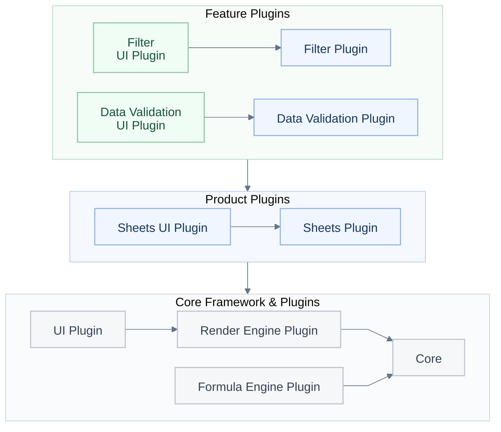
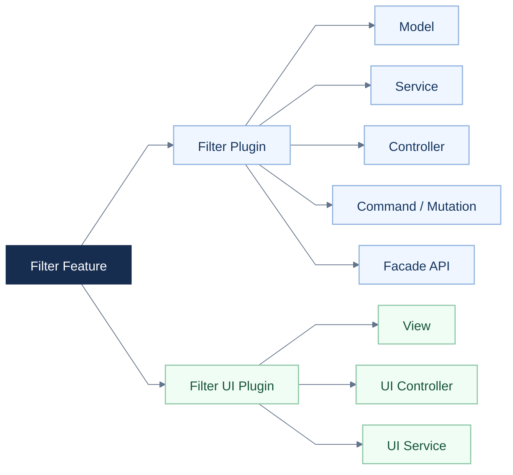
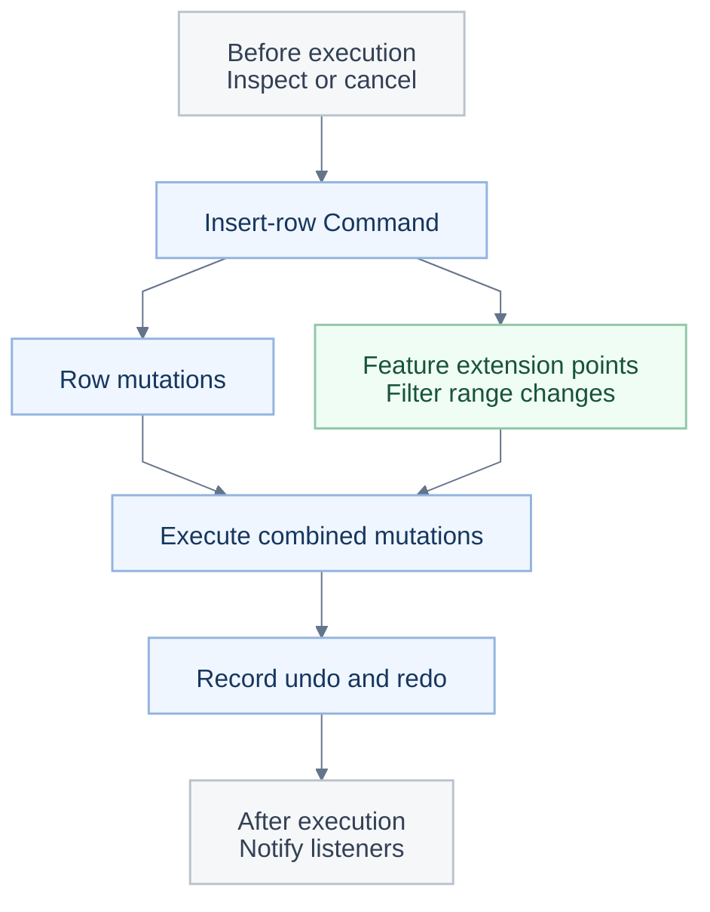

<a id="readme-top"></a>

<p align="center"></p>

<h1 align="center">Créez votre propre bureau IA avec Univer Office SDK.</h1>

<p align="center">Commencez avec Sheets et Docs open source, puis connectez votre propre application ou agent.</p>

<p align="center"><a href="#quick-start">🚀 Démarrage rapide</a> · <a href="https://docs.univer.ai/">📚 Documentation</a> · <a href="https://univer.ai/compare/">⚖️ Comparaison des fonctionnalités</a> · <a href="https://univer.ai/">🌐 Site web</a> · <a href="https://docs.univer.ai/showcase">🎮 Exemples</a> · <a href="https://docs.univer.ai/reference/classes/univer">🔧 Référence API</a> · <a href="https://docs.univer.ai/blog">📝 Blog</a></p>

<p align="center"><a href="../../README.md">English</a> · <strong>Français</strong> · <a href="../../docs/readme/de-DE.md">Deutsch</a> · <a href="../../docs/readme/es-ES.md">Español</a> · <a href="../../docs/readme/zh-CN.md">简体中文</a> · <a href="../../docs/readme/zh-TW.md">繁體中文</a> · <a href="../../docs/readme/ja-JP.md">日本語</a> · <a href="../../docs/readme/ko-KR.md">한국어</a></p>

<p align="center">
  <a href="https://github.com/dream-num/univer/releases"></a>
  <a href="../../LICENSE"></a>
  <a href="https://github.com/dream-num/univer/actions/workflows/build-packages.yml"></a>
  <a href="https://www.codefactor.io/repository/github/dream-num/univer/overview/dev"></a>
  <a href="https://codecov.io/gh/dream-num/univer"></a>
</p>

<p align="center">
  <a href="https://github.com/dream-num/univer"></a>
  <a href="https://github.com/dream-num/univer/graphs/contributors"></a>
  <a href="https://github.com/dream-num/univer/issues"></a>
  <a href="https://github.com/dream-num/univer/commits/dev/"></a>
</p>

<p align="center">
  <a href="https://discord.gg/z3NKNT6D2f"></a>
  <a href="https://twitter.com/univerhq"></a>
  <a href="https://opencollective.com/univer"></a>
</p>

<p align="center">
  <a href="https://trendshift.io/repositories/4376"></a>
</p>

<details>
<summary>Sommaire</summary>

- [💡 Qu'est-ce qu'Univer ?](#what-is-univer)
  - [Capacités open source](#open-source-capabilities)
- [🚀 Construisez sur la base open source](#what-you-can-build)
  - [Démarrage rapide : un éditeur de feuilles de calcul open source](#quick-start)
  - [Connectez votre application au contenu éditable](#connect-your-application-to-editable-content)
- [🏗️ Explorez l'architecture open source](#open-source-architecture)
  - [Définissez des frontières claires pour les fonctionnalités personnalisées](#give-custom-features-clear-boundaries)
  - [Assemblez les modifications et annuler/rétablir entre fonctionnalités](#compose-cross-feature-edits-and-undoredo)
  - [Connectez les applications et les agents via les API Facade et les événements](#connect-applications-and-agents-through-facade-apis-and-events)
- [🧩 Étendez votre application avec Univer Office SDK](#open-source-and-commercial-extensions)
  - [Périmètre et licences](#scope-and-licensing)
- [🌐 Modèles d'application et écosystème](#application-patterns-and-ecosystem)
  - [Univer Workspace : une application de référence d'Office SDK](#univer-workspace-an-office-sdk-reference-application)
  - [CLI, intégrations d'agents et skills pour les développeurs](#cli-agent-integrations-and-developer-skills)
- [📚 Documentation et contributions](#documentation-and-contributing)
  - [Compatibilité à l'exécution](#runtime-compatibility)
- [💬 Communauté](#community)
- [🔒 Sécurité](#security)
- [❤️ Sponsors](#sponsors)
- [📄 Licence](#license)

</details>

<a id="what-is-univer"></a>

## 💡 Qu'est-ce qu'Univer ?

<p align="center"></p>

**Univer** est un SDK bureautique permettant de créer des applications Office au sein de votre propre produit. Il fournit des capacités d'édition, de calcul, de collaboration et de traitement de fichiers Office aux utilisateurs et aux agents existants, avec vos données et vos autorisations. La gamme de produits couvre les feuilles de calcul, les documents, les présentations, les tables relationnelles, les canevas et les PDF.

Univer Office SDK comprend trois parties :

- **Web SDK** constitue la base : modèles de contenu, édition, rendu, calcul de formules et API Facade (API destinées aux applications). Assemblez ses plugins dans un éditeur intégré ou votre propre application Office, et réutilisez les modèles de contenu, les commandes et le calcul pour un traitement Headless sans éditeur interactif.
- **Server SDK** ajoute des services backend pour la collaboration en temps réel, l'historique des modifications et l'importation et l'exportation de fichiers Office.
- **AI SDK** relie les capacités Office aux agents et aux workflows existants, avec des outils de contenu et des intégrations d'exécution et de révision.

**Ce dépôt fournit l'architecture centrale et les implémentations des moteurs de Web SDK sous Apache-2.0** : modèles de contenu et formats de snapshots, gestion des plugins et des dépendances, système de commandes, moteurs de formules et de rendu, API Facade, infrastructure UI et capacités d'édition de Sheets et Docs. Les plugins commerciaux de Web SDK, Server SDK et les extensions commerciales d'AI SDK sont distribués et licenciés séparément.

Les agents peuvent utiliser les mêmes API open source ; votre application fournit le modèle et l'orchestration des outils. L'[exemple de devis](#connect-your-application-to-editable-content) montre comment modifier, calculer et enregistrer sans dépendre d'AI SDK.

<a id="open-source-capabilities"></a>

### Capacités open source

<div align="center" style="overflow-x: auto;">

<table align="center" style="display: table; width: auto; margin-left: auto; margin-right: auto;">
<thead>
<tr>
<th>Domaine</th>
<th>Sélection de fonctionnalités</th>
</tr>
</thead>
<tbody>
<tr>
<td><strong>Sheets · Édition et mise en page</strong></td>
<td>Styles de cellules, cellules fusionnées, texte enrichi dans les cellules, volets figés, images flottantes et annuler/rétablir.</td>
</tr>
<tr>
<td><strong>Sheets · Données et calcul</strong></td>
<td>Formules, noms définis, filtrage, tri, validation des données, mise en forme conditionnelle, hyperliens, commentaires et rechercher/remplacer.</td>
</tr>
<tr>
<td><strong>Docs</strong></td>
<td>Édition de texte enrichi, mise en forme des paragraphes, listes, hyperliens, commentaires et intégration des dessins.</td>
</tr>
</tbody>
</table>

</div>

Les fonctionnalités sont assemblées au moyen de plugins et de presets ; le [démarrage rapide](#quick-start) utilise uniquement le **preset Sheets Core**. Les images nécessitent les plugins de dessin correspondants. Consultez la [comparaison des fonctionnalités](https://univer.ai/compare/) pour le détail des capacités open source et commerciales.

Les démonstrations ci-dessous présentent l'ensemble plus large d'**Univer Office SDK**, y compris des capacités commerciales. Elles vont au-delà de la configuration open source par défaut ; consultez [l'open source et les extensions commerciales](#open-source-and-commercial-extensions) pour en connaître le périmètre.

<div align="center" style="overflow-x: auto;">

<table align="center" style="display: table; width: auto; margin-left: auto; margin-right: auto;">
<tbody>
<tr>
  <td width="50%"><a href="https://univer.ai/demo/spreadsheets"></a></td>
  <td width="50%"><a href="https://univer.ai/demo/docs"></a></td>
</tr>
<tr>
  <td width="50%"><a href="https://univer.ai/demo/web-app"></a></td>
  <td width="50%"><a href="https://univer.ai/demo/universe"></a></td>
</tr>
<tr>
  <td width="50%"><a href="https://univer.ai/demo/slides"></a></td>
  <td width="50%"><a href="https://univer.ai/demo/relational-tables"></a></td>
</tr>
<tr>
  <td width="50%"><a href="https://univer.ai/demo/canvases"></a></td>
  <td width="50%"><a href="https://univer.ai/demo/pdf"></a></td>
</tr>
</tbody>
</table>

</div>

<p align="right"><a href="#readme-top"></a></p>

<a id="what-you-can-build"></a>

## 🚀 Construisez sur la base open source

<p align="center"></p>

<div align="center" style="overflow-x: auto;">

<table align="center" style="display: table; width: auto; margin-left: auto; margin-right: auto;">
<thead>
<tr>
<th>Votre objectif</th>
<th>Utiliser la base open source</th>
<th>Par où commencer</th>
</tr>
</thead>
<tbody>
<tr>
<td><strong>Intégrer Sheets ou Docs</strong></td>
<td>Ajoutez une interface Office éditable à votre application ou produit d'agents, et connectez vos données via les API Facade.</td>
<td><a href="#quick-start">Démarrage rapide</a></td>
</tr>
<tr>
<td><strong>Traiter du contenu sans éditeur</strong></td>
<td>Réutilisez les plugins de contenu, les modèles, les commandes et le calcul dans Node.js pour l'édition, les snapshots et les tâches automatisées.</td>
<td><a href="https://docs.univer.ai/guides/sheets/getting-started/node">Guide Headless</a></td>
</tr>
<tr>
<td><strong>Développer des fonctionnalités ou des éditeurs personnalisés</strong></td>
<td>Réutilisez les moteurs, les composants UI, les frontières entre plugins, l'injection de dépendances et les systèmes de commandes et d'annulation. Appuyez-vous sur les fonctionnalités existantes pour étendre Sheets et Docs ou développer vos propres éditeurs.</td>
<td><a href="#open-source-architecture">Architecture open source</a></td>
</tr>
</tbody>
</table>

</div>

**Coordonnez les modifications et annuler/rétablir entre fonctionnalités.** Insérer une ligne dans une plage de filtre modifie à la fois le contenu de base et la plage du filtre ; l'annulation doit restaurer les deux. Chaque fonctionnalité fournit ses propres modifications et données d'annulation, et la commande assemble leur exécution et leur historique. La présentation de l'architecture explique comment étendre ces workflows d'édition.

<a id="quick-start"></a>

### Démarrage rapide : un éditeur de feuilles de calcul open source

Dans une application de navigateur utilisant un bundler comme Vite :

```bash
pnpm add @univerjs/presets @univerjs/preset-sheets-core
```

Créez le conteneur avant d'initialiser Univer :

```html
<div id="app" style="height: 100vh"></div>
```

```ts
import { UniverSheetsCorePreset } from '@univerjs/preset-sheets-core'
import UniverPresetSheetsCoreEnUS from '@univerjs/preset-sheets-core/locales/en-US'
import { createUniver, LocaleType, mergeLocales } from '@univerjs/presets'
import '@univerjs/preset-sheets-core/lib/index.css'

const { univerAPI } = createUniver({
  locale: LocaleType.EN_US,
  locales: {
    [LocaleType.EN_US]: mergeLocales(UniverPresetSheetsCoreEnUS),
  },
  presets: [
    UniverSheetsCorePreset({
      container: 'app',
    }),
  ],
})

univerAPI.createWorkbook({})
```

Votre page contient désormais un éditeur de feuilles de calcul. Utilisez l'objet `univerAPI` retourné pour manipuler son contenu. Cet exemple utilise des packages open source et ne nécessite ni licence commerciale Univer ni Server SDK.

Avec un framework à composants, conservez l'instance `univer` retournée par `createUniver` et appelez `univer.dispose()` lors du démontage du composant. Consultez le [guide du cycle de vie](https://docs.univer.ai/guides/sheets/getting-started/lifecycle).

Les presets assemblent les plugins et enregistrent leurs API Facade. Pour un contrôle manuel, consultez l'[exemple Plugin Mode](#manual-plugin-composition) ci-dessous. Le [guide d'installation](https://docs.univer.ai/guides/sheets/getting-started/installation) couvre les deux modes, les dépendances peer et les intégrations avec les frameworks.

Maintenez les packages coordonnés `@univerjs/*` à la même version. Les packages commerciaux doivent utiliser la série de versions correspondante ; les packages publiés indépendamment, comme les icônes, suivent la compatibilité qu'ils déclarent. Consultez la [politique de stabilité des API](../../docs/API_STABILITY.md).

<a id="connect-your-application-to-editable-content"></a>

### Connectez votre application au contenu éditable

Les API Facade constituent l'interface de l'application avec les classeurs, les feuilles et les plages. Poursuivez le démarrage rapide pour remplir un devis, modifier une quantité depuis le code de l'application et lire le total recalculé :

```ts
// Wait for formula controllers before editing a newly created workbook.
await new Promise<void>((resolve) => {
  if (univerAPI.getCurrentLifecycleStage() >= univerAPI.Enum.LifecycleStages.Steady) {
    resolve()
    return
  }
  const listener = univerAPI.addEvent(univerAPI.Event.LifeCycleChanged, ({ stage }) => {
    if (stage === univerAPI.Enum.LifecycleStages.Steady) {
      listener.dispose()
      resolve()
    }
  })
})

const workbook = univerAPI.getActiveWorkbook()!
const sheet = workbook.getActiveSheet()

sheet.getRange('A1:D4').setValues([
  ['Item', 'Quantity', 'Unit price', 'Amount'],
  ['Seats', 2, 25, '=B2*C2'],
  ['Support', 1, 100, '=B3*C3'],
  ['Total', '', '', '=SUM(D2:D3)'],
])

// An application control or agent can make the same edit.
sheet.getRange('B2').setValue(4)

univerAPI.getFormula().onCalculationResultApplied().then(() => {
  console.log(sheet.getRange('D4').getValue()) // 200
  localStorage.setItem('quotation', JSON.stringify(workbook.save()))
}).catch(console.error)
```

L'éditeur et votre application travaillent sur le même classeur ; les modifications des formules sont recalculées automatiquement. `workbook.save()` retourne un snapshot JSON contenant le classeur et les données de ses plugins enregistrés. La persistance relève de votre application ; cet exemple utilise le stockage du navigateur. Lors d'un chargement ultérieur de la page, après l'initialisation, restaurez le snapshot **au lieu de créer un classeur vide** :

```ts
const saved = localStorage.getItem('quotation')
if (saved) {
  univerAPI.createWorkbook(JSON.parse(saved))
}
```

Ce workflow utilise uniquement des packages open source. La persistance des snapshots est distincte de l'importation et de l'exportation XLSX, qui utilisent les capacités de conversion de fichiers distribuées séparément. Utilisez les API Facade publiques pour intégrer votre application ; les liens vers le code source ci-dessous expliquent l'implémentation interne et les points d'extension. Consultez la [politique de stabilité des API](../../docs/API_STABILITY.md) avant de dépendre d'un point d'extension.

<a id="manual-plugin-composition"></a>

<details>
<summary>Avancé : assembler les plugins manuellement (Plugin Mode)</summary>

Utilisez Plugin Mode si vous avez besoin d'un contrôle précis sur la sélection, les dépendances ou le chargement des plugins. Le preset précédent gère cet assemblage pour vous.

Cette initialisation alternative utilise le même conteneur `app` et la pile de plugins de navigateur du preset Sheets Core, sans Worker. Utilisez-la **à la place de** l'initialisation par preset, puis exécutez le même exemple de devis avec l'objet `univerAPI` retourné.

```bash
pnpm add @univerjs/core @univerjs/design @univerjs/docs @univerjs/docs-ui \
  @univerjs/engine-formula @univerjs/engine-render @univerjs/network \
  @univerjs/sheets @univerjs/sheets-ui @univerjs/sheets-formula \
  @univerjs/sheets-formula-ui @univerjs/sheets-numfmt \
  @univerjs/sheets-numfmt-ui @univerjs/ui
```

```ts
import { LocaleType, mergeLocales, Univer } from '@univerjs/core'
import { FUniver } from '@univerjs/core/facade'
import DesignEnUS from '@univerjs/design/locale/en-US'
import { UniverDocsPlugin } from '@univerjs/docs'
import { UniverDocsUIPlugin } from '@univerjs/docs-ui'
import DocsUIEnUS from '@univerjs/docs-ui/locale/en-US'
import { UniverFormulaEnginePlugin } from '@univerjs/engine-formula'
import FormulaEnUS from '@univerjs/engine-formula/locale/en-US'
import { UniverRenderEnginePlugin } from '@univerjs/engine-render'
import { UniverNetworkPlugin } from '@univerjs/network'
import { UniverSheetsPlugin } from '@univerjs/sheets'
import SheetsEnUS from '@univerjs/sheets/locale/en-US'
import { UniverSheetsFormulaPlugin } from '@univerjs/sheets-formula'
import SheetsFormulaEnUS from '@univerjs/sheets-formula/locale/en-US'
import { UniverSheetsFormulaUIPlugin } from '@univerjs/sheets-formula-ui'
import SheetsFormulaUIEnUS from '@univerjs/sheets-formula-ui/locale/en-US'
import { UniverSheetsNumfmtPlugin } from '@univerjs/sheets-numfmt'
import { UniverSheetsNumfmtUIPlugin } from '@univerjs/sheets-numfmt-ui'
import SheetsNumfmtUIEnUS from '@univerjs/sheets-numfmt-ui/locale/en-US'
import { UniverSheetsUIPlugin } from '@univerjs/sheets-ui'
import SheetsUIEnUS from '@univerjs/sheets-ui/locale/en-US'
import { UniverUIPlugin } from '@univerjs/ui'
import UIEnUS from '@univerjs/ui/locale/en-US'
import '@univerjs/design/lib/index.css'
import '@univerjs/ui/lib/index.css'
import '@univerjs/docs-ui/lib/index.css'
import '@univerjs/sheets-ui/lib/index.css'
import '@univerjs/sheets-formula-ui/lib/index.css'
import '@univerjs/sheets-numfmt-ui/lib/index.css'
import '@univerjs/network/facade'
import '@univerjs/docs/facade'
import '@univerjs/docs-ui/facade'
import '@univerjs/engine-formula/facade'
import '@univerjs/sheets/facade'
import '@univerjs/ui/facade'
import '@univerjs/sheets-ui/facade'
import '@univerjs/sheets-formula/facade'
import '@univerjs/sheets-numfmt/facade'
import '@univerjs/sheets-formula-ui/facade'

const univer = new Univer({
  locale: LocaleType.EN_US,
  locales: {
    [LocaleType.EN_US]: mergeLocales(
      DesignEnUS,
      DocsUIEnUS,
      FormulaEnUS,
      SheetsEnUS,
      SheetsFormulaEnUS,
      SheetsFormulaUIEnUS,
      SheetsNumfmtUIEnUS,
      SheetsUIEnUS,
      UIEnUS,
    ),
  },
})

univer.registerPlugin(UniverNetworkPlugin)
univer.registerPlugin(UniverDocsPlugin)
univer.registerPlugin(UniverRenderEnginePlugin)
univer.registerPlugin(UniverUIPlugin, { container: 'app' })
univer.registerPlugin(UniverDocsUIPlugin)
univer.registerPlugin(UniverFormulaEnginePlugin)
univer.registerPlugin(UniverSheetsPlugin, {
  onlyRegisterFormulaRelatedMutations: false,
})
univer.registerPlugin(UniverSheetsUIPlugin, {
  protectedRangeShadow: true,
})
univer.registerPlugin(UniverSheetsNumfmtPlugin)
univer.registerPlugin(UniverSheetsNumfmtUIPlugin)
univer.registerPlugin(UniverSheetsFormulaPlugin)
univer.registerPlugin(UniverSheetsFormulaUIPlugin)

const univerAPI = FUniver.newAPI(univer)
univerAPI.createWorkbook({})
```

Les plugins Docs permettent l'édition de texte enrichi dans les feuilles de calcul. Lorsque vous ajoutez une fonctionnalité, incluez les extensions Facade, les ressources linguistiques et les styles UI correspondants. Libérez `univer` lorsque son conteneur est démonté.

</details>

<p align="right"><a href="#readme-top"></a></p>

<a id="open-source-architecture"></a>

## 🏗️ Explorez l'architecture open source

<p align="center"></p>

<a id="give-custom-features-clear-boundaries"></a>

### Définissez des frontières claires pour les fonctionnalités personnalisées

Univer organise la logique de contenu et les interactions UI dans des plugins distincts. Les plugins de fonctionnalités gèrent les règles et les modifications du contenu ; les plugins UI fournissent l'interface et les interactions utilisateur. Par exemple, `sheets-filter` gère les plages et les règles de filtrage, tandis que `sheets-filter-ui` fournit les panneaux, les menus et les raccourcis.



**Figure 1 : trois couches de plugins.** Les plugins de fonctionnalités reposent sur les plugins de produit, qui réutilisent le framework central et ses plugins. Les flèches entre groupes montrent les dépendances envers la couche inférieure ; Core fournit les modèles de contenu, les commandes, l'injection de dépendances et la gestion du cycle de vie. Certains plugins et certaines dépendances sont omis.

Les nouvelles fonctionnalités conservent leurs règles dans leurs propres plugins et coopèrent via des services publics, des commandes et des points d'extension définis. Les plugins UI reposent sur des services et des composants UI partagés.

Les dépendances sont explicites à deux niveaux :

- **Entre plugins :** `DependentOn` déclare les dépendances entre plugins à l'exécution. Le service de plugins les ordonne, et les étapes du cycle de vie séparent l'enregistrement des dépendances, l'initialisation du contenu et l'initialisation de l'UI.
- **À l'intérieur des plugins :** l'injection de dépendances relie les contrôleurs et les services par leurs dépendances déclarées. Les substitutions prises en charge permettent à une application de remplacer une implémentation, d'adapter un service de plateforme ou de fournir un double de test. Les injecteurs propres à chaque instance séparent l'état de l'application entre les instances d'Univer.

Les enregistrements libérables permettent également de nettoyer les commandes, les écouteurs, les composants et les icônes lorsque leur propriétaire est libéré.

Le [plugin de filtrage](../../packages/sheets-filter/src/plugin.ts) et son [plugin UI](../../packages/sheets-filter-ui/src/plugin.ts) illustrent ces frontières dans du code fonctionnel.

<details>
<summary>À l'intérieur d'une fonctionnalité : Model, Controller, Service et infrastructure UI</summary>

Pour le filtrage, `sheets-filter` prend en charge la logique de contenu et `sheets-filter-ui` les interactions UI. Chaque module a une responsabilité ciblée.



**Figure 2 : organisation du code. Les flèches signifient « contient ».** Les deux plugins peuvent contenir des Controllers et des Services : les Controllers de logique coordonnent les modifications du contenu et les fonctionnalités liées ; les Controllers UI relient les menus, les raccourcis et les interactions, tandis que les Services UI gèrent l'état des panneaux. Ces responsabilités donnent aux nouvelles fonctionnalités une structure cohérente pour leur implémentation et leurs tests.

L'infrastructure UI suit la même séparation. **`@univerjs/design`** fournit les composants et les styles partagés, **`@univerjs/ui`** fournit les services de l'espace de travail, comme les menus, les raccourcis, les panneaux et l'enregistrement des composants, et **`@univerjs/icons`** fournit les icônes. Une fonctionnalité enregistre ses composants et ses icônes, ajoute des menus et raccorde son rendu via ces points d'extension. Les équipes peuvent ajouter un panneau ou une fonctionnalité de barre d'outils en réutilisant l'infrastructure UI de l'application. Consultez la [présentation de l'UI](https://docs.univer.ai/guides/sheets/ui/overview) et l'[enregistrement des composants et des icônes](../../packages/sheets-filter-ui/src/controllers/components.controller.ts) du plugin de filtrage.

</details>

<a id="compose-cross-feature-edits-and-undoredo"></a>

### Assemblez les modifications et annuler/rétablir entre fonctionnalités

Par exemple, lorsque des lignes sont insérées dans une plage de filtre, le plugin de filtrage fournit la modification de plage correspondante et ses données d'annulation. La commande de lignes assemble la modification de base et celles des fonctionnalités participantes, les exécute et enregistre ensemble leurs informations d'annulation et de rétablissement. La fonctionnalité d'insertion de lignes peut utiliser le mécanisme d'extension partagé, tandis que le plugin de filtrage conserve ses règles de mise à jour des plages.

Le système de commandes distingue trois types d'action :

- **Command** orchestre une action métier et les modifications qu'elle nécessite.
- **Mutation** modifie du contenu enregistré dans un snapshot, avec des paramètres sérialisables.
- **Operation** modifie un état transitoire, comme un panneau ouvert ou la position de défilement.

**Une structure partagée pour annuler/rétablir.** Pour une modification annulable, l'implémentation de la fonctionnalité fournit les mutations directes et les mutations inverses correspondantes, puis la Command les enregistre via `IUndoRedoService`. Lorsqu'une action touche plusieurs fonctionnalités, la Command peut combiner leurs modifications et leurs données d'annulation dans un seul enregistrement, afin que l'utilisateur puisse annuler et rétablir l'action complète. Consultez l'[extension des commandes](https://docs.univer.ai/blog/custom-command).

Les fonctionnalités doivent toujours coopérer. **Les intercepteurs et les gestionnaires de plages de référence donnent un cadre défini à cette coopération.** Aux points d'extension pris en charge, les plugins apportent des vérifications ou des mutations liées ; les priorités des intercepteurs contrôlent l'ordre lorsque l'API le prévoit.

<details>
<summary>Exemple : commandes, callbacks, coordination des fonctionnalités et annuler/rétablir</summary>



Ce diagramme simplifie un workflow d'insertion de lignes. Les exécutions de commandes imbriquées ont leurs propres callbacks ; il ne montre pas tous les événements ni le chemin distinct des Operations. Consultez la [commande de lignes](../../packages/sheets/src/commands/commands/insert-row-col.command.ts), le [contrôleur de filtrage](../../packages/sheets-filter/src/controllers/sheets-filter.controller.ts) et le [service d'intercepteurs](../../packages/sheets/src/services/sheet-interceptor/sheet-interceptor.service.ts).

</details>

Ces frontières permettent une stratégie de test pratique : tester les modèles et les services séparément, remplacer les dépendances externes via la DI et ajouter des cas de régression pour les actions combinées et annuler/rétablir. Les [tests du contrôleur de filtrage](../../packages/sheets-filter/src/controllers/__tests__/sheets-filter.controller.spec.ts) couvrent les modifications de lignes et de colonnes et leur effet sur le filtrage.

<a id="connect-applications-and-agents-through-facade-apis-and-events"></a>

### Connectez les applications et les agents via les API Facade et les événements

Le dépôt comprend les modèles de contenu, le moteur de formules et le moteur de rendu et de mise en page Canvas utilisés par les éditeurs. Ce sont des briques partagées : le texte enrichi des feuilles de calcul, par exemple, réutilise la mise en page et le rendu des documents. Les fonctionnalités personnalisées peuvent s'appuyer sur ces moteurs au lieu d'implémenter une pile de contenu distincte. Découvrez l'[architecture du moteur de formules](https://docs.univer.ai/blog/formula) et l'[architecture du moteur de rendu](https://docs.univer.ai/blog/rendering).

Les éditeurs de navigateur, les tâches Headless sous Node.js et les Workers assemblés de manière adaptée peuvent réutiliser les plugins de contenu, les modèles, les commandes et le calcul correspondants. Consultez [Headless Univer](https://docs.univer.ai/guides/sheets/getting-started/node) et l'[architecture isomorphe](../../docs/ISOMORPHIC.md).

`ICommandService` expose des callbacks d'exécution permettant aux plugins d'observer les commandes avant et après leur exécution. Les API Facade encapsulent les capacités sous-jacentes dans des objets applicatifs comme `FWorkbook`, `FWorksheet` et `FRange`.

Chaque plugin apporte ses propres extensions Facade, des **événements typés via `univerAPI.Event`** et des **énumérations via `univerAPI.Enum`**. Le code de l'application peut découvrir les noms d'événements et les constantes depuis un point d'entrée unique, sans importer de services privés ni répéter des chaînes. Par exemple, `BeforeCommandExecute` peut inspecter et annuler une exécution ; `CommandExecuted` signale les exécutions aux écouteurs. Les écouteurs retournent des objets libérables, et l'annulation s'applique lorsque l'événement la prend en charge.

Les extensions Facade restent dans les packages de leurs fonctionnalités, afin qu'une API de contenu n'ait pas à importer des API UI sans rapport. Consultez la [conception de Facade](https://docs.univer.ai/blog/facade), les [callbacks de commandes et le pont d'événements](../../packages/core/src/facade/f-univer.ts), ainsi que le [point d'entrée Enum](../../packages/core/src/facade/f-enum.ts).

Le dépôt fournit des implémentations fonctionnelles et des modèles pour les étendre. Lisez le [parcours de l'implémentation du filtrage](https://docs.univer.ai/blog/anatomy) pour un exemple complet, ou la [politique de stabilité des API](../../docs/API_STABILITY.md) avant de dépendre d'un point d'extension.

<p align="right"><a href="#readme-top"></a></p>

<a id="open-source-and-commercial-extensions"></a>

## 🧩 Étendez votre application avec Univer Office SDK

<p align="center"></p>

Pour disposer de davantage de capacités prêtes à intégrer, assemblez les modules correspondants d'**Univer Office SDK** : types de contenu supplémentaires, plugins d'édition avancée, collaboration, conversion de fichiers et outils pour les agents. Ils étendent les mêmes modèles de contenu, architecture de plugins, système de commandes et conception de Facade présentés ci-dessus, vous permettant de poursuivre votre intégration existante.

<div align="center" style="overflow-x: auto;">

<table align="center" style="display: table; width: auto; margin-left: auto; margin-right: auto;">
<thead>
<tr>
<th>Partie</th>
<th>Comment elle étend la base</th>
</tr>
</thead>
<tbody>
<tr>
<td><strong>Cœur open source de Web SDK · ce dépôt</strong></td>
<td>Modèles, moteurs, plugins, infrastructure UI et capacités Sheets et Docs open source, avec les opérations Headless correspondantes sur le contenu. Utilisez-les dans des applications commerciales sous Apache-2.0.</td>
</tr>
<tr>
<td><strong>Plugins commerciaux de Web SDK</strong></td>
<td>Suivent les modèles Plugin, injection de dépendances, Command/Mutation et extension Facade du cœur. Ajoutent des graphiques, des formes, des tableaux croisés dynamiques, SmartArt et d'autres fonctionnalités pour les types de contenu correspondants.</td>
</tr>
<tr>
<td><strong>Server SDK</strong></td>
<td>Étend les mêmes modèles de contenu et conventions de mutations avec la collaboration en temps réel, l'historique des révisions et la conversion de fichiers Office. S'intègre à l'identité, aux autorisations et au stockage de votre application.</td>
</tr>
<tr>
<td><strong>Extensions AI SDK</strong></td>
<td>Réutilisent les capacités Headless et Facade de Web SDK pour fournir des API Node.js composables et des briques de CLI permettant aux agents d'inspecter, de modifier et de vérifier le contenu, avec des intégrations de collaboration et de révision Worktree.</td>
</tr>
</tbody>
</table>

</div>

<a id="scope-and-licensing"></a>

### Périmètre et licences

- **Ce dépôt :** des packages Apache-2.0 utilisables dans des applications commerciales sous cette licence, y compris les capacités Headless open source sur le contenu.
- **Extensions commerciales :** les plugins commerciaux de Web SDK, Server SDK et les capacités d'AI SDK qui dépassent la base open source sont distribués et licenciés séparément. L'évaluation **Freemium** inclut des filigranes et des limites de fonctionnalités.
- **Applications de référence :** les applications open source comme Univer Workspace ont leurs propres licences de code source. Leurs dépendances SDK conservent leurs licences respectives.

Consultez la [comparaison des fonctionnalités](https://univer.ai/compare/), notamment son filtre **Open source only**, pour connaître la couverture détaillée, et les [offres et licences](https://univer.ai/pricing/) pour les options commerciales.

<details>
<summary>Comment les modèles de contenu partagés relient l'édition, la collaboration et les fichiers</summary>

Ces capacités manipulent des **snapshots Unit** sérialisables, notamment `IWorkbookData` pour Sheets, `IDocumentData` pour Docs, `ISlideData` pour Slides et `IBoardData` pour les canevas (appelés **Boards** dans l'API). Ces types proviennent du cœur et des packages de produit respectifs ; les capacités actuelles de Slides et Boards sont des produits commerciaux distribués séparément. Les conventions Unit partagées permettent aux éditeurs de navigateur, aux services backend et aux agents de travailler sur le même contenu.

Les commandes orchestrent les modifications ; **les Mutations décrivent les changements de contenu**. La collaboration regroupe ces mutations en **changesets**, applique la **transformation opérationnelle (OT)** aux modifications concurrentes et gère les révisions confirmées et les snapshots. L'historique peut reconstruire une révision à partir d'un snapshot et des changesets suivants. Consultez la [conception de la collaboration](https://docs.univer.ai/blog/ot) et la [présentation de Collaboration SDK](https://docs.univer.ai/server/collaboration/overview).

**Exchange** convertit les structures de fichiers Office en snapshots de contenu Univer et inversement. Pour les formats OOXML comme **XLSX, DOCX et PPTX**, il analyse le fichier pour produire les données Sheet, Doc ou Slide correspondantes, puis génère la représentation du fichier à l'exportation. Le contenu converti peut rejoindre les mêmes workflows d'édition, de calcul, de collaboration et d'agents. Consultez l'[importation et l'exportation de fichiers Office](https://docs.univer.ai/server/import-export/node).

</details>

<details>
<summary>Comment AI SDK donne aux agents les mêmes capacités de contenu</summary>

AI SDK repose sur les **modèles de contenu Headless, les commandes, le calcul et les API Facade** de Web SDK. Il expose des API TypeScript structurées et des presets Commander facultatifs que les applications peuvent assembler dans leur propre CLI Office ou leurs outils pour agents.

- **Comprendre, découvrir et modifier.** L'inspection retourne du contenu structuré. API Reference aide l'agent à trouver les symboles et les signatures Facade livrés avec son SDK. L'exécution Facade distingue les modes de lecture et d'écriture, capture les mutations et utilise une synchronisation explicite ainsi que des résultats de commit. Consultez les [opérations sur le contenu](https://docs.univer.ai/ai/content-operations).
- **Vérifier le résultat du rendu.** Un Render Runtime de navigateur réutilise le rendu de Web SDK pour les captures d'écran. La vérification de mise en page des diapositives ajoute des constats structurés pour des problèmes comme du texte hors page ou superposé, fournissant à l'agent des éléments pour une nouvelle passe d'édition. Consultez l'[inspection visuelle](https://docs.univer.ai/ai/visual-inspection).
- **Modifier des brouillons pour une révision humaine.** Avec les capacités de collaboration et Web correspondantes, les agents peuvent modifier et vérifier un brouillon Worktree isolé sur plusieurs passes, puis le remettre à une personne pour le réviser, le fusionner ou le rouvrir. Ce workflow utilise les mêmes conventions de snapshots, de mutations et de révisions. Consultez [Worktree](https://docs.univer.ai/ai/worktree).

Pour les appels répétés, des [pools de Workers et un daemon](https://docs.univer.ai/ai/runtime-architecture) facultatifs réutilisent les instances de contenu chargées et réduisent les initialisations répétées. Votre application gère la CLI racine, les cibles, l'autorisation et la sortie. Explorez le [catalogue de packages AI SDK](https://docs.univer.ai/ai/packages) pour sélectionner les capacités nécessaires.

</details>

<p align="right"><a href="#readme-top"></a></p>

<a id="application-patterns-and-ecosystem"></a>

## 🌐 Modèles d'application et écosystème

<p align="center"></p>

<a id="univer-workspace-an-office-sdk-reference-application"></a>

### Univer Workspace : une application de référence d'Office SDK

Pour une application de référence complète, commencez par [Univer Workspace](https://github.com/dream-num/univer-workspace). Elle montre comment assembler les éditeurs d'Univer Office SDK, la collaboration, les capacités de fichiers, les agents existants et la révision humaine dans un espace de travail auto-hébergeable. Suivez ses modèles d'intégration pour construire votre propre application Office ou espace de travail pour agents.

<div align="center" style="overflow-x: auto;">

<table align="center" style="display: table; width: auto; margin-left: auto; margin-right: auto;">
  <tr>
    <td width="50%" valign="top">
      <a href="https://space.univer.ai/"></a>
    </td>
    <td width="50%" valign="top">
      <a href="https://univer.ai/demo/web-app"></a>
    </td>
  </tr>
  <tr>
    <td width="50%" valign="top">
      <strong>Agents et contenu Office éditable</strong><br />
      Réunissez conversations, édition de feuilles de calcul et contenu Office dans un même espace de travail.<br />
      <a href="https://space.univer.ai/">Essayer Workspace</a> · <a href="https://github.com/dream-num/univer-workspace">Code source et configuration de Workspace</a>
    </td>
    <td width="50%" valign="top">
      <strong>Web App × Sheet · Expérimental</strong><br />
      Reliez les contrôles aux cellules : l'application écrit dans la feuille et les modifications de la feuille actualisent l'application.<br />
      <a href="https://univer.ai/demo/web-app">Essayer la démonstration d'application pilotée par une feuille</a>
    </td>
  </tr>
</table>

</div>

Workspace est open source ; ses dépendances SDK suivent leurs licences respectives. Consultez la [présentation de Workspace](https://univer.ai/workspace/) pour les applications connectées et les workflows de révision.

<p align="center"><a href="https://www.youtube.com/watch?v=1p-SMEiK6Kg"></a></p>

[Voir une démonstration d'intégration du SDK](https://www.youtube.com/watch?v=1p-SMEiK6Kg)

<a id="cli-agent-integrations-and-developer-skills"></a>

### CLI, intégrations d'agents et skills pour les développeurs

Les mêmes capacités SDK peuvent aussi être intégrées aux agents et aux outils que vous utilisez déjà :

<div align="center" style="overflow-x: auto;">

<table align="center" style="display: table; width: auto; margin-left: auto; margin-right: auto;">
<thead>
<tr>
<th>Projet</th>
<th>Ce qu'il apporte</th>
</tr>
</thead>
<tbody>
<tr>
<td><a href="https://github.com/dream-num/univer-cli">Univer CLI</a></td>
<td>Un espace de travail local en ligne de commande pour créer, modifier, inspecter et livrer du contenu Office.</td>
</tr>
<tr>
<td><a href="https://github.com/dream-num/dsh-univer-office">Univer Office for DeepSeek Harness</a></td>
<td>Contenu lié, vérification des résultats, modifications versionnées et collaboration Worktree isolée.</td>
</tr>
<tr>
<td><a href="https://github.com/dream-num/workbuddy-univer-office">Univer Office for WorkBuddy</a></td>
<td>Intégration Office locale, aperçus MCP et révision des brouillons. Version préliminaire pour développeurs.</td>
</tr>
<tr>
<td><a href="https://github.com/dream-num/openclaw-univer-office">Univer Office for OpenClaw</a></td>
<td>Outils de création, de révision et de livraison de contenu Office.</td>
</tr>
<tr>
<td><a href="https://github.com/dream-num/univer-sdk-skills">Univer SDK Skills</a></td>
<td>Instructions aidant les agents de programmation à intégrer le SDK, à développer des plugins et à implémenter des workflows backend.</td>
</tr>
</tbody>
</table>

</div>

Chaque dépôt documente sa configuration et ses dépendances SDK. Explorez l'[écosystème](https://univer.ai/ecosystem/) pour les points d'entrée des agents, ou la [documentation](https://docs.univer.ai/) pour créer votre propre intégration.

<p align="right"><a href="#readme-top"></a></p>

<a id="documentation-and-contributing"></a>

## 📚 Documentation et contributions

Merci à tous les [contributeurs](https://github.com/dream-num/univer/graphs/contributors) qui construisent et améliorent Univer. Les contributions aux moteurs, aux plugins, aux tests, à la documentation et aux exemples sont les bienvenues.

<p align="center"><a href="https://docs.univer.ai/guides/sheets">🧩 Web SDK</a> · <a href="https://docs.univer.ai/server">🖥️ Server SDK</a> · <a href="https://docs.univer.ai/ai">🤖 AI SDK</a> · <a href="https://docs.univer.ai/reference/classes/univer">🔧 Référence API</a> · <a href="https://office.univer.ai/">🎮 Démonstration en ligne</a></p>

<div align="center" style="overflow-x: auto;">

<table align="center" style="display: table; width: auto; margin-left: auto; margin-right: auto;">
  <tr>
    <th align="center"><br />Edge</th>
    <th align="center"><br />Firefox</th>
    <th align="center"><br />Chrome</th>
    <th align="center"><br />Safari</th>
    <th align="center"><br />Electron</th>
  </tr>
  <tr>
    <td align="center"><code>&gt;=88</code></td>
    <td align="center"><code>&gt;=90</code></td>
    <td align="center"><code>&gt;=88</code></td>
    <td align="center"><code>&gt;=14.1</code></td>
    <td align="center"><code>&gt;=12</code></td>
  </tr>
</table>

</div>

<p align="center">Univer est compilé avec Chrome 88 comme cible et vise la compatibilité avec les versions indiquées ci-dessus.</p>

<a id="runtime-compatibility"></a>

### Compatibilité à l'exécution

- **Polyfills** : Univer dépend d'`Intl.Segmenter`. Ajoutez un polyfill comme `@formatjs/intl-segmenter` si votre navigateur ou environnement d'exécution ne le fournit pas.
- **Outils de build** : nous recommandons Vite, esbuild ou Webpack 5. Si votre outil ne prend pas en charge le champ `exports` de `package.json` (cas fréquent avec Webpack 4), des correspondances de chemins supplémentaires peuvent être nécessaires.
- **React** : la couche de vues d'Univer est construite sur React 18, prend en charge React 18 et 19, et fournit une compatibilité minimale avec React 16.9+ et 17.
- **Node.js** : Headless Univer prend en charge Node.js `>=18.17.0`. Le développement de ce monorepo nécessite Node.js `>=22.18`.

<details>
<summary>Développer dans ce dépôt</summary>

### Organisation du dépôt

```text
.
├── packages/      Core packages, engines, document types, UI plugins, and feature plugins
├── examples/      All-in-one Vite workbench used for local browser development
├── common/        Shared internal tooling, storybook, and utilities
├── tests/         Additional integration test projects
└── docs/          Architecture notes, images, and repository-local documentation
```

Les README propres aux packages se trouvent à côté de chaque package dans [`packages/`](../../packages).

### Développement local

Prérequis :

- Node.js `>=22.18`
- pnpm : utilisez la version déclarée dans le champ `packageManager` de `package.json`.

```bash
git clone https://github.com/dream-num/univer.git
cd univer
pnpm install
pnpm dev
```

Commandes utiles :

<div align="center" style="overflow-x: auto;">

<table align="center" style="display: table; width: auto; margin-left: auto; margin-right: auto;">
<thead>
<tr>
<th>Commande</th>
<th>Rôle</th>
</tr>
</thead>
<tbody>
<tr>
<td><code class="notranslate">pnpm dev</code></td>
<td>Démarrer l'environnement de développement de Sheets et Docs.</td>
</tr>
<tr>
<td><code class="notranslate">pnpm build</code></td>
<td>Compiler les packages du workspace, à l'exclusion des packages common internes.</td>
</tr>
<tr>
<td><code class="notranslate">pnpm test</code></td>
<td>Exécuter les tests unitaires via Turbo.</td>
</tr>
<tr>
<td><code class="notranslate">pnpm typecheck</code></td>
<td>Exécuter les vérifications TypeScript via Turbo.</td>
</tr>
<tr>
<td><code class="notranslate">pnpm lint</code></td>
<td>Exécuter ESLint.</td>
</tr>
<tr>
<td><code class="notranslate">pnpm storybook:dev</code></td>
<td>Démarrer Storybook pour le développement des composants UI.</td>
</tr>
</tbody>
</table>

</div>

Lisez [CONTRIBUTING.md](../../CONTRIBUTING.md) avant d'ouvrir une pull request.

</details>

<details>
<summary>Références d'architecture et de contribution</summary>

- [Packages du dépôt](../../packages), [presets](../../presets) et [exemples](../../examples).
- [Construire un Univer isomorphe](../../docs/ISOMORPHIC.md).
- [Contribuer à Facade API](../../docs/CONTRIBUTING-FACADE.md).
- [Politique de stabilité des API](../../docs/API_STABILITY.md).
- [Conventions de nommage](../../docs/NAMING_CONVENTION.md) et [correction des fuites mémoire](../../docs/FIX_MEMORY_LEAK.md).
- [Résumés d'architecture](../../docs/tldr) et [notes sur les pièces jointes OLE](../../packages/drawing/docs/ole-attachments.md).

</details>

<p align="right"><a href="#readme-top"></a></p>

<a id="community"></a>

## 💬 Communauté

Posez vos questions dans [GitHub Discussions](https://github.com/dream-num/univer/discussions), rejoignez [Discord](https://discord.gg/z3NKNT6D2f) et suivez [X](https://twitter.com/univerhq) ou [YouTube](https://www.youtube.com/@dreamNum). Veuillez lire le [code de conduite](../../CODE_OF_CONDUCT.md).

<p align="right"><a href="#readme-top"></a></p>

<a id="security"></a>

## 🔒 Sécurité

Si vous pensez avoir découvert un problème de sécurité, veuillez suivre la [politique de sécurité](../../SECURITY.md).

<p align="right"><a href="#readme-top"></a></p>

<a id="sponsors"></a>

## ❤️ Sponsors

Univer est soutenu par la communauté et ses sponsors. Vous pouvez soutenir le projet via [Open Collective](https://opencollective.com/univer).

<p>
  <a href="https://opencollective.com/univer/sponsor/0/website"></a>
</p>

<p>
  <a href="https://opencollective.com/univer/backer/0/website"></a>
  <a href="https://opencollective.com/univer/backer/1/website"></a>
  <a href="https://opencollective.com/univer/backer/2/website"></a>
  <a href="https://opencollective.com/univer/backer/3/website"></a>
  <a href="https://opencollective.com/univer/backer/4/website"></a>
  <a href="https://opencollective.com/univer/backer/5/website"></a>
  <a href="https://opencollective.com/univer/backer/6/website"></a>
</p>

<p align="right"><a href="#readme-top"></a></p>

<a id="license"></a>

## 📄 Licence

Copyright (c) 2021-present DreamNum Co., Ltd.

Les packages open source de ce dépôt sont distribués sous licence [Apache-2.0](../../LICENSE). Les modules commerciaux du SDK sont distribués et licenciés séparément.

<p align="right"><a href="#readme-top"></a></p>
