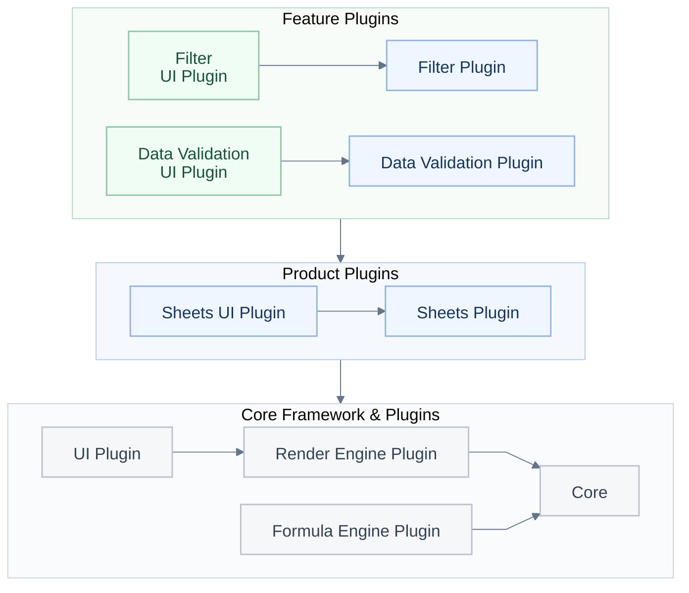
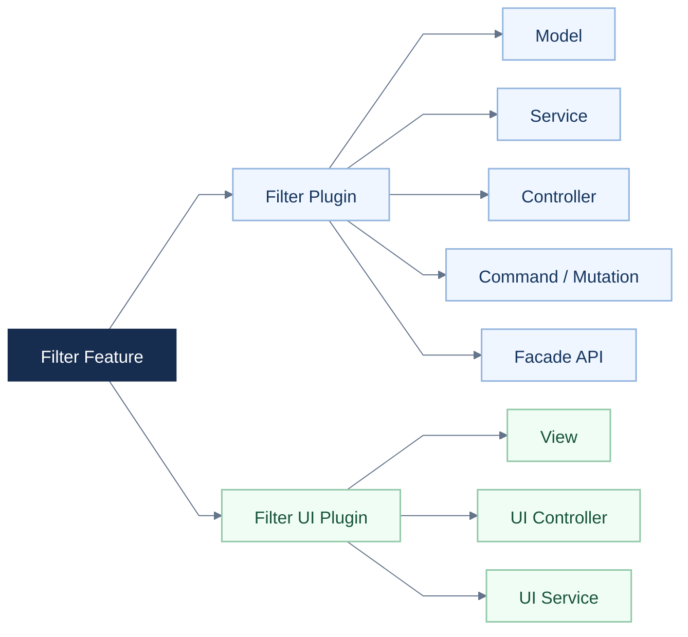
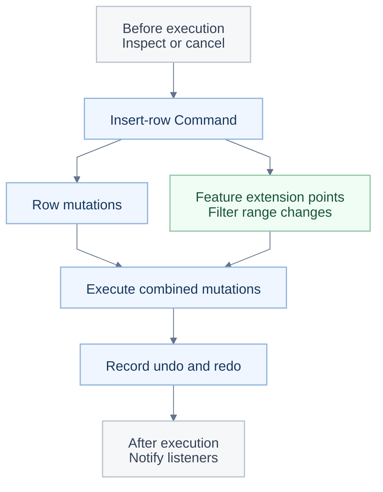

<a id="readme-top"></a>

<p align="center"></p>

<h1 align="center">Univer Office SDK で独自の AI オフィスを構築。</h1>

<p align="center">オープンソースの Sheets と Docs から始め、独自のアプリケーションやエージェントに接続できます。</p>

<p align="center"><a href="#quick-start">🚀 クイックスタート</a> · <a href="https://docs.univer.ai/">📚 ドキュメント</a> · <a href="https://univer.ai/compare/">⚖️ 機能比較</a> · <a href="https://univer.ai/">🌐 公式サイト</a> · <a href="https://docs.univer.ai/showcase">🎮 ショーケース</a> · <a href="https://docs.univer.ai/reference/classes/univer">🔧 API Reference</a> · <a href="https://docs.univer.ai/blog">📝 ブログ</a></p>

<p align="center"><a href="../../README.md">English</a> · <a href="../../docs/readme/fr-FR.md">Français</a> · <a href="../../docs/readme/de-DE.md">Deutsch</a> · <a href="../../docs/readme/es-ES.md">Español</a> · <a href="../../docs/readme/zh-CN.md">简体中文</a> · <a href="../../docs/readme/zh-TW.md">繁體中文</a> · <strong>日本語</strong> · <a href="../../docs/readme/ko-KR.md">한국어</a></p>

<p align="center">
  <a href="https://github.com/dream-num/univer/releases"></a>
  <a href="../../LICENSE"></a>
  <a href="https://github.com/dream-num/univer/actions/workflows/build-packages.yml"></a>
  <a href="https://www.codefactor.io/repository/github/dream-num/univer/overview/dev"></a>
  <a href="https://codecov.io/gh/dream-num/univer"></a>
</p>

<p align="center">
  <a href="https://github.com/dream-num/univer"></a>
  <a href="https://github.com/dream-num/univer/graphs/contributors"></a>
  <a href="https://github.com/dream-num/univer/issues"></a>
  <a href="https://github.com/dream-num/univer/commits/dev/"></a>
</p>

<p align="center">
  <a href="https://discord.gg/z3NKNT6D2f"></a>
  <a href="https://twitter.com/univerhq"></a>
  <a href="https://opencollective.com/univer"></a>
</p>

<p align="center">
  <a href="https://trendshift.io/repositories/4376"></a>
</p>

<details>
<summary>目次</summary>

- [💡 Univer とは？](#what-is-univer)
  - [オープンソースの機能](#open-source-capabilities)
- [🚀 オープンソースの基盤を使って構築](#what-you-can-build)
  - [クイックスタート：オープンソースのスプレッドシートエディター](#quick-start)
  - [アプリケーションを編集可能なコンテンツに接続](#connect-your-application-to-editable-content)
- [🏗️ オープンソースアーキテクチャを知る](#open-source-architecture)
  - [カスタム機能の境界を明確にする](#give-custom-features-clear-boundaries)
  - [複数機能の編集と元に戻す／やり直しを組み合わせる](#compose-cross-feature-edits-and-undoredo)
  - [Facade API とイベントでアプリケーションやエージェントを接続](#connect-applications-and-agents-through-facade-apis-and-events)
- [🧩 Univer Office SDK でアプリケーションを拡張](#open-source-and-commercial-extensions)
  - [範囲とライセンス](#scope-and-licensing)
- [🌐 アプリケーションのパターンとエコシステム](#application-patterns-and-ecosystem)
  - [Univer Workspace：Office SDK のリファレンスアプリケーション](#univer-workspace-an-office-sdk-reference-application)
  - [CLI、エージェント統合、開発スキル](#cli-agent-integrations-and-developer-skills)
- [📚 ドキュメントとコントリビューション](#documentation-and-contributing)
  - [実行環境の互換性](#runtime-compatibility)
- [💬 コミュニティ](#community)
- [🔒 セキュリティ](#security)
- [❤️ スポンサー](#sponsors)
- [📄 ライセンス](#license)

</details>

<a id="what-is-univer"></a>

## 💡 Univer とは？

<p align="center"></p>

**Univer** は、自社製品の中にオフィスアプリケーションを構築するための Office SDK です。独自のデータと権限を使い、ユーザーや既存のエージェントにオフィス編集、計算、共同作業、ファイル処理を提供します。製品群はスプレッドシート、ドキュメント、プレゼンテーション、リレーショナルテーブル、キャンバス、PDF をカバーします。

Univer Office SDK は 3 つの部分で構成されています。

- **Web SDK** は基盤となる部分で、コンテンツモデル、編集、レンダリング、数式計算、Facade API（アプリケーション向け API）を提供します。プラグインを組み合わせて埋め込みエディターや独自のオフィスアプリケーションを構築でき、対話型エディターを使わずにコンテンツモデル、コマンド、計算を Headless 処理で再利用することもできます。
- **Server SDK** は、リアルタイム共同作業、編集履歴、オフィスファイルのインポートとエクスポートに対応するバックエンドサービスを追加します。
- **AI SDK** は、コンテンツツール、実行、レビューの統合を通じて、オフィス機能を既存のエージェントやワークフローに接続します。

**このリポジトリは Web SDK のコアアーキテクチャとエンジン実装を Apache-2.0 で提供します**。内容は、コンテンツモデルとスナップショット形式、プラグインと依存関係の管理、コマンドシステム、数式・レンダリングエンジン、Facade API、UI 基盤、Sheets と Docs の編集機能です。商用 Web SDK プラグイン、Server SDK、商用 AI SDK 拡張は、個別に配布・ライセンス提供されます。

エージェントも同じオープンソース API を使用できます。モデルとツールのオーケストレーションはアプリケーション側で用意します。[見積書の例](#connect-your-application-to-editable-content)では、AI SDK に依存せずに編集、計算、保存を行います。

<a id="open-source-capabilities"></a>

### オープンソースの機能

<div align="center" style="overflow-x: auto;">

<table align="center" style="display: table; width: auto; margin-left: auto; margin-right: auto;">
<thead>
<tr>
<th>分野</th>
<th>主な機能</th>
</tr>
</thead>
<tbody>
<tr>
<td><strong>Sheets · 編集とレイアウト</strong></td>
<td>セルスタイル、セル結合、セル内リッチテキスト、ウィンドウ枠の固定、浮動画像、元に戻す／やり直し。</td>
</tr>
<tr>
<td><strong>Sheets · データと計算</strong></td>
<td>数式、定義名、フィルター、並べ替え、データの入力規則、条件付き書式、ハイパーリンク、コメント、検索と置換。</td>
</tr>
<tr>
<td><strong>Docs</strong></td>
<td>リッチテキスト編集、段落書式、リスト、ハイパーリンク、コメント、描画機能の統合。</td>
</tr>
</tbody>
</table>

</div>

機能はプラグインとプリセットを組み合わせて構成します。[クイックスタート](#quick-start)では **Sheets Core プリセット**のみを使います。画像には対応する描画プラグインが必要です。オープンソースと商用機能の詳しい範囲は[機能比較](https://univer.ai/compare/)をご覧ください。

以下のデモは、商用機能を含む広範な **Univer Office SDK** を紹介します。標準のオープンソース構成よりも多くの機能が含まれます。範囲については[オープンソースと商用拡張](#open-source-and-commercial-extensions)をご覧ください。

<div align="center" style="overflow-x: auto;">

<table align="center" style="display: table; width: auto; margin-left: auto; margin-right: auto;">
<tbody>
<tr>
  <td width="50%"><a href="https://univer.ai/demo/spreadsheets"></a></td>
  <td width="50%"><a href="https://univer.ai/demo/docs"></a></td>
</tr>
<tr>
  <td width="50%"><a href="https://univer.ai/demo/web-app"></a></td>
  <td width="50%"><a href="https://univer.ai/demo/universe"></a></td>
</tr>
<tr>
  <td width="50%"><a href="https://univer.ai/demo/slides"></a></td>
  <td width="50%"><a href="https://univer.ai/demo/relational-tables"></a></td>
</tr>
<tr>
  <td width="50%"><a href="https://univer.ai/demo/canvases"></a></td>
  <td width="50%"><a href="https://univer.ai/demo/pdf"></a></td>
</tr>
</tbody>
</table>

</div>

<p align="right"><a href="#readme-top"></a></p>

<a id="what-you-can-build"></a>

## 🚀 オープンソースの基盤を使って構築

<p align="center"></p>

<div align="center" style="overflow-x: auto;">

<table align="center" style="display: table; width: auto; margin-left: auto; margin-right: auto;">
<thead>
<tr>
<th>目的</th>
<th>オープンソース基盤の使い方</th>
<th>はじめに</th>
</tr>
</thead>
<tbody>
<tr>
<td><strong>Sheets または Docs を埋め込む</strong></td>
<td>アプリケーションやエージェント製品に編集可能なオフィス画面を追加し、Facade API でデータを接続します。</td>
<td><a href="#quick-start">クイックスタート</a></td>
</tr>
<tr>
<td><strong>エディターなしでコンテンツを処理する</strong></td>
<td>Node.js でコンテンツプラグイン、モデル、コマンド、計算を再利用し、編集、スナップショット、自動化タスクを実行します。</td>
<td><a href="https://docs.univer.ai/guides/sheets/getting-started/node">Headless ガイド</a></td>
</tr>
<tr>
<td><strong>独自の機能やエディターを開発する</strong></td>
<td>エンジン、UI コンポーネント、プラグインの境界、依存性注入、コマンド／元に戻すシステムを再利用します。既存機能を参考に Sheets と Docs を拡張したり、独自のエディターを開発したりできます。</td>
<td><a href="#open-source-architecture">オープンソースアーキテクチャ</a></td>
</tr>
</tbody>
</table>

</div>

**複数の機能にまたがる編集と元に戻す／やり直しを連携させます。** フィルター範囲内に行を挿入すると、基礎となるコンテンツとフィルター範囲の両方が変わり、元に戻す際には両方を復元する必要があります。各機能が変更と取り消しデータを提供し、コマンドが実行と履歴をまとめます。アーキテクチャの解説では、こうした編集フローの拡張方法を説明します。

<a id="quick-start"></a>

### クイックスタート：オープンソースのスプレッドシートエディター

Vite などのバンドラーを使うブラウザーアプリケーションで、次を実行します。

```bash
pnpm add @univerjs/presets @univerjs/preset-sheets-core
```

Univer を初期化する前にコンテナーを作成します。

```html
<div id="app" style="height: 100vh"></div>
```

```ts
import { UniverSheetsCorePreset } from '@univerjs/preset-sheets-core'
import UniverPresetSheetsCoreEnUS from '@univerjs/preset-sheets-core/locales/en-US'
import { createUniver, LocaleType, mergeLocales } from '@univerjs/presets'
import '@univerjs/preset-sheets-core/lib/index.css'

const { univerAPI } = createUniver({
  locale: LocaleType.EN_US,
  locales: {
    [LocaleType.EN_US]: mergeLocales(UniverPresetSheetsCoreEnUS),
  },
  presets: [
    UniverSheetsCorePreset({
      container: 'app',
    }),
  ],
})

univerAPI.createWorkbook({})
```

これでページにスプレッドシートエディターが表示されます。返された `univerAPI` を使ってコンテンツを操作できます。この例はオープンソースパッケージを使用し、商用 Univer ライセンスや Server SDK は不要です。

コンポーネントフレームワークでは、`createUniver` が返す `univer` インスタンスを保持し、コンポーネントのアンマウント時に `univer.dispose()` を呼び出してください。[ライフサイクルガイド](https://docs.univer.ai/guides/sheets/getting-started/lifecycle)をご覧ください。

プリセットはプラグインを組み合わせ、Facade API を登録します。手動で制御する場合は、下の[プラグインモードの例](#manual-plugin-composition)をご覧ください。[インストールガイド](https://docs.univer.ai/guides/sheets/getting-started/installation)は、両モード、ピア依存関係、フレームワークとの統合を扱います。

連携する `@univerjs/*` パッケージは同じバージョンに揃えてください。商用パッケージは対応するリリース系列を使います。アイコンなど独立してリリースされるパッケージは、それぞれが宣言する互換性に従います。[API 安定性ポリシー](../../docs/API_STABILITY.md)をご覧ください。

<a id="connect-your-application-to-editable-content"></a>

### アプリケーションを編集可能なコンテンツに接続

Facade API は、ワークブック、ワークシート、範囲に対するアプリケーション向けインターフェースです。クイックスタートに続けて見積書を入力し、アプリケーションコードから数量を更新して、再計算後の合計を読み取ります。

```ts
// Wait for formula controllers before editing a newly created workbook.
await new Promise<void>((resolve) => {
  if (univerAPI.getCurrentLifecycleStage() >= univerAPI.Enum.LifecycleStages.Steady) {
    resolve()
    return
  }
  const listener = univerAPI.addEvent(univerAPI.Event.LifeCycleChanged, ({ stage }) => {
    if (stage === univerAPI.Enum.LifecycleStages.Steady) {
      listener.dispose()
      resolve()
    }
  })
})

const workbook = univerAPI.getActiveWorkbook()!
const sheet = workbook.getActiveSheet()

sheet.getRange('A1:D4').setValues([
  ['Item', 'Quantity', 'Unit price', 'Amount'],
  ['Seats', 2, 25, '=B2*C2'],
  ['Support', 1, 100, '=B3*C3'],
  ['Total', '', '', '=SUM(D2:D3)'],
])

// An application control or agent can make the same edit.
sheet.getRange('B2').setValue(4)

univerAPI.getFormula().onCalculationResultApplied().then(() => {
  console.log(sheet.getRange('D4').getValue()) // 200
  localStorage.setItem('quotation', JSON.stringify(workbook.save()))
}).catch(console.error)
```

エディターとアプリケーションは同じワークブックを操作し、数式の変更は自動的に再計算されます。`workbook.save()` は、ワークブックと登録済みプラグインのデータを含む JSON スナップショットを返します。永続化はアプリケーション側の責任で、この例ではブラウザーのストレージを使用します。後でページを読み込む際は、初期化後に**空のワークブックを作る代わりに**スナップショットを復元します。

```ts
const saved = localStorage.getItem('quotation')
if (saved) {
  univerAPI.createWorkbook(JSON.parse(saved))
}
```

このフローはオープンソースパッケージのみを使います。スナップショットの永続化と XLSX のインポート／エクスポートは別の機能で、後者には個別配布のファイル変換機能が必要です。アプリケーションの統合には公開 Facade API を使ってください。下のソースリンクでは内部実装と拡張ポイントを説明します。拡張ポイントに依存する前に [API 安定性ポリシー](../../docs/API_STABILITY.md)をご確認ください。

<a id="manual-plugin-composition"></a>

<details>
<summary>詳細：プラグインを手動で構成する（プラグインモード）</summary>

プラグインの選択、依存関係、読み込みを細かく制御する必要がある場合は、プラグインモードを使います。上記のプリセットはこの構成を代わりに行います。

この別の初期化方法は、同じ `app` コンテナーと Sheets Core プリセットのブラウザー用プラグイン構成を Worker なしで使います。プリセットの初期化を**置き換え**、返された `univerAPI` で同じ見積書の例を実行してください。

```bash
pnpm add @univerjs/core @univerjs/design @univerjs/docs @univerjs/docs-ui \
  @univerjs/engine-formula @univerjs/engine-render @univerjs/network \
  @univerjs/sheets @univerjs/sheets-ui @univerjs/sheets-formula \
  @univerjs/sheets-formula-ui @univerjs/sheets-numfmt \
  @univerjs/sheets-numfmt-ui @univerjs/ui
```

```ts
import { LocaleType, mergeLocales, Univer } from '@univerjs/core'
import { FUniver } from '@univerjs/core/facade'
import DesignEnUS from '@univerjs/design/locale/en-US'
import { UniverDocsPlugin } from '@univerjs/docs'
import { UniverDocsUIPlugin } from '@univerjs/docs-ui'
import DocsUIEnUS from '@univerjs/docs-ui/locale/en-US'
import { UniverFormulaEnginePlugin } from '@univerjs/engine-formula'
import FormulaEnUS from '@univerjs/engine-formula/locale/en-US'
import { UniverRenderEnginePlugin } from '@univerjs/engine-render'
import { UniverNetworkPlugin } from '@univerjs/network'
import { UniverSheetsPlugin } from '@univerjs/sheets'
import SheetsEnUS from '@univerjs/sheets/locale/en-US'
import { UniverSheetsFormulaPlugin } from '@univerjs/sheets-formula'
import SheetsFormulaEnUS from '@univerjs/sheets-formula/locale/en-US'
import { UniverSheetsFormulaUIPlugin } from '@univerjs/sheets-formula-ui'
import SheetsFormulaUIEnUS from '@univerjs/sheets-formula-ui/locale/en-US'
import { UniverSheetsNumfmtPlugin } from '@univerjs/sheets-numfmt'
import { UniverSheetsNumfmtUIPlugin } from '@univerjs/sheets-numfmt-ui'
import SheetsNumfmtUIEnUS from '@univerjs/sheets-numfmt-ui/locale/en-US'
import { UniverSheetsUIPlugin } from '@univerjs/sheets-ui'
import SheetsUIEnUS from '@univerjs/sheets-ui/locale/en-US'
import { UniverUIPlugin } from '@univerjs/ui'
import UIEnUS from '@univerjs/ui/locale/en-US'
import '@univerjs/design/lib/index.css'
import '@univerjs/ui/lib/index.css'
import '@univerjs/docs-ui/lib/index.css'
import '@univerjs/sheets-ui/lib/index.css'
import '@univerjs/sheets-formula-ui/lib/index.css'
import '@univerjs/sheets-numfmt-ui/lib/index.css'
import '@univerjs/network/facade'
import '@univerjs/docs/facade'
import '@univerjs/docs-ui/facade'
import '@univerjs/engine-formula/facade'
import '@univerjs/sheets/facade'
import '@univerjs/ui/facade'
import '@univerjs/sheets-ui/facade'
import '@univerjs/sheets-formula/facade'
import '@univerjs/sheets-numfmt/facade'
import '@univerjs/sheets-formula-ui/facade'

const univer = new Univer({
  locale: LocaleType.EN_US,
  locales: {
    [LocaleType.EN_US]: mergeLocales(
      DesignEnUS,
      DocsUIEnUS,
      FormulaEnUS,
      SheetsEnUS,
      SheetsFormulaEnUS,
      SheetsFormulaUIEnUS,
      SheetsNumfmtUIEnUS,
      SheetsUIEnUS,
      UIEnUS,
    ),
  },
})

univer.registerPlugin(UniverNetworkPlugin)
univer.registerPlugin(UniverDocsPlugin)
univer.registerPlugin(UniverRenderEnginePlugin)
univer.registerPlugin(UniverUIPlugin, { container: 'app' })
univer.registerPlugin(UniverDocsUIPlugin)
univer.registerPlugin(UniverFormulaEnginePlugin)
univer.registerPlugin(UniverSheetsPlugin, {
  onlyRegisterFormulaRelatedMutations: false,
})
univer.registerPlugin(UniverSheetsUIPlugin, {
  protectedRangeShadow: true,
})
univer.registerPlugin(UniverSheetsNumfmtPlugin)
univer.registerPlugin(UniverSheetsNumfmtUIPlugin)
univer.registerPlugin(UniverSheetsFormulaPlugin)
univer.registerPlugin(UniverSheetsFormulaUIPlugin)

const univerAPI = FUniver.newAPI(univer)
univerAPI.createWorkbook({})
```

Docs プラグインはスプレッドシート内のリッチテキスト編集を支えます。機能を追加する際は、対応する Facade 拡張、ロケール、UI スタイルも含めてください。コンテナーのアンマウント時に `univer` を破棄します。

</details>

<p align="right"><a href="#readme-top"></a></p>

<a id="open-source-architecture"></a>

## 🏗️ オープンソースアーキテクチャを知る

<p align="center"></p>

<a id="give-custom-features-clear-boundaries"></a>

### カスタム機能の境界を明確にする

Univer はコンテンツロジックと UI 操作を別々のプラグインに分けています。機能プラグインはルールとコンテンツ変更を管理し、UI プラグインは画面とユーザー操作を提供します。たとえば `sheets-filter` はフィルター範囲とルールを管理し、`sheets-filter-ui` はパネル、メニュー、ショートカットを提供します。



**図 1：3 層のプラグイン。** 機能プラグインは製品プラグインの上に構築され、製品プラグインはコアフレームワークとプラグインを再利用します。グループ間の矢印は下の層への依存を示します。Core はコンテンツモデル、コマンド、依存性注入、ライフサイクル管理を提供します。一部のプラグインと依存関係は省略しています。

新しい機能は自身のプラグイン内でルールを保持し、公開サービス、コマンド、定義された拡張ポイントを通じて連携します。UI プラグインは共有 UI サービスとコンポーネントの上に構築されます。

依存関係は 2 つのレベルで明示されます。

- **プラグイン間：** `DependentOn` が実行時のプラグイン依存関係を宣言します。プラグインサービスが順序を決め、ライフサイクルの段階が依存関係の登録、コンテンツの初期化、UI の初期化を分離します。
- **プラグイン内部：** 依存性注入は、宣言された依存関係を使ってコントローラーとサービスを接続します。対応するオーバーライドにより、アプリケーションは実装の置き換え、プラットフォームサービスへの適応、テストダブルの提供ができます。インスタンス単位のインジェクターは、Univer インスタンス間のアプリケーション状態を分離します。

破棄可能な登録により、所有者の破棄時にコマンド、リスナー、コンポーネント、アイコンもクリーンアップできます。

[フィルタープラグイン](../../packages/sheets-filter/src/plugin.ts)とその [UI プラグイン](../../packages/sheets-filter-ui/src/plugin.ts)は、実際のコードでこれらの境界を示しています。

<details>
<summary>機能の内部：Model、Controller、Service、UI 基盤</summary>

フィルターでは、`sheets-filter` がコンテンツロジックを担当し、`sheets-filter-ui` が UI 操作を担当します。各モジュールは明確な責務を持ちます。



**図 2：コードの構成。矢印は「含む」を意味します。** 両方のプラグインに Controller と Service を配置できます。ロジックの Controller はコンテンツの変更と関連機能を調整し、UI Controller はメニュー、ショートカット、操作を接続し、UI Service はパネルの状態を管理します。これらの責務は、新機能の実装とテストに一貫した構造を与えます。

UI 基盤も同じ分担に従います。**`@univerjs/design`** は共有コンポーネントとスタイル、**`@univerjs/ui`** はメニュー、ショートカット、パネル、コンポーネント登録などのワークベンチサービス、**`@univerjs/icons`** はアイコンを提供します。各機能はこれらの拡張ポイントを通じてコンポーネントとアイコンを登録し、メニューを追加してレンダリングを接続します。チームはアプリケーションの UI 基盤を再利用しながら、パネルやツールバー機能を追加できます。[UI 概要](https://docs.univer.ai/guides/sheets/ui/overview)と、フィルタープラグインの[コンポーネント・アイコン登録](../../packages/sheets-filter-ui/src/controllers/components.controller.ts)をご覧ください。

</details>

<a id="compose-cross-feature-edits-and-undoredo"></a>

### 複数機能の編集と元に戻す／やり直しを組み合わせる

たとえばフィルター範囲内に行を挿入すると、フィルタープラグインは対応する範囲変更と取り消しデータを提供します。行コマンドは基本の編集と参加機能の変更をまとめて実行し、元に戻す／やり直しの情報も一緒に記録します。行挿入機能は共通の拡張機構を利用でき、フィルタープラグインは自身の範囲更新ルールを担当します。

コマンドシステムは 3 種類のアクションを区別します。

- **Command** は業務操作と必要な変更をまとめます。
- **Mutation** は、シリアライズ可能なパラメーターを使ってスナップショットに保存されるコンテンツを変更します。
- **Operation** は、開いているパネルやスクロール位置などの一時的な状態を変更します。

**元に戻す／やり直しの共通構造。** 元に戻せる編集では、機能の実装が順方向の Mutation と対応する逆方向の Mutation を提供し、Command が `IUndoRedoService` を通じて記録します。1 つの操作が複数機能に影響する場合、Command はそれぞれの変更と取り消しデータを 1 件の記録にまとめ、ユーザーが操作全体を元に戻したり、やり直したりできるようにします。[コマンドの拡張](https://docs.univer.ai/blog/custom-command)をご覧ください。

機能同士の連携も必要です。**インターセプターと参照範囲ハンドラーが、そのための明確な場所を提供します。** 対応する拡張ポイントでプラグインは検査や関連 Mutation を追加し、API が定義する範囲でインターセプターの優先順位が実行順を制御します。

<details>
<summary>例：コマンド、コールバック、機能間の連携、元に戻す／やり直し</summary>



この図は行挿入のフローを簡略化したものです。入れ子になったコマンドの実行にはそれぞれコールバックがあり、すべてのイベントや独立した Operation の経路は描いていません。[行コマンド](../../packages/sheets/src/commands/commands/insert-row-col.command.ts)、[フィルターコントローラー](../../packages/sheets-filter/src/controllers/sheets-filter.controller.ts)、[インターセプターサービス](../../packages/sheets/src/services/sheet-interceptor/sheet-interceptor.service.ts)をご覧ください。

</details>

こうした境界は実践的なテスト方針を支えます。モデルとサービスを個別にテストし、外部依存を DI で置き換え、組み合わせた操作と元に戻す／やり直しの回帰テストを追加します。[フィルターコントローラーのテスト](../../packages/sheets-filter/src/controllers/__tests__/sheets-filter.controller.spec.ts)は、行と列の変更がフィルターに与える影響を検証します。

<a id="connect-applications-and-agents-through-facade-apis-and-events"></a>

### Facade API とイベントでアプリケーションやエージェントを接続

このリポジトリには、エディターを支えるコンテンツモデル、数式エンジン、Canvas レンダリング・レイアウトエンジンが含まれています。これらは共通の構成要素です。たとえばスプレッドシートのリッチテキストは、ドキュメントのレイアウトとレンダリングを再利用します。カスタム機能は別のコンテンツ基盤を実装する代わりに、これらのエンジンの上に構築できます。[数式エンジンのアーキテクチャ](https://docs.univer.ai/blog/formula)と[レンダリングエンジンのアーキテクチャ](https://docs.univer.ai/blog/rendering)をご覧ください。

ブラウザーエディター、Node.js の Headless タスク、適切に構成した Worker は、対応するコンテンツプラグイン、モデル、コマンド、計算を再利用できます。[Headless Univer](https://docs.univer.ai/guides/sheets/getting-started/node)と[同型アーキテクチャ](../../docs/ISOMORPHIC.md)をご覧ください。

`ICommandService` は実行コールバックを公開し、プラグインがコマンド実行の前後を監視できるようにします。Facade API は、基礎となる機能を `FWorkbook`、`FWorksheet`、`FRange` などのアプリケーション向けオブジェクトに包みます。

各プラグインは独自の Facade 拡張、**`univerAPI.Event` による型付きイベント**、**`univerAPI.Enum` による列挙値**を提供します。アプリケーションコードは非公開サービスをインポートしたり文字列を繰り返したりせず、1 つの入口からイベント名や定数を見つけられます。たとえば `BeforeCommandExecute` は実行を検査・キャンセルでき、`CommandExecuted` は実行をリスナーに通知します。リスナーは破棄可能なオブジェクトを返し、キャンセルは対応するイベントでのみ有効です。

Facade 拡張は機能パッケージに含まれるため、コンテンツ API が無関係な UI API を取り込む必要はありません。[Facade の設計](https://docs.univer.ai/blog/facade)、[コマンドコールバックとイベントブリッジ](../../packages/core/src/facade/f-univer.ts)、[Enum の入口](../../packages/core/src/facade/f-enum.ts)をご覧ください。

このリポジトリは動作する機能実装と拡張のパターンを提供します。完全な例は[フィルター実装の解説](https://docs.univer.ai/blog/anatomy)をご覧ください。拡張ポイントに依存する前には [API 安定性ポリシー](../../docs/API_STABILITY.md)もご確認ください。

<p align="right"><a href="#readme-top"></a></p>

<a id="open-source-and-commercial-extensions"></a>

## 🧩 Univer Office SDK でアプリケーションを拡張

<p align="center"></p>

すぐに統合できる機能をさらに必要とする場合は、対応する **Univer Office SDK** モジュールを組み合わせます。追加のコンテンツ種類、高度な編集プラグイン、共同作業、ファイル変換、エージェントツールを利用できます。これらは上で紹介した同じコンテンツモデル、プラグインアーキテクチャ、コマンドシステム、Facade 設計を拡張するため、既存の統合を基に構築できます。

<div align="center" style="overflow-x: auto;">

<table align="center" style="display: table; width: auto; margin-left: auto; margin-right: auto;">
<thead>
<tr>
<th>部分</th>
<th>基盤の拡張方法</th>
</tr>
</thead>
<tbody>
<tr>
<td><strong>オープンソース Web SDK コア · このリポジトリ</strong></td>
<td>オープンソースのモデル、エンジン、プラグイン、UI 基盤、Sheets と Docs の機能、および対応する Headless コンテンツ操作。Apache-2.0 に基づき商用アプリケーションで利用できます。</td>
</tr>
<tr>
<td><strong>商用 Web SDK プラグイン</strong></td>
<td>コアの Plugin、依存性注入、Command/Mutation、Facade 拡張パターンに従い、対応するコンテンツにチャート、図形、ピボットテーブル、SmartArt などを追加します。</td>
</tr>
<tr>
<td><strong>Server SDK</strong></td>
<td>同じコンテンツモデルと Mutation の規約に、リアルタイム共同作業、変更履歴、オフィスファイル変換を追加します。アプリケーションの ID、権限、ストレージと統合します。</td>
</tr>
<tr>
<td><strong>AI SDK 拡張</strong></td>
<td>Web SDK の Headless と Facade の機能を再利用し、エージェントがコンテンツを調査、編集、検証するための構成可能な Node.js API と CLI の基礎を提供します。共同作業と Worktree レビューも統合できます。</td>
</tr>
</tbody>
</table>

</div>

<a id="scope-and-licensing"></a>

### 範囲とライセンス

- **このリポジトリ：** Apache-2.0 のパッケージは、そのライセンスに従って商用アプリケーションで利用できます。オープンソースの Headless コンテンツ機能も含まれます。
- **商用拡張：** 商用 Web SDK プラグイン、Server SDK、オープンソース基盤を超える AI SDK 機能は個別に配布・ライセンス提供されます。**Freemium** 評価には透かしと機能制限があります。
- **リファレンスアプリケーション：** Univer Workspace などのオープンソースアプリケーションには固有のソースライセンスがあり、SDK 依存関係には各 SDK のライセンスが引き続き適用されます。

詳しい範囲は、**Open source only** フィルターを備えた[機能比較](https://univer.ai/compare/)をご覧ください。商用の選択肢は[プランとライセンス](https://univer.ai/pricing/)で確認できます。

<details>
<summary>共有コンテンツモデルが編集、共同作業、ファイルをつなぐ仕組み</summary>

これらの機能はシリアライズ可能な **Unit スナップショット**を操作します。Sheets の `IWorkbookData`、Docs の `IDocumentData`、Slides の `ISlideData`、キャンバスの `IBoardData`（API では **Boards**）などです。これらの型は core と各製品パッケージで提供され、現在の Slides と Boards は個別配布の商用製品です。共通の Unit 規約により、ブラウザーエディター、バックエンドサービス、エージェントが同じコンテンツを扱えます。

Command は編集をまとめ、**Mutation はコンテンツの変更を記述します**。共同作業は Mutation を **changeset（変更セット）**にまとめ、並行する変更に **operational transformation（OT）** を適用し、確定したリビジョンとスナップショットを管理します。履歴はスナップショットと後続の変更セットからリビジョンを復元できます。[共同作業の設計](https://docs.univer.ai/blog/ot)と [Collaboration SDK 概要](https://docs.univer.ai/server/collaboration/overview)をご覧ください。

**Exchange** はオフィスファイルの構造と Univer のコンテンツスナップショットを相互に変換します。**XLSX、DOCX、PPTX** などの OOXML 形式では、ファイルを対応する Sheet、Doc、Slide のデータに解析し、エクスポート時にファイル表現を生成します。変換後のコンテンツは、同じ編集、計算、共同作業、エージェントのフローに参加できます。[オフィスファイルのインポートとエクスポート](https://docs.univer.ai/server/import-export/node)をご覧ください。

</details>

<details>
<summary>AI SDK がエージェントに同じコンテンツ機能を提供する仕組み</summary>

AI SDK は、Web SDK の **Headless コンテンツモデル、コマンド、計算、Facade API** を基にしています。構造化された TypeScript API とオプションの Commander プリセットを公開し、アプリケーションが独自の Office CLI やエージェントツールを構成できます。

- **理解、発見、編集。** 検査は構造化されたコンテンツを返します。API Reference は、SDK に含まれる Facade のシンボルとシグネチャをエージェントが探すのを助けます。Facade の実行は読み取りと書き込みを区別し、Mutation を取得して、明示的な同期とコミット結果を扱います。[コンテンツ操作](https://docs.univer.ai/ai/content-operations)をご覧ください。
- **レンダリング結果を確認。** ブラウザーの Render Runtime が Web SDK のレンダリングを再利用してスクリーンショットを取得します。スライドのレイアウト検査は、文字のページ外へのはみ出しや重なりなどを構造化して返し、エージェントの次の編集の根拠になります。[視覚的な検査](https://docs.univer.ai/ai/visual-inspection)をご覧ください。
- **人がレビューする下書きを編集。** 対応する共同作業と Web の機能を使い、エージェントは独立した Worktree 下書きを複数回編集・検証してから、人にレビュー、マージ、再開を引き継げます。フローは同じスナップショット、Mutation、リビジョン規約を利用します。[Worktree](https://docs.univer.ai/ai/worktree)をご覧ください。

繰り返し呼び出す場合は、オプションの [Worker プールとデーモン](https://docs.univer.ai/ai/runtime-architecture)が読み込み済みのコンテンツを再利用し、再初期化を減らします。ルート CLI、対象、認可、出力はアプリケーションが管理します。[AI SDK パッケージ一覧](https://docs.univer.ai/ai/packages)で必要な機能を選択してください。

</details>

<p align="right"><a href="#readme-top"></a></p>

<a id="application-patterns-and-ecosystem"></a>

## 🌐 アプリケーションのパターンとエコシステム

<p align="center"></p>

<a id="univer-workspace-an-office-sdk-reference-application"></a>

### Univer Workspace：Office SDK のリファレンスアプリケーション

完全なアプリケーションの参考には、[Univer Workspace](https://github.com/dream-num/univer-workspace)から始めてください。Univer Office SDK のエディター、共同作業、ファイル機能、既存のエージェント、人によるレビューを、セルフホスト可能なワークスペースに組み合わせる方法を示しています。独自のオフィスアプリケーションやエージェントワークスペースを構築する際の統合パターンとして利用できます。

<div align="center" style="overflow-x: auto;">

<table align="center" style="display: table; width: auto; margin-left: auto; margin-right: auto;">
  <tr>
    <td width="50%" valign="top">
      <a href="https://space.univer.ai/"></a>
    </td>
    <td width="50%" valign="top">
      <a href="https://univer.ai/demo/web-app"></a>
    </td>
  </tr>
  <tr>
    <td width="50%" valign="top">
      <strong>エージェントと編集可能なオフィスコンテンツ</strong><br />
      会話、スプレッドシート編集、オフィスコンテンツを 1 つのワークスペースにまとめます。<br />
      <a href="https://space.univer.ai/">Workspace を試す</a> · <a href="https://github.com/dream-num/univer-workspace">Workspace のソースとセットアップ</a>
    </td>
    <td width="50%" valign="top">
      <strong>Web App × Sheet · 実験的機能</strong><br />
      操作をセルに結び付け、アプリからシートへ書き込み、シートの変更をアプリに反映します。<br />
      <a href="https://univer.ai/demo/web-app">シートを活用したアプリのデモを試す</a>
    </td>
  </tr>
</table>

</div>

Workspace はオープンソースで、SDK 依存関係にはそれぞれのライセンスが適用されます。接続されたアプリやレビューフローについては [Workspace 概要](https://univer.ai/workspace/)をご覧ください。

<p align="center"><a href="https://www.youtube.com/watch?v=1p-SMEiK6Kg"></a></p>

[SDK 統合デモを見る](https://www.youtube.com/watch?v=1p-SMEiK6Kg)

<a id="cli-agent-integrations-and-developer-skills"></a>

### CLI、エージェント統合、開発スキル

同じ SDK 機能を、すでに使っているエージェントやツールにも組み込めます。

<div align="center" style="overflow-x: auto;">

<table align="center" style="display: table; width: auto; margin-left: auto; margin-right: auto;">
<thead>
<tr>
<th>プロジェクト</th>
<th>提供する機能</th>
</tr>
</thead>
<tbody>
<tr>
<td><a href="https://github.com/dream-num/univer-cli">Univer CLI</a></td>
<td>オフィスコンテンツの作成、編集、検査、納品を行うローカルのコマンドラインワークスペース。</td>
</tr>
<tr>
<td><a href="https://github.com/dream-num/dsh-univer-office">Univer Office for DeepSeek Harness</a></td>
<td>関連コンテンツ、結果の検証、変更のバージョン管理、独立した Worktree での共同作業。</td>
</tr>
<tr>
<td><a href="https://github.com/dream-num/workbuddy-univer-office">Univer Office for WorkBuddy</a></td>
<td>ローカルの Office 統合、MCP プレビュー、下書きレビュー。開発者プレビュー。</td>
</tr>
<tr>
<td><a href="https://github.com/dream-num/openclaw-univer-office">Univer Office for OpenClaw</a></td>
<td>オフィスコンテンツの作成、レビュー、納品ツール。</td>
</tr>
<tr>
<td><a href="https://github.com/dream-num/univer-sdk-skills">Univer SDK Skills</a></td>
<td>コーディングエージェントによる SDK 統合、プラグイン開発、バックエンドフロー実装を支援する指示。</td>
</tr>
</tbody>
</table>

</div>

各リポジトリにセットアップと SDK 依存関係の説明があります。エージェントの入口は[エコシステム](https://univer.ai/ecosystem/)で確認でき、独自の統合を構築する場合は[ドキュメント](https://docs.univer.ai/)を利用できます。

<p align="right"><a href="#readme-top"></a></p>

<a id="documentation-and-contributing"></a>

## 📚 ドキュメントとコントリビューション

Univer を構築し、改善するすべての[コントリビューター](https://github.com/dream-num/univer/graphs/contributors)に感謝します。エンジン、プラグイン、テスト、ドキュメント、サンプルへの貢献を歓迎します。

<p align="center"><a href="https://docs.univer.ai/guides/sheets">🧩 Web SDK</a> · <a href="https://docs.univer.ai/server">🖥️ Server SDK</a> · <a href="https://docs.univer.ai/ai">🤖 AI SDK</a> · <a href="https://docs.univer.ai/reference/classes/univer">🔧 API リファレンス</a> · <a href="https://office.univer.ai/">🎮 ライブデモ</a></p>

<div align="center" style="overflow-x: auto;">

<table align="center" style="display: table; width: auto; margin-left: auto; margin-right: auto;">
  <tr>
    <th align="center"><br />Edge</th>
    <th align="center"><br />Firefox</th>
    <th align="center"><br />Chrome</th>
    <th align="center"><br />Safari</th>
    <th align="center"><br />Electron</th>
  </tr>
  <tr>
    <td align="center"><code>&gt;=88</code></td>
    <td align="center"><code>&gt;=90</code></td>
    <td align="center"><code>&gt;=88</code></td>
    <td align="center"><code>&gt;=14.1</code></td>
    <td align="center"><code>&gt;=12</code></td>
  </tr>
</table>

</div>

<p align="center">Univer は Chrome 88 をターゲットとしてコンパイルされ、上記のバージョンでの動作を目指しています。</p>

<a id="runtime-compatibility"></a>

### 実行環境の互換性

- **ポリフィル**：Univer は `Intl.Segmenter` に依存します。対象のブラウザーやランタイムで利用できない場合は、`@formatjs/intl-segmenter` などのポリフィルを追加してください。
- **ビルドツール**：Vite、esbuild、Webpack 5 を推奨します。`package.json` の `exports` フィールドに非対応のツール（Webpack 4 など）では、追加のパスマッピングが必要な場合があります。
- **React**：Univer のビュー層は React 18 を基に構築され、React 18 と 19 に対応し、React 16.9+ と 17 には最小限の互換性サポートを提供します。
- **Node.js 環境**：Headless Univer は Node.js `>=18.17.0` に対応します。このモノレポの開発には Node.js `>=22.18` が必要です。

<details>
<summary>このリポジトリでの開発</summary>

### リポジトリ構成

```text
.
├── packages/      Core packages, engines, document types, UI plugins, and feature plugins
├── examples/      All-in-one Vite workbench used for local browser development
├── common/        Shared internal tooling, storybook, and utilities
├── tests/         Additional integration test projects
└── docs/          Architecture notes, images, and repository-local documentation
```

パッケージごとの README は、[`packages/`](../../packages) 内の各パッケージの隣にあります。

### ローカル開発

必要条件：

- Node.js `>=22.18`
- pnpm：`package.json` の `packageManager` で宣言されたバージョンを使用します。

```bash
git clone https://github.com/dream-num/univer.git
cd univer
pnpm install
pnpm dev
```

便利なコマンド：

<div align="center" style="overflow-x: auto;">

<table align="center" style="display: table; width: auto; margin-left: auto; margin-right: auto;">
<thead>
<tr>
<th>コマンド</th>
<th>用途</th>
</tr>
</thead>
<tbody>
<tr>
<td><code class="notranslate">pnpm dev</code></td>
<td>Sheets と Docs の開発ワークベンチを起動。</td>
</tr>
<tr>
<td><code class="notranslate">pnpm build</code></td>
<td>内部 common パッケージを除くワークスペースパッケージをビルド。</td>
</tr>
<tr>
<td><code class="notranslate">pnpm test</code></td>
<td>Turbo 経由でユニットテストを実行。</td>
</tr>
<tr>
<td><code class="notranslate">pnpm typecheck</code></td>
<td>Turbo 経由で TypeScript のチェックを実行。</td>
</tr>
<tr>
<td><code class="notranslate">pnpm lint</code></td>
<td>ESLint を実行。</td>
</tr>
<tr>
<td><code class="notranslate">pnpm storybook:dev</code></td>
<td>UI コンポーネント開発用に Storybook を起動。</td>
</tr>
</tbody>
</table>

</div>

Pull Request を作成する前に [CONTRIBUTING.md](../../CONTRIBUTING.md) をお読みください。

</details>

<details>
<summary>アーキテクチャと貢献の参考資料</summary>

- [リポジトリのパッケージ](../../packages)、[プリセット](../../presets)、[サンプル](../../examples)。
- [同型 Univer の構築](../../docs/ISOMORPHIC.md)。
- [Facade API への貢献](../../docs/CONTRIBUTING-FACADE.md)。
- [API 安定性ポリシー](../../docs/API_STABILITY.md)。
- [命名規則](../../docs/NAMING_CONVENTION.md)と[メモリリークの修正](../../docs/FIX_MEMORY_LEAK.md)。
- [アーキテクチャの TLDR](../../docs/tldr)と [OLE 添付ファイルの説明](../../packages/drawing/docs/ole-attachments.md)。

</details>

<p align="right"><a href="#readme-top"></a></p>

<a id="community"></a>

## 💬 コミュニティ

[GitHub Discussions](https://github.com/dream-num/univer/discussions) で質問し、[Discord](https://discord.gg/z3NKNT6D2f) に参加して、[X](https://twitter.com/univerhq) や [YouTube](https://www.youtube.com/@dreamNum) をフォローしてください。[行動規範](../../CODE_OF_CONDUCT.md)もお読みください。

<p align="right"><a href="#readme-top"></a></p>

<a id="security"></a>

## 🔒 セキュリティ

セキュリティ上の問題を見つけたと思われる場合は、[Security Policy](../../SECURITY.md) に従ってください。

<p align="right"><a href="#readme-top"></a></p>

<a id="sponsors"></a>

## ❤️ スポンサー

Univer はコミュニティとスポンサーによって支えられています。[Open Collective](https://opencollective.com/univer) からプロジェクトを支援できます。

<p>
  <a href="https://opencollective.com/univer/sponsor/0/website"></a>
</p>

<p>
  <a href="https://opencollective.com/univer/backer/0/website"></a>
  <a href="https://opencollective.com/univer/backer/1/website"></a>
  <a href="https://opencollective.com/univer/backer/2/website"></a>
  <a href="https://opencollective.com/univer/backer/3/website"></a>
  <a href="https://opencollective.com/univer/backer/4/website"></a>
  <a href="https://opencollective.com/univer/backer/5/website"></a>
  <a href="https://opencollective.com/univer/backer/6/website"></a>
</p>

<p align="right"><a href="#readme-top"></a></p>

<a id="license"></a>

## 📄 ライセンス

Copyright (c) 2021-present DreamNum Co., Ltd.

このリポジトリのオープンソースパッケージは [Apache-2.0](../../LICENSE) の下で提供されています。商用 SDK モジュールは個別に配布・ライセンス提供されます。

<p align="right"><a href="#readme-top"></a></p>
