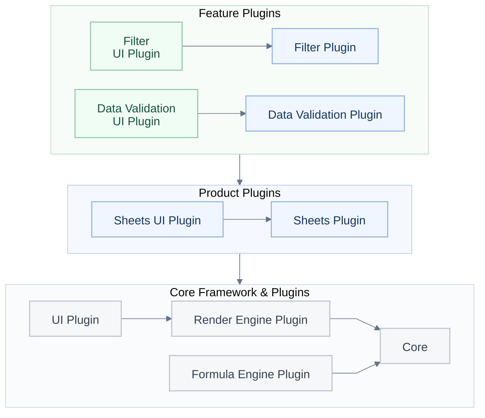
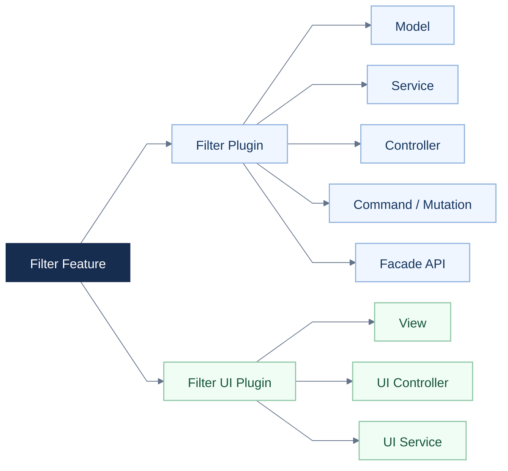
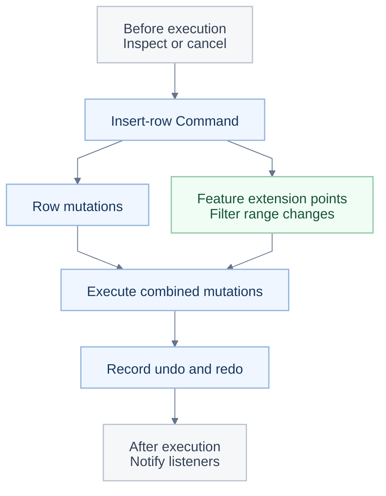

<a id="readme-top"></a>

<p align="center"></p>

<h1 align="center">Univer Office SDK로 나만의 AI 오피스를 구축하세요.</h1>

<p align="center">오픈 소스 Sheets와 Docs로 시작해 자체 애플리케이션이나 에이전트를 연결하세요.</p>

<p align="center"><a href="#quick-start">🚀 빠른 시작</a> · <a href="https://docs.univer.ai/">📚 문서</a> · <a href="https://univer.ai/compare/">⚖️ 기능 비교</a> · <a href="https://univer.ai/">🌐 웹사이트</a> · <a href="https://docs.univer.ai/showcase">🎮 쇼케이스</a> · <a href="https://docs.univer.ai/reference/classes/univer">🔧 API Reference</a> · <a href="https://docs.univer.ai/blog">📝 블로그</a></p>

<p align="center"><a href="../../README.md">English</a> · <a href="../../docs/readme/fr-FR.md">Français</a> · <a href="../../docs/readme/de-DE.md">Deutsch</a> · <a href="../../docs/readme/es-ES.md">Español</a> · <a href="../../docs/readme/zh-CN.md">简体中文</a> · <a href="../../docs/readme/zh-TW.md">繁體中文</a> · <a href="../../docs/readme/ja-JP.md">日本語</a> · <strong>한국어</strong></p>

<p align="center">
  <a href="https://github.com/dream-num/univer/releases"></a>
  <a href="../../LICENSE"></a>
  <a href="https://github.com/dream-num/univer/actions/workflows/build-packages.yml"></a>
  <a href="https://www.codefactor.io/repository/github/dream-num/univer/overview/dev"></a>
  <a href="https://codecov.io/gh/dream-num/univer"></a>
</p>

<p align="center">
  <a href="https://github.com/dream-num/univer"></a>
  <a href="https://github.com/dream-num/univer/graphs/contributors"></a>
  <a href="https://github.com/dream-num/univer/issues"></a>
  <a href="https://github.com/dream-num/univer/commits/dev/"></a>
</p>

<p align="center">
  <a href="https://discord.gg/z3NKNT6D2f"></a>
  <a href="https://twitter.com/univerhq"></a>
  <a href="https://opencollective.com/univer"></a>
</p>

<p align="center">
  <a href="https://trendshift.io/repositories/4376"></a>
</p>

<details>
<summary>목차</summary>

- [💡 Univer란?](#what-is-univer)
  - [오픈 소스 기능](#open-source-capabilities)
- [🚀 오픈 소스 기반으로 구축하기](#what-you-can-build)
  - [빠른 시작: 오픈 소스 스프레드시트 편집기](#quick-start)
  - [애플리케이션을 편집 가능한 콘텐츠에 연결하기](#connect-your-application-to-editable-content)
- [🏗️ 오픈 소스 아키텍처 살펴보기](#open-source-architecture)
  - [맞춤 기능의 경계를 명확하게 나누기](#give-custom-features-clear-boundaries)
  - [여러 기능의 편집과 실행 취소/다시 실행 조합하기](#compose-cross-feature-edits-and-undoredo)
  - [Facade API와 이벤트로 애플리케이션 및 에이전트 연결하기](#connect-applications-and-agents-through-facade-apis-and-events)
- [🧩 Univer Office SDK로 애플리케이션 확장하기](#open-source-and-commercial-extensions)
  - [범위와 라이선스](#scope-and-licensing)
- [🌐 애플리케이션 패턴과 생태계](#application-patterns-and-ecosystem)
  - [Univer Workspace: Office SDK 참조 애플리케이션](#univer-workspace-an-office-sdk-reference-application)
  - [CLI, 에이전트 통합, 개발 스킬](#cli-agent-integrations-and-developer-skills)
- [📚 문서와 기여](#documentation-and-contributing)
  - [런타임 호환성](#runtime-compatibility)
- [💬 커뮤니티](#community)
- [🔒 보안](#security)
- [❤️ 스폰서](#sponsors)
- [📄 라이선스](#license)

</details>

<a id="what-is-univer"></a>

## 💡 Univer란?

<p align="center"></p>

**Univer**는 자체 제품 안에 오피스 애플리케이션을 구축하기 위한 Office SDK입니다. 자체 데이터와 권한을 사용해 사용자와 기존 에이전트에 오피스 편집, 계산, 협업, 파일 처리 기능을 제공합니다. 제품군에는 스프레드시트, 문서, 프레젠테이션, 관계형 테이블, 캔버스, PDF가 포함됩니다.

Univer Office SDK는 세 부분으로 구성됩니다.

- **Web SDK**는 기반이 되는 부분으로 콘텐츠 모델, 편집, 렌더링, 수식 계산, Facade API(애플리케이션용 API)를 제공합니다. 플러그인을 조합해 임베디드 편집기나 자체 오피스 애플리케이션을 구축하고, 대화형 편집기 없이 콘텐츠 모델, 명령, 계산을 Headless 처리에 재사용할 수 있습니다.
- **Server SDK**는 실시간 협업, 편집 이력, 오피스 파일 가져오기와 내보내기를 위한 백엔드 서비스를 추가합니다.
- **AI SDK**는 콘텐츠 도구, 실행 및 검토 통합을 통해 오피스 기능을 기존 에이전트와 워크플로에 연결합니다.

**이 저장소는 Apache-2.0 라이선스로 Web SDK의 핵심 아키텍처와 엔진 구현을 제공합니다.** 콘텐츠 모델과 스냅샷 형식, 플러그인 및 의존성 관리, 명령 시스템, 수식 및 렌더링 엔진, Facade API, UI 기반, Sheets와 Docs 편집 기능이 포함됩니다. 상용 Web SDK 플러그인, Server SDK, 상용 AI SDK 확장 기능은 별도로 배포되고 라이선스가 부여됩니다.

에이전트도 동일한 오픈 소스 API를 사용할 수 있으며, 모델과 도구 오케스트레이션은 애플리케이션에서 제공합니다. [견적서 예제](#connect-your-application-to-editable-content)는 AI SDK에 의존하지 않는 편집, 계산, 저장을 보여 줍니다.

<a id="open-source-capabilities"></a>

### 오픈 소스 기능

<div align="center" style="overflow-x: auto;">

<table align="center" style="display: table; width: auto; margin-left: auto; margin-right: auto;">
<thead>
<tr>
<th>영역</th>
<th>주요 기능</th>
</tr>
</thead>
<tbody>
<tr>
<td><strong>Sheets · 편집과 레이아웃</strong></td>
<td>셀 스타일, 셀 병합, 셀 내부 서식 있는 텍스트, 틀 고정, 부동 이미지, 실행 취소/다시 실행.</td>
</tr>
<tr>
<td><strong>Sheets · 데이터와 계산</strong></td>
<td>수식, 정의된 이름, 필터링, 정렬, 데이터 유효성 검사, 조건부 서식, 하이퍼링크, 댓글, 찾기 및 바꾸기.</td>
</tr>
<tr>
<td><strong>Docs</strong></td>
<td>서식 있는 텍스트 편집, 단락 서식, 목록, 하이퍼링크, 댓글, 그리기 기능 통합.</td>
</tr>
</tbody>
</table>

</div>

기능은 플러그인과 프리셋으로 조합합니다. [빠른 시작](#quick-start)은 **Sheets Core 프리셋**만 사용합니다. 이미지에는 해당 그리기 플러그인이 필요합니다. 오픈 소스와 상용 기능의 상세 범위는 [기능 비교](https://univer.ai/compare/)를 확인하세요.

아래 데모는 상용 기능을 포함한 더 넓은 **Univer Office SDK**를 보여 줍니다. 기본 오픈 소스 구성보다 많은 기능을 포함하며, 범위는 [오픈 소스와 상용 확장](#open-source-and-commercial-extensions)을 참고하세요.

<div align="center" style="overflow-x: auto;">

<table align="center" style="display: table; width: auto; margin-left: auto; margin-right: auto;">
<tbody>
<tr>
  <td width="50%"><a href="https://univer.ai/demo/spreadsheets"></a></td>
  <td width="50%"><a href="https://univer.ai/demo/docs"></a></td>
</tr>
<tr>
  <td width="50%"><a href="https://univer.ai/demo/web-app"></a></td>
  <td width="50%"><a href="https://univer.ai/demo/universe"></a></td>
</tr>
<tr>
  <td width="50%"><a href="https://univer.ai/demo/slides"></a></td>
  <td width="50%"><a href="https://univer.ai/demo/relational-tables"></a></td>
</tr>
<tr>
  <td width="50%"><a href="https://univer.ai/demo/canvases"></a></td>
  <td width="50%"><a href="https://univer.ai/demo/pdf"></a></td>
</tr>
</tbody>
</table>

</div>

<p align="right"><a href="#readme-top"></a></p>

<a id="what-you-can-build"></a>

## 🚀 오픈 소스 기반으로 구축하기

<p align="center"></p>

<div align="center" style="overflow-x: auto;">

<table align="center" style="display: table; width: auto; margin-left: auto; margin-right: auto;">
<thead>
<tr>
<th>목표</th>
<th>오픈 소스 기반 활용</th>
<th>시작점</th>
</tr>
</thead>
<tbody>
<tr>
<td><strong>Sheets 또는 Docs 임베딩</strong></td>
<td>애플리케이션이나 에이전트 제품에 편집 가능한 오피스 화면을 추가하고 Facade API로 데이터를 연결합니다.</td>
<td><a href="#quick-start">빠른 시작</a></td>
</tr>
<tr>
<td><strong>편집기 없이 콘텐츠 처리</strong></td>
<td>Node.js에서 콘텐츠 플러그인, 모델, 명령, 계산을 재사용해 편집, 스냅샷, 자동화 작업을 수행합니다.</td>
<td><a href="https://docs.univer.ai/guides/sheets/getting-started/node">Headless 가이드</a></td>
</tr>
<tr>
<td><strong>맞춤 기능 또는 편집기 개발</strong></td>
<td>엔진, UI 컴포넌트, 플러그인 경계, 의존성 주입, 명령/실행 취소 시스템을 재사용합니다. 기존 기능을 참고해 Sheets와 Docs를 확장하거나 자체 편집기를 개발합니다.</td>
<td><a href="#open-source-architecture">오픈 소스 아키텍처</a></td>
</tr>
</tbody>
</table>

</div>

**여러 기능에 걸친 편집과 실행 취소/다시 실행을 조율합니다.** 필터 범위에 행을 삽입하면 기본 콘텐츠와 필터 범위가 모두 바뀌며, 실행 취소 시 둘 다 복원해야 합니다. 각 기능이 자체 변경과 실행 취소 데이터를 제공하고, 명령이 실행과 이력을 조합합니다. 아키텍처 설명에서 이러한 편집 흐름을 확장하는 방법을 다룹니다.

<a id="quick-start"></a>

### 빠른 시작: 오픈 소스 스프레드시트 편집기

Vite 같은 번들러를 사용하는 브라우저 애플리케이션에서 다음을 실행합니다.

```bash
pnpm add @univerjs/presets @univerjs/preset-sheets-core
```

Univer를 초기화하기 전에 컨테이너를 만드세요.

```html
<div id="app" style="height: 100vh"></div>
```

```ts
import { UniverSheetsCorePreset } from '@univerjs/preset-sheets-core'
import UniverPresetSheetsCoreEnUS from '@univerjs/preset-sheets-core/locales/en-US'
import { createUniver, LocaleType, mergeLocales } from '@univerjs/presets'
import '@univerjs/preset-sheets-core/lib/index.css'

const { univerAPI } = createUniver({
  locale: LocaleType.EN_US,
  locales: {
    [LocaleType.EN_US]: mergeLocales(UniverPresetSheetsCoreEnUS),
  },
  presets: [
    UniverSheetsCorePreset({
      container: 'app',
    }),
  ],
})

univerAPI.createWorkbook({})
```

이제 페이지에 스프레드시트 편집기가 있습니다. 반환된 `univerAPI`로 콘텐츠를 조작하세요. 이 예제는 오픈 소스 패키지를 사용하므로 상용 Univer 라이선스나 Server SDK가 필요하지 않습니다.

컴포넌트 프레임워크에서는 `createUniver`가 반환한 `univer` 인스턴스를 보관하고 컴포넌트가 언마운트될 때 `univer.dispose()`를 호출하세요. [수명 주기 가이드](https://docs.univer.ai/guides/sheets/getting-started/lifecycle)를 참고하세요.

프리셋은 플러그인을 조합하고 Facade API를 등록합니다. 수동 제어가 필요하면 아래의 [플러그인 모드 예제](#manual-plugin-composition)를 확인하세요. [설치 가이드](https://docs.univer.ai/guides/sheets/getting-started/installation)는 두 모드, 피어 의존성, 프레임워크 통합을 다룹니다.

함께 사용하는 `@univerjs/*` 패키지는 같은 버전으로 유지하세요. 상용 패키지는 일치하는 릴리스 계열을 사용해야 합니다. 아이콘처럼 독립적으로 배포되는 패키지는 각 패키지의 호환성 선언을 따릅니다. [API 안정성 정책](../../docs/API_STABILITY.md)을 참고하세요.

<a id="connect-your-application-to-editable-content"></a>

### 애플리케이션을 편집 가능한 콘텐츠에 연결하기

Facade API는 통합 문서, 워크시트, 범위를 위한 애플리케이션 인터페이스입니다. 빠른 시작에 이어 견적서를 채우고, 애플리케이션 코드에서 수량을 변경한 뒤, 다시 계산된 합계를 읽어 보세요.

```ts
// Wait for formula controllers before editing a newly created workbook.
await new Promise<void>((resolve) => {
  if (univerAPI.getCurrentLifecycleStage() >= univerAPI.Enum.LifecycleStages.Steady) {
    resolve()
    return
  }
  const listener = univerAPI.addEvent(univerAPI.Event.LifeCycleChanged, ({ stage }) => {
    if (stage === univerAPI.Enum.LifecycleStages.Steady) {
      listener.dispose()
      resolve()
    }
  })
})

const workbook = univerAPI.getActiveWorkbook()!
const sheet = workbook.getActiveSheet()

sheet.getRange('A1:D4').setValues([
  ['Item', 'Quantity', 'Unit price', 'Amount'],
  ['Seats', 2, 25, '=B2*C2'],
  ['Support', 1, 100, '=B3*C3'],
  ['Total', '', '', '=SUM(D2:D3)'],
])

// An application control or agent can make the same edit.
sheet.getRange('B2').setValue(4)

univerAPI.getFormula().onCalculationResultApplied().then(() => {
  console.log(sheet.getRange('D4').getValue()) // 200
  localStorage.setItem('quotation', JSON.stringify(workbook.save()))
}).catch(console.error)
```

편집기와 애플리케이션은 같은 통합 문서를 조작하며, 수식 변경은 자동으로 다시 계산됩니다. `workbook.save()`는 통합 문서와 등록된 플러그인 데이터가 포함된 JSON 스냅샷을 반환합니다. 영구 저장은 애플리케이션이 담당하며, 이 예제는 브라우저 저장소를 사용합니다. 나중에 페이지를 다시 불러올 때 초기화 후 **빈 통합 문서를 만드는 대신** 스냅샷을 복원하세요.

```ts
const saved = localStorage.getItem('quotation')
if (saved) {
  univerAPI.createWorkbook(JSON.parse(saved))
}
```

이 흐름은 오픈 소스 패키지만 사용합니다. 스냅샷 저장은 XLSX 가져오기 및 내보내기와 별개이며, 후자에는 별도로 배포되는 파일 변환 기능이 필요합니다. 애플리케이션 통합에는 공개 Facade API를 사용하세요. 아래 소스 링크는 내부 구현과 확장 지점을 설명합니다. 확장 지점에 의존하기 전에 [API 안정성 정책](../../docs/API_STABILITY.md)을 확인하세요.

<a id="manual-plugin-composition"></a>

<details>
<summary>고급: 플러그인 수동 조합(플러그인 모드)</summary>

플러그인 선택, 의존성, 로딩을 정밀하게 제어해야 할 때 플러그인 모드를 사용하세요. 위 프리셋은 이 조합을 대신 처리합니다.

이 대체 초기화 방식은 같은 `app` 컨테이너와 Sheets Core 프리셋의 브라우저 플러그인 구성을 Worker 없이 사용합니다. 프리셋 초기화 **대신** 사용한 다음, 반환된 `univerAPI`로 같은 견적서 예제를 실행하세요.

```bash
pnpm add @univerjs/core @univerjs/design @univerjs/docs @univerjs/docs-ui \
  @univerjs/engine-formula @univerjs/engine-render @univerjs/network \
  @univerjs/sheets @univerjs/sheets-ui @univerjs/sheets-formula \
  @univerjs/sheets-formula-ui @univerjs/sheets-numfmt \
  @univerjs/sheets-numfmt-ui @univerjs/ui
```

```ts
import { LocaleType, mergeLocales, Univer } from '@univerjs/core'
import { FUniver } from '@univerjs/core/facade'
import DesignEnUS from '@univerjs/design/locale/en-US'
import { UniverDocsPlugin } from '@univerjs/docs'
import { UniverDocsUIPlugin } from '@univerjs/docs-ui'
import DocsUIEnUS from '@univerjs/docs-ui/locale/en-US'
import { UniverFormulaEnginePlugin } from '@univerjs/engine-formula'
import FormulaEnUS from '@univerjs/engine-formula/locale/en-US'
import { UniverRenderEnginePlugin } from '@univerjs/engine-render'
import { UniverNetworkPlugin } from '@univerjs/network'
import { UniverSheetsPlugin } from '@univerjs/sheets'
import SheetsEnUS from '@univerjs/sheets/locale/en-US'
import { UniverSheetsFormulaPlugin } from '@univerjs/sheets-formula'
import SheetsFormulaEnUS from '@univerjs/sheets-formula/locale/en-US'
import { UniverSheetsFormulaUIPlugin } from '@univerjs/sheets-formula-ui'
import SheetsFormulaUIEnUS from '@univerjs/sheets-formula-ui/locale/en-US'
import { UniverSheetsNumfmtPlugin } from '@univerjs/sheets-numfmt'
import { UniverSheetsNumfmtUIPlugin } from '@univerjs/sheets-numfmt-ui'
import SheetsNumfmtUIEnUS from '@univerjs/sheets-numfmt-ui/locale/en-US'
import { UniverSheetsUIPlugin } from '@univerjs/sheets-ui'
import SheetsUIEnUS from '@univerjs/sheets-ui/locale/en-US'
import { UniverUIPlugin } from '@univerjs/ui'
import UIEnUS from '@univerjs/ui/locale/en-US'
import '@univerjs/design/lib/index.css'
import '@univerjs/ui/lib/index.css'
import '@univerjs/docs-ui/lib/index.css'
import '@univerjs/sheets-ui/lib/index.css'
import '@univerjs/sheets-formula-ui/lib/index.css'
import '@univerjs/sheets-numfmt-ui/lib/index.css'
import '@univerjs/network/facade'
import '@univerjs/docs/facade'
import '@univerjs/docs-ui/facade'
import '@univerjs/engine-formula/facade'
import '@univerjs/sheets/facade'
import '@univerjs/ui/facade'
import '@univerjs/sheets-ui/facade'
import '@univerjs/sheets-formula/facade'
import '@univerjs/sheets-numfmt/facade'
import '@univerjs/sheets-formula-ui/facade'

const univer = new Univer({
  locale: LocaleType.EN_US,
  locales: {
    [LocaleType.EN_US]: mergeLocales(
      DesignEnUS,
      DocsUIEnUS,
      FormulaEnUS,
      SheetsEnUS,
      SheetsFormulaEnUS,
      SheetsFormulaUIEnUS,
      SheetsNumfmtUIEnUS,
      SheetsUIEnUS,
      UIEnUS,
    ),
  },
})

univer.registerPlugin(UniverNetworkPlugin)
univer.registerPlugin(UniverDocsPlugin)
univer.registerPlugin(UniverRenderEnginePlugin)
univer.registerPlugin(UniverUIPlugin, { container: 'app' })
univer.registerPlugin(UniverDocsUIPlugin)
univer.registerPlugin(UniverFormulaEnginePlugin)
univer.registerPlugin(UniverSheetsPlugin, {
  onlyRegisterFormulaRelatedMutations: false,
})
univer.registerPlugin(UniverSheetsUIPlugin, {
  protectedRangeShadow: true,
})
univer.registerPlugin(UniverSheetsNumfmtPlugin)
univer.registerPlugin(UniverSheetsNumfmtUIPlugin)
univer.registerPlugin(UniverSheetsFormulaPlugin)
univer.registerPlugin(UniverSheetsFormulaUIPlugin)

const univerAPI = FUniver.newAPI(univer)
univerAPI.createWorkbook({})
```

Docs 플러그인은 스프레드시트의 서식 있는 텍스트 편집을 지원합니다. 기능을 추가할 때는 해당 Facade 확장, 로케일 번들, UI 스타일도 포함하세요. 컨테이너가 언마운트되면 `univer`를 해제하세요.

</details>

<p align="right"><a href="#readme-top"></a></p>

<a id="open-source-architecture"></a>

## 🏗️ 오픈 소스 아키텍처 살펴보기

<p align="center"></p>

<a id="give-custom-features-clear-boundaries"></a>

### 맞춤 기능의 경계를 명확하게 나누기

Univer는 콘텐츠 로직과 UI 상호작용을 별도의 플러그인으로 구성합니다. 기능 플러그인은 규칙과 콘텐츠 변경을 관리하고, UI 플러그인은 인터페이스와 사용자 상호작용을 제공합니다. 예를 들어 `sheets-filter`는 필터 범위와 규칙을 관리하고, `sheets-filter-ui`는 패널, 메뉴, 단축키를 제공합니다.



**그림 1: 세 가지 플러그인 계층.** 기능 플러그인은 제품 플러그인 위에 구축되고, 제품 플러그인은 핵심 프레임워크와 플러그인을 재사용합니다. 그룹 간 화살표는 아래 계층에 대한 의존성을 나타냅니다. Core는 콘텐츠 모델, 명령, 의존성 주입, 수명 주기 관리를 제공합니다. 일부 플러그인과 의존성은 생략했습니다.

새 기능은 자체 플러그인에 규칙을 유지하고 공개 서비스, 명령, 정의된 확장 지점으로 협력합니다. UI 플러그인은 공유 UI 서비스와 컴포넌트를 바탕으로 구성됩니다.

의존성은 두 수준에서 명시됩니다.

- **플러그인 사이:** `DependentOn`은 런타임 플러그인 의존성을 선언합니다. 플러그인 서비스가 순서를 정하고, 수명 주기 단계가 의존성 등록, 콘텐츠 초기화, UI 초기화를 분리합니다.
- **플러그인 내부:** 의존성 주입이 선언된 의존성을 통해 컨트롤러와 서비스를 연결합니다. 지원되는 오버라이드를 사용하면 애플리케이션에서 구현을 교체하거나 플랫폼 서비스를 맞추거나 테스트 대역을 제공할 수 있습니다. 인스턴스 범위의 주입기는 Univer 인스턴스 사이의 애플리케이션 상태를 분리합니다.

해제 가능한 등록은 소유자가 해제될 때 명령, 리스너, 컴포넌트, 아이콘을 정리할 수 있게 합니다.

[필터 플러그인](../../packages/sheets-filter/src/plugin.ts)과 [UI 플러그인](../../packages/sheets-filter-ui/src/plugin.ts)은 실제 코드에서 이러한 경계를 보여 줍니다.

<details>
<summary>기능 내부: Model, Controller, Service, UI 기반</summary>

필터링에서 `sheets-filter`는 콘텐츠 로직을, `sheets-filter-ui`는 UI 상호작용을 담당합니다. 각 모듈은 명확한 책임을 가집니다.



**그림 2: 코드 구성. 화살표는 “포함”을 뜻합니다.** 두 플러그인 모두 Controller와 Service를 포함할 수 있습니다. 로직 Controller는 콘텐츠 변경과 관련 기능을 조율하고, UI Controller는 메뉴, 단축키, 상호작용을 연결하며, UI Service는 패널 상태를 관리합니다. 이러한 책임은 새 기능의 구현과 테스트에 일관된 구조를 제공합니다.

UI 기반도 같은 분담을 따릅니다. **`@univerjs/design`**은 공유 컴포넌트와 스타일을, **`@univerjs/ui`**는 메뉴, 단축키, 패널, 컴포넌트 등록 등 워크벤치 서비스를, **`@univerjs/icons`**는 아이콘을 제공합니다. 기능은 이러한 확장 지점을 통해 컴포넌트와 아이콘을 등록하고, 메뉴를 추가하고, 렌더링을 연결합니다. 팀은 애플리케이션의 UI 기반을 재사용하며 패널이나 툴바 기능을 추가할 수 있습니다. [UI 개요](https://docs.univer.ai/guides/sheets/ui/overview)와 필터 플러그인의 [컴포넌트 및 아이콘 등록](../../packages/sheets-filter-ui/src/controllers/components.controller.ts)을 확인하세요.

</details>

<a id="compose-cross-feature-edits-and-undoredo"></a>

### 여러 기능의 편집과 실행 취소/다시 실행 조합하기

예를 들어 필터 범위 안에 행을 삽입하면 필터 플러그인은 해당 범위 변경과 실행 취소 데이터를 제공합니다. 행 명령은 기본 편집과 참여 기능의 변경을 조합해 실행하고, 실행 취소/다시 실행 정보도 함께 기록합니다. 행 삽입 기능은 공유 확장 메커니즘을 활용하고, 필터 플러그인은 자체 범위 갱신 규칙을 담당합니다.

명령 시스템은 세 가지 동작을 구분합니다.

- **Command**는 비즈니스 동작과 필요한 변경을 조율합니다.
- **Mutation**은 직렬화 가능한 매개변수를 사용해 스냅샷에 저장되는 콘텐츠를 변경합니다.
- **Operation**은 열린 패널이나 스크롤 위치 같은 일시적인 상태를 변경합니다.

**실행 취소/다시 실행의 공통 구조.** 실행 취소 가능한 편집에서 기능 구현은 정방향 Mutation과 대응하는 역방향 Mutation을 제공하고, Command가 `IUndoRedoService`로 기록합니다. 하나의 동작이 여러 기능에 영향을 미치면 Command는 변경과 실행 취소 데이터를 하나의 기록으로 묶어, 사용자가 전체 동작을 취소하고 다시 실행할 수 있게 합니다. [명령 확장](https://docs.univer.ai/blog/custom-command)을 참고하세요.

기능 사이의 협력도 필요합니다. **인터셉터와 참조 범위 핸들러가 그 협력을 위한 명확한 지점을 제공합니다.** 지원되는 확장 지점에서 플러그인은 검사나 관련 Mutation을 추가하고, API가 정의한 범위에서 인터셉터 우선순위가 실행 순서를 제어합니다.

<details>
<summary>예제: 명령, 콜백, 기능 조율, 실행 취소/다시 실행</summary>



이 다이어그램은 행 삽입 흐름을 단순화한 것입니다. 중첩된 명령 실행에는 각각 콜백이 있으며, 모든 이벤트나 별도의 Operation 경로를 표시하지는 않습니다. [행 명령](../../packages/sheets/src/commands/commands/insert-row-col.command.ts), [필터 컨트롤러](../../packages/sheets-filter/src/controllers/sheets-filter.controller.ts), [인터셉터 서비스](../../packages/sheets/src/services/sheet-interceptor/sheet-interceptor.service.ts)를 확인하세요.

</details>

이러한 경계는 실용적인 테스트 전략을 지원합니다. 모델과 서비스를 독립적으로 테스트하고, DI로 외부 의존성을 교체하며, 조합된 동작과 실행 취소/다시 실행에 대한 회귀 테스트를 추가합니다. [필터 컨트롤러 테스트](../../packages/sheets-filter/src/controllers/__tests__/sheets-filter.controller.spec.ts)는 행과 열의 변경이 필터링에 미치는 영향을 검증합니다.

<a id="connect-applications-and-agents-through-facade-apis-and-events"></a>

### Facade API와 이벤트로 애플리케이션 및 에이전트 연결하기

이 저장소는 편집기를 뒷받침하는 콘텐츠 모델, 수식 엔진, Canvas 렌더링 및 레이아웃 엔진을 포함합니다. 이들은 공유되는 기반 요소이며, 예를 들어 스프레드시트의 서식 있는 텍스트는 문서의 레이아웃과 렌더링을 재사용합니다. 맞춤 기능은 별도 콘텐츠 스택을 구현하지 않고 이러한 엔진을 기반으로 개발할 수 있습니다. [수식 엔진 아키텍처](https://docs.univer.ai/blog/formula)와 [렌더링 엔진 아키텍처](https://docs.univer.ai/blog/rendering)를 참고하세요.

브라우저 편집기, Node.js Headless 작업, 적절히 구성한 Worker는 해당 콘텐츠 플러그인, 모델, 명령, 계산을 재사용할 수 있습니다. [Headless Univer](https://docs.univer.ai/guides/sheets/getting-started/node)와 [동형 아키텍처](../../docs/ISOMORPHIC.md)를 확인하세요.

`ICommandService`는 실행 콜백을 공개해 플러그인이 명령 실행 전후를 관찰할 수 있게 합니다. Facade API는 기반 기능을 `FWorkbook`, `FWorksheet`, `FRange` 같은 애플리케이션 객체로 감쌉니다.

각 플러그인은 자체 Facade 확장, **`univerAPI.Event`를 통한 타입이 지정된 이벤트**, **`univerAPI.Enum`을 통한 열거형**을 제공합니다. 애플리케이션은 비공개 서비스를 가져오거나 문자열을 반복하지 않고 하나의 진입점에서 이벤트 이름과 상수를 찾을 수 있습니다. 예를 들어 `BeforeCommandExecute`는 실행을 검사하고 취소하며, `CommandExecuted`는 실행을 리스너에 알립니다. 리스너는 해제 가능한 객체를 반환하며, 취소는 해당 이벤트가 지원할 때만 적용됩니다.

Facade 확장은 기능 패키지에 포함되므로 콘텐츠 API가 관련 없는 UI API를 불러올 필요가 없습니다. [Facade 설계](https://docs.univer.ai/blog/facade), [명령 콜백과 이벤트 브리지](../../packages/core/src/facade/f-univer.ts), [Enum 진입점](../../packages/core/src/facade/f-enum.ts)을 확인하세요.

이 저장소는 실제 기능 구현과 확장 패턴을 제공합니다. 완전한 예제는 [필터 구현 해설](https://docs.univer.ai/blog/anatomy)을 참고하고, 확장 지점에 의존하기 전에는 [API 안정성 정책](../../docs/API_STABILITY.md)을 확인하세요.

<p align="right"><a href="#readme-top"></a></p>

<a id="open-source-and-commercial-extensions"></a>

## 🧩 Univer Office SDK로 애플리케이션 확장하기

<p align="center"></p>

바로 통합할 수 있는 기능이 더 필요하다면 해당 **Univer Office SDK** 모듈을 조합하세요. 추가 콘텐츠 유형, 고급 편집 플러그인, 협업, 파일 변환, 에이전트 도구를 사용할 수 있습니다. 이들은 위에서 설명한 같은 콘텐츠 모델, 플러그인 아키텍처, 명령 시스템, Facade 설계를 확장하므로 기존 통합을 바탕으로 개발할 수 있습니다.

<div align="center" style="overflow-x: auto;">

<table align="center" style="display: table; width: auto; margin-left: auto; margin-right: auto;">
<thead>
<tr>
<th>구성 요소</th>
<th>기반을 확장하는 방법</th>
</tr>
</thead>
<tbody>
<tr>
<td><strong>오픈 소스 Web SDK 코어 · 이 저장소</strong></td>
<td>오픈 소스 모델, 엔진, 플러그인, UI 기반, Sheets와 Docs 기능 및 해당 Headless 콘텐츠 작업. Apache-2.0에 따라 상용 애플리케이션에서 사용할 수 있습니다.</td>
</tr>
<tr>
<td><strong>상용 Web SDK 플러그인</strong></td>
<td>코어의 Plugin, 의존성 주입, Command/Mutation, Facade 확장 패턴을 따릅니다. 해당 콘텐츠 유형에 차트, 도형, 피벗 테이블, SmartArt 등의 기능을 추가합니다.</td>
</tr>
<tr>
<td><strong>Server SDK</strong></td>
<td>같은 콘텐츠 모델과 Mutation 규약을 실시간 협업, 버전 이력, 오피스 파일 변환으로 확장합니다. 애플리케이션의 신원, 권한, 저장소와 통합합니다.</td>
</tr>
<tr>
<td><strong>AI SDK 확장</strong></td>
<td>Web SDK의 Headless 및 Facade 기능을 재사용해 에이전트가 콘텐츠를 살펴보고 편집하고 검사할 수 있는 조합 가능한 Node.js API와 CLI 기반 요소를 제공합니다. 협업과 Worktree 검토도 통합합니다.</td>
</tr>
</tbody>
</table>

</div>

<a id="scope-and-licensing"></a>

### 범위와 라이선스

- **이 저장소:** Apache-2.0 패키지는 해당 라이선스에 따라 상용 애플리케이션에서 사용할 수 있습니다. 오픈 소스 Headless 콘텐츠 기능도 포함됩니다.
- **상용 확장:** 상용 Web SDK 플러그인, Server SDK, 오픈 소스 기반을 넘어서는 AI SDK 기능은 별도로 배포되고 라이선스가 부여됩니다. **Freemium** 평가에는 워터마크와 기능 제한이 있습니다.
- **참조 애플리케이션:** Univer Workspace 같은 오픈 소스 애플리케이션에는 자체 소스 라이선스가 있습니다. SDK 의존성에는 각 SDK의 라이선스가 계속 적용됩니다.

상세 범위는 **Open source only** 필터가 있는 [기능 비교](https://univer.ai/compare/)에서, 상용 옵션은 [요금제와 라이선스](https://univer.ai/pricing/)에서 확인하세요.

<details>
<summary>공유 콘텐츠 모델이 편집, 협업, 파일을 연결하는 방법</summary>

이 기능들은 직렬화 가능한 **Unit 스냅샷**을 조작합니다. Sheets의 `IWorkbookData`, Docs의 `IDocumentData`, Slides의 `ISlideData`, 캔버스의 `IBoardData`(API에서는 **Boards**) 등이 있습니다. 이 타입들은 core와 각 제품 패키지에서 제공되며, 현재 Slides와 Boards 기능은 별도로 배포되는 상용 제품입니다. 공유 Unit 규약을 통해 브라우저 편집기, 백엔드 서비스, 에이전트가 같은 콘텐츠를 다룰 수 있습니다.

Command는 편집을 조율하고 **Mutation은 콘텐츠 변경을 설명합니다**. 협업은 Mutation을 **changeset(변경 집합)**으로 묶고, 동시 변경에 **운영 변환(OT)**을 적용하며, 확정된 리비전과 스냅샷을 관리합니다. 이력 기능은 스냅샷과 이후 변경 집합으로 특정 리비전을 복원할 수 있습니다. [협업 설계](https://docs.univer.ai/blog/ot)와 [Collaboration SDK 개요](https://docs.univer.ai/server/collaboration/overview)를 확인하세요.

**Exchange**는 오피스 파일 구조와 Univer 콘텐츠 스냅샷을 상호 변환합니다. **XLSX, DOCX, PPTX** 같은 OOXML 형식에서는 파일을 해당 Sheet, Doc, Slide 데이터로 파싱하고, 내보낼 때 파일 표현을 생성합니다. 변환된 콘텐츠는 같은 편집, 계산, 협업, 에이전트 워크플로에 참여할 수 있습니다. [오피스 파일 가져오기와 내보내기](https://docs.univer.ai/server/import-export/node)를 확인하세요.

</details>

<details>
<summary>AI SDK가 에이전트에 같은 콘텐츠 기능을 제공하는 방법</summary>

AI SDK는 Web SDK의 **Headless 콘텐츠 모델, 명령, 계산, Facade API**를 기반으로 합니다. 구조화된 TypeScript API와 선택적인 Commander 프리셋을 공개해 애플리케이션에서 자체 Office CLI나 에이전트 도구를 구성할 수 있게 합니다.

- **이해, 발견, 편집.** 검사는 구조화된 콘텐츠를 반환합니다. API Reference는 에이전트가 SDK에 포함된 Facade 심볼과 시그니처를 찾도록 돕습니다. Facade 실행은 읽기와 쓰기 모드를 구분하고, Mutation을 수집하며, 명시적인 동기화와 커밋 결과를 다룹니다. [콘텐츠 작업](https://docs.univer.ai/ai/content-operations)을 참고하세요.
- **렌더링 결과 확인.** 브라우저 Render Runtime은 Web SDK 렌더링을 재사용해 스크린샷을 만듭니다. 슬라이드 레이아웃 검사는 페이지를 벗어나거나 겹치는 텍스트 등의 문제를 구조화해 반환하여 에이전트가 다음 편집에 사용할 근거를 제공합니다. [시각적 검사](https://docs.univer.ai/ai/visual-inspection)를 참고하세요.
- **사람이 검토할 초안 편집.** 해당 협업 및 Web 기능을 사용하면 에이전트는 격리된 Worktree 초안을 여러 차례 편집하고 검증한 후 사람에게 검토, 병합, 재개를 맡길 수 있습니다. 이 흐름은 같은 스냅샷, Mutation, 리비전 규약을 사용합니다. [Worktree](https://docs.univer.ai/ai/worktree)를 확인하세요.

반복 호출 시 선택적인 [Worker 풀과 데몬](https://docs.univer.ai/ai/runtime-architecture)이 로드된 콘텐츠 인스턴스를 재사용해 반복 초기화를 줄입니다. 루트 CLI, 대상, 권한 부여, 출력은 애플리케이션이 담당합니다. [AI SDK 패키지 목록](https://docs.univer.ai/ai/packages)에서 필요한 기능을 선택하세요.

</details>

<p align="right"><a href="#readme-top"></a></p>

<a id="application-patterns-and-ecosystem"></a>

## 🌐 애플리케이션 패턴과 생태계

<p align="center"></p>

<a id="univer-workspace-an-office-sdk-reference-application"></a>

### Univer Workspace: Office SDK 참조 애플리케이션

완전한 애플리케이션 예제는 [Univer Workspace](https://github.com/dream-num/univer-workspace)에서 시작하세요. Univer Office SDK 편집기, 협업, 파일 기능, 기존 에이전트, 사람의 검토를 자체 호스팅 가능한 워크스페이스로 조합하는 방법을 보여 줍니다. 자체 오피스 애플리케이션이나 에이전트 워크스페이스를 구축할 때 이 통합 패턴을 참고하세요.

<div align="center" style="overflow-x: auto;">

<table align="center" style="display: table; width: auto; margin-left: auto; margin-right: auto;">
  <tr>
    <td width="50%" valign="top">
      <a href="https://space.univer.ai/"></a>
    </td>
    <td width="50%" valign="top">
      <a href="https://univer.ai/demo/web-app"></a>
    </td>
  </tr>
  <tr>
    <td width="50%" valign="top">
      <strong>에이전트와 편집 가능한 오피스 콘텐츠</strong><br />
      대화, 스프레드시트 편집, 오피스 콘텐츠를 하나의 워크스페이스에 모읍니다.<br />
      <a href="https://space.univer.ai/">Workspace 체험</a> · <a href="https://github.com/dream-num/univer-workspace">Workspace 소스 및 설정</a>
    </td>
    <td width="50%" valign="top">
      <strong>Web App × Sheet · 실험적 기능</strong><br />
      컨트롤을 셀에 연결합니다. 앱이 시트에 쓰고 시트의 변경이 앱을 갱신합니다.<br />
      <a href="https://univer.ai/demo/web-app">시트 기반 앱 데모 체험</a>
    </td>
  </tr>
</table>

</div>

Workspace는 오픈 소스이며 SDK 의존성은 각 라이선스를 따릅니다. 연결된 앱과 검토 흐름은 [Workspace 개요](https://univer.ai/workspace/)를 확인하세요.

<p align="center"><a href="https://www.youtube.com/watch?v=1p-SMEiK6Kg"></a></p>

[SDK 통합 데모 보기](https://www.youtube.com/watch?v=1p-SMEiK6Kg)

<a id="cli-agent-integrations-and-developer-skills"></a>

### CLI, 에이전트 통합, 개발 스킬

같은 SDK 기능을 이미 사용하는 에이전트와 도구에도 조합할 수 있습니다.

<div align="center" style="overflow-x: auto;">

<table align="center" style="display: table; width: auto; margin-left: auto; margin-right: auto;">
<thead>
<tr>
<th>프로젝트</th>
<th>제공하는 기능</th>
</tr>
</thead>
<tbody>
<tr>
<td><a href="https://github.com/dream-num/univer-cli">Univer CLI</a></td>
<td>오피스 콘텐츠를 만들고 편집하고 검사하고 전달하는 로컬 명령줄 워크스페이스.</td>
</tr>
<tr>
<td><a href="https://github.com/dream-num/dsh-univer-office">Univer Office for DeepSeek Harness</a></td>
<td>연결된 콘텐츠, 결과 검증, 버전별 변경, 격리된 Worktree 협업.</td>
</tr>
<tr>
<td><a href="https://github.com/dream-num/workbuddy-univer-office">Univer Office for WorkBuddy</a></td>
<td>로컬 Office 통합, MCP 미리 보기, 초안 검토. 개발자 프리뷰.</td>
</tr>
<tr>
<td><a href="https://github.com/dream-num/openclaw-univer-office">Univer Office for OpenClaw</a></td>
<td>오피스 콘텐츠를 만들고 검토하고 전달하는 도구.</td>
</tr>
<tr>
<td><a href="https://github.com/dream-num/univer-sdk-skills">Univer SDK Skills</a></td>
<td>코딩 에이전트가 SDK를 통합하고 플러그인을 개발하며 백엔드 워크플로를 구현하도록 돕는 지침.</td>
</tr>
</tbody>
</table>

</div>

각 저장소에 설정과 SDK 의존성이 설명되어 있습니다. 에이전트 진입점은 [생태계](https://univer.ai/ecosystem/)에서 확인하고, 자체 통합을 만들려면 [문서](https://docs.univer.ai/)를 참고하세요.

<p align="right"><a href="#readme-top"></a></p>

<a id="documentation-and-contributing"></a>

## 📚 문서와 기여

Univer를 만들고 개선하는 모든 [기여자](https://github.com/dream-num/univer/graphs/contributors)에게 감사드립니다. 엔진, 플러그인, 테스트, 문서, 예제에 대한 기여를 환영합니다.

<p align="center"><a href="https://docs.univer.ai/guides/sheets">🧩 Web SDK</a> · <a href="https://docs.univer.ai/server">🖥️ Server SDK</a> · <a href="https://docs.univer.ai/ai">🤖 AI SDK</a> · <a href="https://docs.univer.ai/reference/classes/univer">🔧 API 참조</a> · <a href="https://office.univer.ai/">🎮 라이브 데모</a></p>

<div align="center" style="overflow-x: auto;">

<table align="center" style="display: table; width: auto; margin-left: auto; margin-right: auto;">
  <tr>
    <th align="center"><br />Edge</th>
    <th align="center"><br />Firefox</th>
    <th align="center"><br />Chrome</th>
    <th align="center"><br />Safari</th>
    <th align="center"><br />Electron</th>
  </tr>
  <tr>
    <td align="center"><code>&gt;=88</code></td>
    <td align="center"><code>&gt;=90</code></td>
    <td align="center"><code>&gt;=88</code></td>
    <td align="center"><code>&gt;=14.1</code></td>
    <td align="center"><code>&gt;=12</code></td>
  </tr>
</table>

</div>

<p align="center">Univer는 Chrome 88을 대상으로 컴파일되며 위에 나열된 버전에서 동작하는 것을 목표로 합니다.</p>

<a id="runtime-compatibility"></a>

### 런타임 호환성

- **폴리필**: Univer는 `Intl.Segmenter`에 의존합니다. 대상 브라우저나 런타임이 제공하지 않으면 `@formatjs/intl-segmenter` 같은 폴리필을 추가하세요.
- **빌드 도구**: Vite, esbuild, Webpack 5를 권장합니다. 빌드 도구가 `package.json`의 `exports` 필드를 지원하지 않으면(Webpack 4에서 흔함) 추가 경로 매핑이 필요할 수 있습니다.
- **React**: Univer의 뷰 계층은 React 18을 기반으로 하며 React 18과 19를 지원하고, React 16.9+ 및 17에는 최소한의 호환성 지원을 제공합니다.
- **Node.js 런타임**: Headless Univer는 Node.js `>=18.17.0`을 지원합니다. 이 모노레포를 개발하려면 Node.js `>=22.18`이 필요합니다.

<details>
<summary>이 저장소에서 개발하기</summary>

### 저장소 구조

```text
.
├── packages/      Core packages, engines, document types, UI plugins, and feature plugins
├── examples/      All-in-one Vite workbench used for local browser development
├── common/        Shared internal tooling, storybook, and utilities
├── tests/         Additional integration test projects
└── docs/          Architecture notes, images, and repository-local documentation
```

패키지별 README는 [`packages/`](../../packages)의 각 패키지 옆에 있습니다.

### 로컬 개발

요구 사항:

- Node.js `>=22.18`
- pnpm: `package.json`의 `packageManager`에 선언된 버전을 사용하세요.

```bash
git clone https://github.com/dream-num/univer.git
cd univer
pnpm install
pnpm dev
```

유용한 명령:

<div align="center" style="overflow-x: auto;">

<table align="center" style="display: table; width: auto; margin-left: auto; margin-right: auto;">
<thead>
<tr>
<th>명령</th>
<th>용도</th>
</tr>
</thead>
<tbody>
<tr>
<td><code class="notranslate">pnpm dev</code></td>
<td>Sheets와 Docs 개발 워크벤치를 시작합니다.</td>
</tr>
<tr>
<td><code class="notranslate">pnpm build</code></td>
<td>내부 common 패키지를 제외한 워크스페이스 패키지를 빌드합니다.</td>
</tr>
<tr>
<td><code class="notranslate">pnpm test</code></td>
<td>Turbo로 단위 테스트를 실행합니다.</td>
</tr>
<tr>
<td><code class="notranslate">pnpm typecheck</code></td>
<td>Turbo로 TypeScript 검사를 실행합니다.</td>
</tr>
<tr>
<td><code class="notranslate">pnpm lint</code></td>
<td>ESLint를 실행합니다.</td>
</tr>
<tr>
<td><code class="notranslate">pnpm storybook:dev</code></td>
<td>UI 컴포넌트 개발용 Storybook을 시작합니다.</td>
</tr>
</tbody>
</table>

</div>

Pull Request를 열기 전에 [CONTRIBUTING.md](../../CONTRIBUTING.md)를 읽어 주세요.

</details>

<details>
<summary>아키텍처 및 기여 참고 자료</summary>

- [저장소 패키지](../../packages), [프리셋](../../presets), [예제](../../examples).
- [동형 Univer 구축](../../docs/ISOMORPHIC.md).
- [Facade API 기여](../../docs/CONTRIBUTING-FACADE.md).
- [API 안정성 정책](../../docs/API_STABILITY.md).
- [명명 규칙](../../docs/NAMING_CONVENTION.md)과 [메모리 누수 수정](../../docs/FIX_MEMORY_LEAK.md).
- [아키텍처 TLDR](../../docs/tldr)과 [OLE 첨부 파일 안내](../../packages/drawing/docs/ole-attachments.md).

</details>

<p align="right"><a href="#readme-top"></a></p>

<a id="community"></a>

## 💬 커뮤니티

[GitHub Discussions](https://github.com/dream-num/univer/discussions)에서 질문하고, [Discord](https://discord.gg/z3NKNT6D2f)에 참여하고, [X](https://twitter.com/univerhq)나 [YouTube](https://www.youtube.com/@dreamNum)를 팔로우하세요. [행동 강령](../../CODE_OF_CONDUCT.md)을 읽어 주세요.

<p align="right"><a href="#readme-top"></a></p>

<a id="security"></a>

## 🔒 보안

보안 문제를 발견했다고 생각되면 [Security Policy](../../SECURITY.md)를 따라 주세요.

<p align="right"><a href="#readme-top"></a></p>

<a id="sponsors"></a>

## ❤️ 스폰서

Univer는 커뮤니티와 스폰서의 지원을 받습니다. [Open Collective](https://opencollective.com/univer)를 통해 프로젝트를 지원할 수 있습니다.

<p>
  <a href="https://opencollective.com/univer/sponsor/0/website"></a>
</p>

<p>
  <a href="https://opencollective.com/univer/backer/0/website"></a>
  <a href="https://opencollective.com/univer/backer/1/website"></a>
  <a href="https://opencollective.com/univer/backer/2/website"></a>
  <a href="https://opencollective.com/univer/backer/3/website"></a>
  <a href="https://opencollective.com/univer/backer/4/website"></a>
  <a href="https://opencollective.com/univer/backer/5/website"></a>
  <a href="https://opencollective.com/univer/backer/6/website"></a>
</p>

<p align="right"><a href="#readme-top"></a></p>

<a id="license"></a>

## 📄 라이선스

Copyright (c) 2021-present DreamNum Co., Ltd.

이 저장소의 오픈 소스 패키지는 [Apache-2.0](../../LICENSE) 라이선스로 제공됩니다. 상용 SDK 모듈은 별도로 배포되고 라이선스가 부여됩니다.

<p align="right"><a href="#readme-top"></a></p>
