<a id="readme-top"></a>

<p align="center"></p>

<h1 align="center">用 Univer Office SDK 构建你的 AI 办公产品</h1>

<p align="center">从开源的 Sheets 和 Docs 开始，再连接你自己的应用或 Agent。</p>

<p align="center"><a href="#quick-start">🚀 快速开始</a> · <a href="https://docs.univer.ai/">📚 开发文档</a> · <a href="https://univer.ai/compare/">⚖️ 功能对比</a> · <a href="https://univer.ai/">🌐 官网</a> · <a href="https://docs.univer.ai/showcase">🎮 示例</a> · <a href="https://docs.univer.ai/reference/classes/univer">🔧 API 参考</a> · <a href="https://docs.univer.ai/blog">📝 博客</a></p>

<p align="center"><a href="../../README.md">English</a> · <a href="../../docs/readme/fr-FR.md">Français</a> · <a href="../../docs/readme/de-DE.md">Deutsch</a> · <a href="../../docs/readme/es-ES.md">Español</a> · <strong>简体中文</strong> · <a href="../../docs/readme/zh-TW.md">繁體中文</a> · <a href="../../docs/readme/ja-JP.md">日本語</a> · <a href="../../docs/readme/ko-KR.md">한국어</a></p>

<p align="center">
  <a href="https://github.com/dream-num/univer/releases"></a>
  <a href="../../LICENSE"></a>
  <a href="https://github.com/dream-num/univer/actions/workflows/build-packages.yml"></a>
  <a href="https://www.codefactor.io/repository/github/dream-num/univer/overview/dev"></a>
  <a href="https://codecov.io/gh/dream-num/univer"></a>
</p>

<p align="center">
  <a href="https://github.com/dream-num/univer"></a>
  <a href="https://github.com/dream-num/univer/graphs/contributors"></a>
  <a href="https://github.com/dream-num/univer/issues"></a>
  <a href="https://github.com/dream-num/univer/commits/dev/"></a>
</p>

<p align="center">
  <a href="https://discord.gg/z3NKNT6D2f"></a>
  <a href="https://twitter.com/univerhq"></a>
  <a href="https://opencollective.com/univer"></a>
</p>

<p align="center">
  <a href="https://trendshift.io/repositories/4376"></a>
</p>

<details>
<summary>目录</summary>

- [💡 Univer 是什么？](#what-is-univer)
  - [开源能力](#open-source-capabilities)
- [🚀 基于开源基础构建](#what-you-can-build)
  - [快速开始：开源电子表格编辑器](#quick-start)
  - [将应用连接到可编辑内容](#connect-your-application-to-editable-content)
- [🏗️ 探索开源架构](#open-source-architecture)
  - [为自定义功能划分清晰边界](#give-custom-features-clear-boundaries)
  - [组合跨功能编辑与撤销／重做](#compose-cross-feature-edits-and-undoredo)
  - [通过 Facade API 和事件连接应用与 Agent](#connect-applications-and-agents-through-facade-apis-and-events)
- [🧩 使用 Univer Office SDK 扩展应用](#open-source-and-commercial-extensions)
  - [范围与授权](#scope-and-licensing)
- [🌐 应用模式与生态](#application-patterns-and-ecosystem)
  - [Univer Workspace：Office SDK 参考应用](#univer-workspace-an-office-sdk-reference-application)
  - [CLI、Agent 集成与开发技能](#cli-agent-integrations-and-developer-skills)
- [📚 文档与贡献](#documentation-and-contributing)
  - [运行环境兼容性](#runtime-compatibility)
- [💬 社区](#community)
- [🔒 安全](#security)
- [❤️ 赞助](#sponsors)
- [📄 许可证](#license)

</details>

<a id="what-is-univer"></a>

## 💡 Univer 是什么？

<p align="center">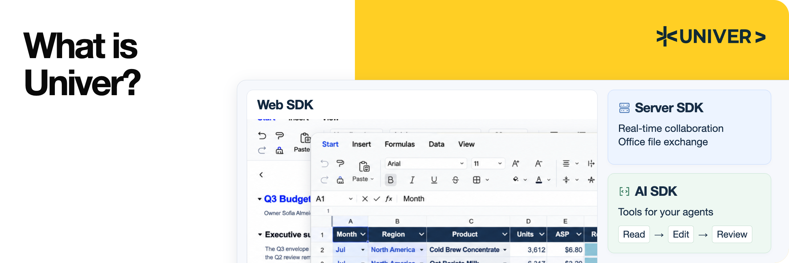</p>

**Univer** 是一套 Office SDK，用于在你自己的产品中构建办公应用。它基于你的数据和权限，为用户和现有 Agent 提供办公编辑、计算、协作及文件处理能力。产品系列覆盖电子表格、文档、演示文稿、关联表格、画布和 PDF。

Univer Office SDK 由三部分组成：

- **Web SDK** 是基础，包含内容模型、编辑、渲染、公式计算和 Facade API（面向应用的 API）。通过组合插件，可以构建嵌入式编辑器或自己的办公应用，也可以在没有交互式编辑器的情况下，复用内容模型、命令和计算能力进行 Headless 处理。
- **Server SDK** 提供实时协作、编辑历史和办公文件导入导出的后端服务。
- **AI SDK** 通过内容工具、执行和审阅集成，将办公能力连接到现有 Agent 和工作流程。

**本仓库以 Apache-2.0 许可证提供 Web SDK 的核心架构和引擎实现**，包括内容模型与快照格式、插件与依赖管理、命令系统、公式与渲染引擎、Facade API、UI 基础设施，以及 Sheets 和 Docs 编辑能力。商业 Web SDK 插件、Server SDK 和商业 AI SDK 扩展单独分发和授权。

Agent 可以使用同样的开源 API，模型和工具编排由你的应用提供。[报价单示例](#connect-your-application-to-editable-content)展示了不依赖 AI SDK 的编辑、计算和保存流程。

<a id="open-source-capabilities"></a>

### 开源能力

<div align="center" style="overflow-x: auto;">

<table align="center" style="display: table; width: auto; margin-left: auto; margin-right: auto;">
<thead>
<tr>
<th>领域</th>
<th>部分能力</th>
</tr>
</thead>
<tbody>
<tr>
<td><strong>Sheets · 编辑与布局</strong></td>
<td>单元格样式、合并单元格、单元格内富文本、冻结窗格、浮动图片，以及撤销／重做。</td>
</tr>
<tr>
<td><strong>Sheets · 数据与计算</strong></td>
<td>公式、定义名称、筛选、排序、数据验证、条件格式、超链接、评论，以及查找替换。</td>
</tr>
<tr>
<td><strong>Docs</strong></td>
<td>富文本编辑、段落格式、列表、超链接、评论和绘图集成。</td>
</tr>
</tbody>
</table>

</div>

功能通过插件和预设组合；[快速开始](#quick-start)仅使用 **Sheets Core 预设**。图片需要相应的绘图插件。详细的开源和商业能力范围请参阅[功能对比](https://univer.ai/compare/)。

以下演示展示更完整的 **Univer Office SDK**，包括商业能力，其范围超出默认开源配置；具体请参阅[开源与商业扩展](#open-source-and-commercial-extensions)。

<div align="center" style="overflow-x: auto;">

<table align="center" style="display: table; width: auto; margin-left: auto; margin-right: auto;">
<tbody>
<tr>
  <td width="50%"><a href="https://univer.ai/demo/spreadsheets">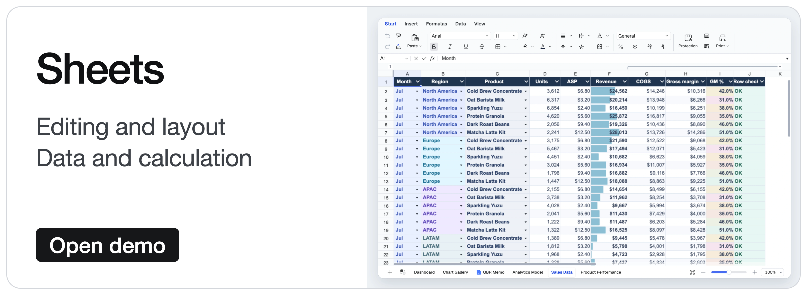</a></td>
  <td width="50%"><a href="https://univer.ai/demo/docs">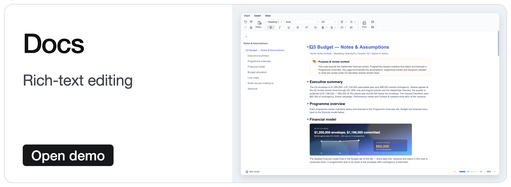</a></td>
</tr>
<tr>
  <td width="50%"><a href="https://univer.ai/demo/web-app">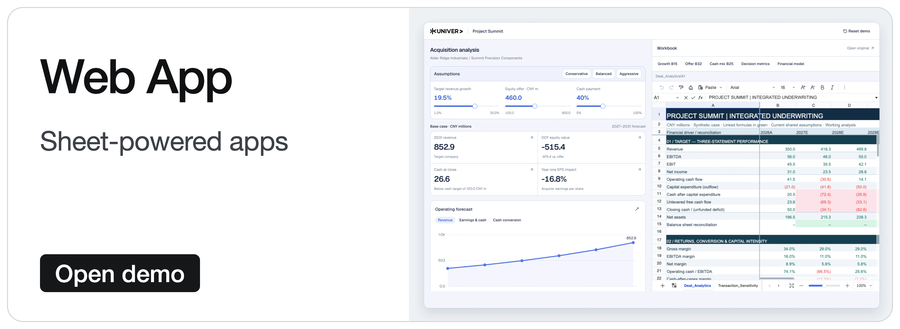</a></td>
  <td width="50%"><a href="https://univer.ai/demo/universe">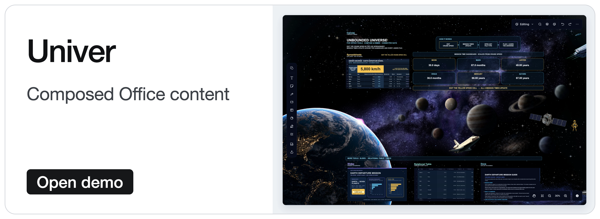</a></td>
</tr>
<tr>
  <td width="50%"><a href="https://univer.ai/demo/slides">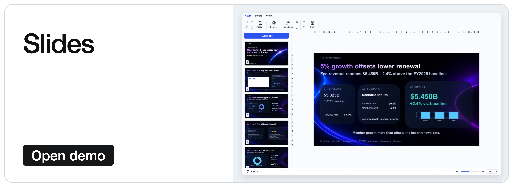</a></td>
  <td width="50%"><a href="https://univer.ai/demo/relational-tables">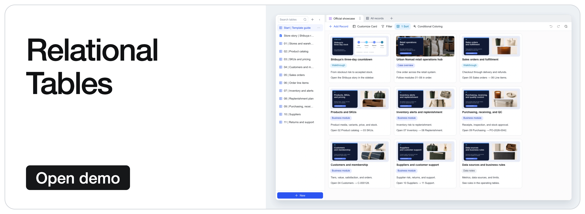</a></td>
</tr>
<tr>
  <td width="50%"><a href="https://univer.ai/demo/canvases">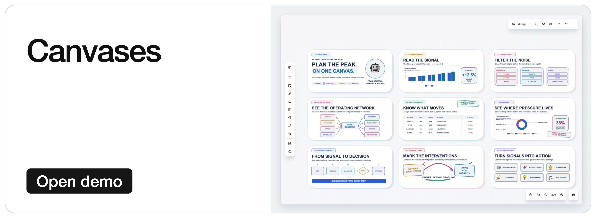</a></td>
  <td width="50%"><a href="https://univer.ai/demo/pdf">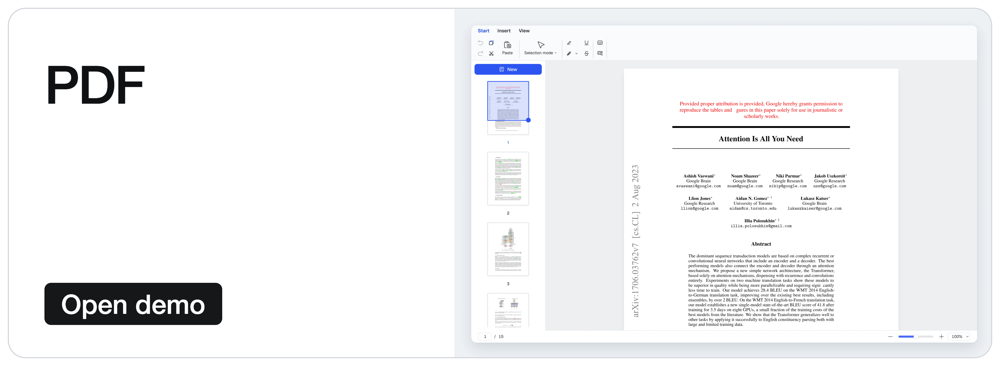</a></td>
</tr>
</tbody>
</table>

</div>

<p align="right"><a href="#readme-top"></a></p>

<a id="what-you-can-build"></a>

## 🚀 基于开源基础构建

<p align="center">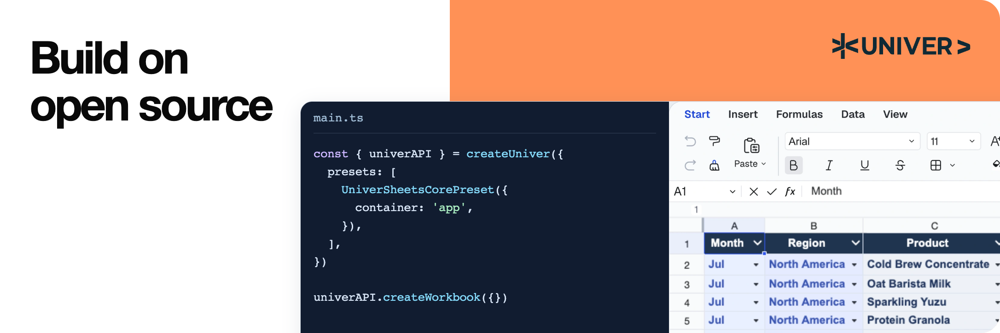</p>

<div align="center" style="overflow-x: auto;">

<table align="center" style="display: table; width: auto; margin-left: auto; margin-right: auto;">
<thead>
<tr>
<th>你的目标</th>
<th>使用开源基础</th>
<th>从这里开始</th>
</tr>
</thead>
<tbody>
<tr>
<td><strong>嵌入 Sheets 或 Docs</strong></td>
<td>为应用或 Agent 产品添加可编辑的办公界面，并通过 Facade API 连接数据。</td>
<td><a href="#quick-start">快速开始</a></td>
</tr>
<tr>
<td><strong>在没有编辑器的情况下处理内容</strong></td>
<td>在 Node.js 中复用内容插件、模型、命令和计算能力，用于编辑、快照和自动化任务。</td>
<td><a href="https://docs.univer.ai/guides/sheets/getting-started/node">Headless 指南</a></td>
</tr>
<tr>
<td><strong>开发自定义功能或编辑器</strong></td>
<td>复用引擎、UI 组件、插件边界、依赖注入及命令／撤销系统。参考现有功能扩展 Sheets 和 Docs，或开发自己的编辑器。</td>
<td><a href="#open-source-architecture">开源架构</a></td>
</tr>
</tbody>
</table>

</div>

**协调跨功能的编辑与撤销／重做。** 在筛选范围内插入一行，会同时改变基础内容和筛选范围，撤销时也需要同时恢复两者。各功能提供自己的变更和撤销数据，由命令组合执行并记录历史。架构介绍会说明如何扩展这些编辑流程。

<a id="quick-start"></a>

### 快速开始：开源电子表格编辑器

在使用 Vite 等构建工具的浏览器应用中：

```bash
pnpm add @univerjs/presets @univerjs/preset-sheets-core
```

初始化 Univer 前，先创建容器：

```html
<div id="app" style="height: 100vh"></div>
```

```ts
import { UniverSheetsCorePreset } from '@univerjs/preset-sheets-core'
import UniverPresetSheetsCoreEnUS from '@univerjs/preset-sheets-core/locales/en-US'
import { createUniver, LocaleType, mergeLocales } from '@univerjs/presets'
import '@univerjs/preset-sheets-core/lib/index.css'

const { univerAPI } = createUniver({
  locale: LocaleType.EN_US,
  locales: {
    [LocaleType.EN_US]: mergeLocales(UniverPresetSheetsCoreEnUS),
  },
  presets: [
    UniverSheetsCorePreset({
      container: 'app',
    }),
  ],
})

univerAPI.createWorkbook({})
```

现在，页面中已经有了电子表格编辑器。使用返回的 `univerAPI` 操作其内容。本示例使用开源包，无需商业 Univer 许可证或 Server SDK。

对于组件框架，请保留 `createUniver` 返回的 `univer` 实例，并在组件卸载时调用 `univer.dispose()`。参阅[生命周期指南](https://docs.univer.ai/guides/sheets/getting-started/lifecycle)。

预设会组合插件并注册其 Facade API。如需手动控制，请参阅下方的[插件模式示例](#manual-plugin-composition)。[安装指南](https://docs.univer.ai/guides/sheets/getting-started/installation)涵盖两种模式、对等依赖和框架集成。

需要配套使用的 `@univerjs/*` 包应保持同一版本。商业包必须匹配相应的发布系列；图标等独立发布的包遵循各自声明的兼容性。参阅 [API 稳定性策略](../../docs/API_STABILITY.md)。

<a id="connect-your-application-to-editable-content"></a>

### 将应用连接到可编辑内容

Facade API 是面向应用的工作簿、工作表和范围接口。继续快速开始的示例，填入报价单，从应用代码更新数量，并读取重新计算后的总额：

```ts
// Wait for formula controllers before editing a newly created workbook.
await new Promise<void>((resolve) => {
  if (univerAPI.getCurrentLifecycleStage() >= univerAPI.Enum.LifecycleStages.Steady) {
    resolve()
    return
  }
  const listener = univerAPI.addEvent(univerAPI.Event.LifeCycleChanged, ({ stage }) => {
    if (stage === univerAPI.Enum.LifecycleStages.Steady) {
      listener.dispose()
      resolve()
    }
  })
})

const workbook = univerAPI.getActiveWorkbook()!
const sheet = workbook.getActiveSheet()

sheet.getRange('A1:D4').setValues([
  ['Item', 'Quantity', 'Unit price', 'Amount'],
  ['Seats', 2, 25, '=B2*C2'],
  ['Support', 1, 100, '=B3*C3'],
  ['Total', '', '', '=SUM(D2:D3)'],
])

// An application control or agent can make the same edit.
sheet.getRange('B2').setValue(4)

univerAPI.getFormula().onCalculationResultApplied().then(() => {
  console.log(sheet.getRange('D4').getValue()) // 200
  localStorage.setItem('quotation', JSON.stringify(workbook.save()))
}).catch(console.error)
```

编辑器与应用操作同一份工作簿，公式变更会自动重新计算。`workbook.save()` 返回包含工作簿及已注册插件数据的 JSON 快照。持久化由你的应用负责，本示例使用浏览器存储。之后再次加载页面时，在初始化后恢复快照，**而不是创建空白工作簿**：

```ts
const saved = localStorage.getItem('quotation')
if (saved) {
  univerAPI.createWorkbook(JSON.parse(saved))
}
```

此流程仅使用开源包。快照持久化与 XLSX 导入导出是不同的能力，后者需要单独分发的文件转换能力。应用集成应使用公开的 Facade API；下方源码链接说明内部实现和扩展点。依赖扩展点前，请参阅 [API 稳定性策略](../../docs/API_STABILITY.md)。

<a id="manual-plugin-composition"></a>

<details>
<summary>进阶：手动组合插件（插件模式）</summary>

当你需要精确控制插件选择、依赖或加载方式时，可以使用插件模式。上方的预设会代你完成这些组合工作。

这套替代初始化方式使用相同的 `app` 容器和 Sheets Core 预设的浏览器插件栈，不使用 Worker。请用它**替代**预设初始化，然后使用返回的 `univerAPI` 运行同一份报价单示例。

```bash
pnpm add @univerjs/core @univerjs/design @univerjs/docs @univerjs/docs-ui \
  @univerjs/engine-formula @univerjs/engine-render @univerjs/network \
  @univerjs/sheets @univerjs/sheets-ui @univerjs/sheets-formula \
  @univerjs/sheets-formula-ui @univerjs/sheets-numfmt \
  @univerjs/sheets-numfmt-ui @univerjs/ui
```

```ts
import { LocaleType, mergeLocales, Univer } from '@univerjs/core'
import { FUniver } from '@univerjs/core/facade'
import DesignEnUS from '@univerjs/design/locale/en-US'
import { UniverDocsPlugin } from '@univerjs/docs'
import { UniverDocsUIPlugin } from '@univerjs/docs-ui'
import DocsUIEnUS from '@univerjs/docs-ui/locale/en-US'
import { UniverFormulaEnginePlugin } from '@univerjs/engine-formula'
import FormulaEnUS from '@univerjs/engine-formula/locale/en-US'
import { UniverRenderEnginePlugin } from '@univerjs/engine-render'
import { UniverNetworkPlugin } from '@univerjs/network'
import { UniverSheetsPlugin } from '@univerjs/sheets'
import SheetsEnUS from '@univerjs/sheets/locale/en-US'
import { UniverSheetsFormulaPlugin } from '@univerjs/sheets-formula'
import SheetsFormulaEnUS from '@univerjs/sheets-formula/locale/en-US'
import { UniverSheetsFormulaUIPlugin } from '@univerjs/sheets-formula-ui'
import SheetsFormulaUIEnUS from '@univerjs/sheets-formula-ui/locale/en-US'
import { UniverSheetsNumfmtPlugin } from '@univerjs/sheets-numfmt'
import { UniverSheetsNumfmtUIPlugin } from '@univerjs/sheets-numfmt-ui'
import SheetsNumfmtUIEnUS from '@univerjs/sheets-numfmt-ui/locale/en-US'
import { UniverSheetsUIPlugin } from '@univerjs/sheets-ui'
import SheetsUIEnUS from '@univerjs/sheets-ui/locale/en-US'
import { UniverUIPlugin } from '@univerjs/ui'
import UIEnUS from '@univerjs/ui/locale/en-US'
import '@univerjs/design/lib/index.css'
import '@univerjs/ui/lib/index.css'
import '@univerjs/docs-ui/lib/index.css'
import '@univerjs/sheets-ui/lib/index.css'
import '@univerjs/sheets-formula-ui/lib/index.css'
import '@univerjs/sheets-numfmt-ui/lib/index.css'
import '@univerjs/network/facade'
import '@univerjs/docs/facade'
import '@univerjs/docs-ui/facade'
import '@univerjs/engine-formula/facade'
import '@univerjs/sheets/facade'
import '@univerjs/ui/facade'
import '@univerjs/sheets-ui/facade'
import '@univerjs/sheets-formula/facade'
import '@univerjs/sheets-numfmt/facade'
import '@univerjs/sheets-formula-ui/facade'

const univer = new Univer({
  locale: LocaleType.EN_US,
  locales: {
    [LocaleType.EN_US]: mergeLocales(
      DesignEnUS,
      DocsUIEnUS,
      FormulaEnUS,
      SheetsEnUS,
      SheetsFormulaEnUS,
      SheetsFormulaUIEnUS,
      SheetsNumfmtUIEnUS,
      SheetsUIEnUS,
      UIEnUS,
    ),
  },
})

univer.registerPlugin(UniverNetworkPlugin)
univer.registerPlugin(UniverDocsPlugin)
univer.registerPlugin(UniverRenderEnginePlugin)
univer.registerPlugin(UniverUIPlugin, { container: 'app' })
univer.registerPlugin(UniverDocsUIPlugin)
univer.registerPlugin(UniverFormulaEnginePlugin)
univer.registerPlugin(UniverSheetsPlugin, {
  onlyRegisterFormulaRelatedMutations: false,
})
univer.registerPlugin(UniverSheetsUIPlugin, {
  protectedRangeShadow: true,
})
univer.registerPlugin(UniverSheetsNumfmtPlugin)
univer.registerPlugin(UniverSheetsNumfmtUIPlugin)
univer.registerPlugin(UniverSheetsFormulaPlugin)
univer.registerPlugin(UniverSheetsFormulaUIPlugin)

const univerAPI = FUniver.newAPI(univer)
univerAPI.createWorkbook({})
```

Docs 插件支持电子表格中的富文本编辑。添加功能时，请同时引入对应的 Facade 扩展、语言包和 UI 样式。容器卸载时应销毁 `univer`。

</details>

<p align="right"><a href="#readme-top"></a></p>

<a id="open-source-architecture"></a>

## 🏗️ 探索开源架构

<p align="center">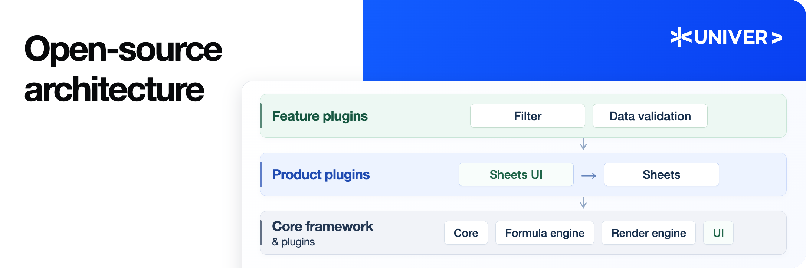</p>

<a id="give-custom-features-clear-boundaries"></a>

### 为自定义功能划分清晰边界

Univer 使用不同的插件组织内容逻辑与 UI 交互。功能插件管理规则和内容变更，UI 插件提供界面及用户交互。例如，`sheets-filter` 管理筛选范围与规则，`sheets-filter-ui` 提供面板、菜单和快捷键。

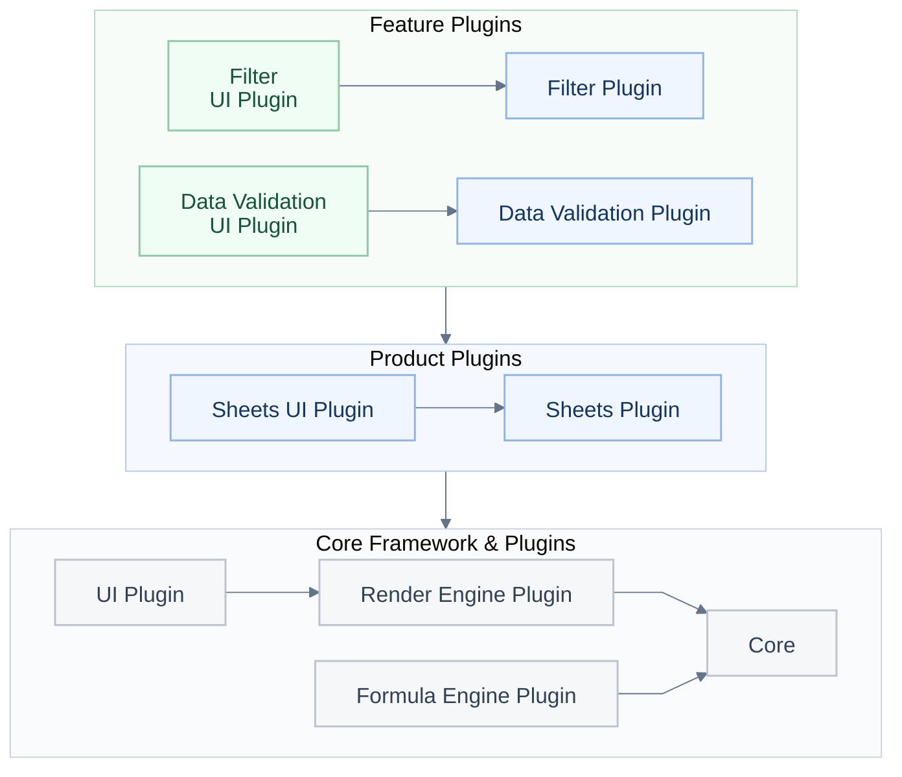

**图 1：三层插件结构。** 功能插件建立在产品插件之上，产品插件复用核心框架与插件。分组箭头表示对下一层的依赖；Core 提供内容模型、命令、依赖注入和生命周期管理。图中省略了部分插件与依赖。

新功能将规则保留在自己的插件中，通过公开服务、命令和明确的扩展点协作。UI 插件建立在共享的 UI 服务与组件之上。

依赖关系在两个层面明确声明：

- **插件之间：** `DependentOn` 声明运行时插件依赖。插件服务对其排序，生命周期阶段将依赖注册、内容初始化和 UI 初始化分开。
- **插件内部：** 依赖注入通过声明的依赖连接控制器与服务。受支持的覆盖机制允许应用替换实现、适配平台服务或提供测试替身。实例级注入器将不同 Univer 实例的应用状态隔离。

可释放的注册机制也让命令、监听器、组件和图标在所属对象销毁时得到清理。

[筛选插件](../../packages/sheets-filter/src/plugin.ts)及其 [UI 插件](../../packages/sheets-filter-ui/src/plugin.ts)在实际代码中展示了这些边界。

<details>
<summary>功能内部：Model、Controller、Service 和 UI 基础设施</summary>

在筛选功能中，`sheets-filter` 负责内容逻辑，`sheets-filter-ui` 负责 UI 交互，每个模块各司其职。

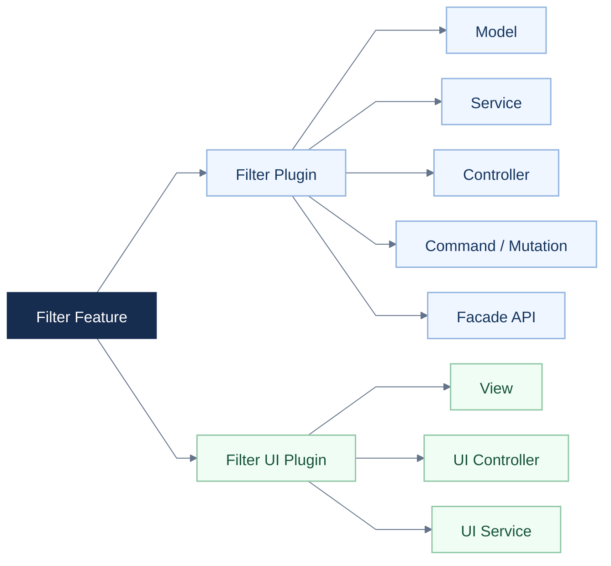

**图 2：代码组织。箭头表示“包含”。** 两种插件都可以包含 Controller 和 Service：逻辑 Controller 协调内容变更与相关功能；UI Controller 连接菜单、快捷键和交互，UI Service 管理面板状态。这些职责为新功能的实现与测试提供一致的结构。

UI 基础设施采用相同的职责划分。**`@univerjs/design`** 提供共享组件和样式，**`@univerjs/ui`** 提供菜单、快捷键、面板和组件注册等工作台服务，**`@univerjs/icons`** 提供图标。功能通过这些扩展点注册组件和图标、添加菜单并接入渲染。团队可以在复用应用 UI 基础设施的同时添加面板或工具栏功能。参阅 [UI 概览](https://docs.univer.ai/guides/sheets/ui/overview)和筛选插件的[组件与图标注册](../../packages/sheets-filter-ui/src/controllers/components.controller.ts)。

</details>

<a id="compose-cross-feature-edits-and-undoredo"></a>

### 组合跨功能编辑与撤销／重做

例如，在筛选范围内插入行时，筛选插件提供相应的范围变更及撤销数据。插行命令组合基础编辑和参与功能的变更，执行它们，并统一记录撤销／重做信息。插行功能可以使用共享的扩展机制，筛选插件则负责自身的范围更新规则。

命令系统区分三种操作：

- **Command** 编排业务操作及其所需的变更。
- **Mutation** 以可序列化参数修改保存在快照中的内容。
- **Operation** 修改临时状态，例如打开的面板或滚动位置。

**统一的撤销／重做结构。** 对于可撤销的编辑，功能实现提供正向 Mutation 和对应的逆向 Mutation，Command 通过 `IUndoRedoService` 记录它们。当一个操作影响多个功能时，Command 可以将它们的变更与撤销数据合并为一条记录，使用户能够完整地撤销和重做该操作。参阅[扩展命令](https://docs.univer.ai/blog/custom-command)。

功能之间仍然需要协作。**拦截器与引用范围处理器为这种协作提供明确的位置。** 在受支持的扩展点，插件提供检查或相关 Mutation；在 API 定义的范围内，拦截器优先级控制执行顺序。

<details>
<summary>示例：命令、回调、功能协作与撤销／重做</summary>

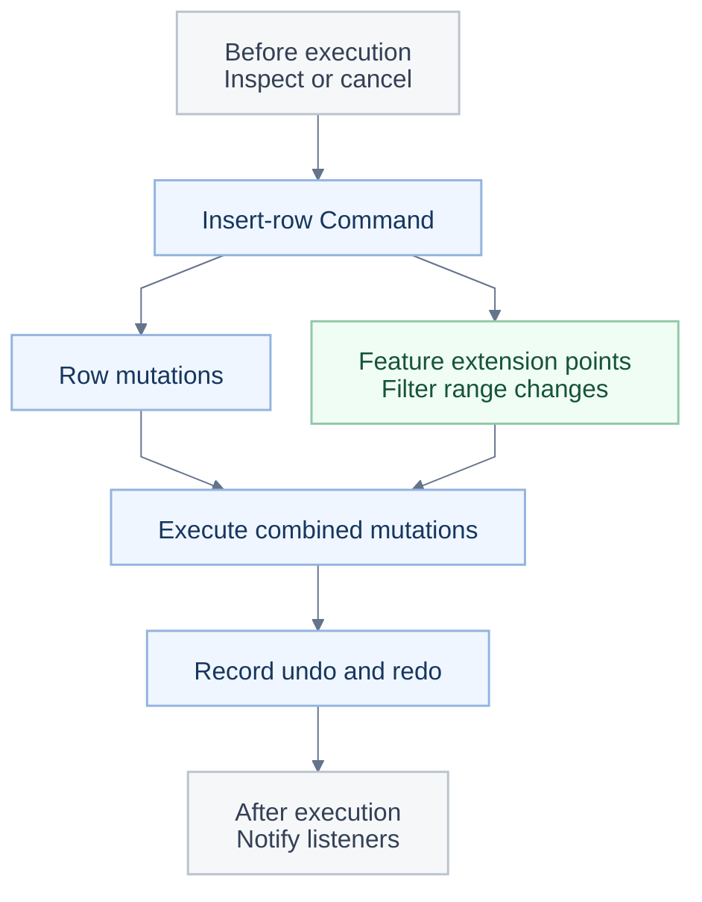

此图简化了插行流程。嵌套命令有各自的执行回调；图中未展示全部事件，也未展示独立的 Operation 路径。参阅[行命令](../../packages/sheets/src/commands/commands/insert-row-col.command.ts)、[筛选控制器](../../packages/sheets-filter/src/controllers/sheets-filter.controller.ts)和[拦截器服务](../../packages/sheets/src/services/sheet-interceptor/sheet-interceptor.service.ts)。

</details>

这些边界支持实用的测试策略：独立测试模型和服务，通过依赖注入替换外部依赖，并为组合操作与撤销／重做补充回归用例。[筛选控制器测试](../../packages/sheets-filter/src/controllers/__tests__/sheets-filter.controller.spec.ts)覆盖行列变更及其对筛选的影响。

<a id="connect-applications-and-agents-through-facade-apis-and-events"></a>

### 通过 Facade API 和事件连接应用与 Agent

本仓库包含编辑器背后的内容模型、公式引擎，以及 Canvas 渲染与布局引擎。它们是共享的基础模块；例如，电子表格的富文本会复用文档的布局和渲染。自定义功能可以基于这些引擎构建，无需另行实现内容技术栈。参阅[公式引擎架构](https://docs.univer.ai/blog/formula)和[渲染引擎架构](https://docs.univer.ai/blog/rendering)。

浏览器编辑器、Node.js 中的 Headless 任务，以及合理组合的 Worker，都可以复用相应的内容插件、模型、命令和计算能力。参阅 [Headless Univer](https://docs.univer.ai/guides/sheets/getting-started/node)和[同构架构](../../docs/ISOMORPHIC.md)。

`ICommandService` 提供执行回调，使插件能够在命令执行前后进行观察。Facade API 将底层能力封装为 `FWorkbook`、`FWorksheet` 和 `FRange` 等面向应用的对象。

各插件提供自己的 Facade 扩展、**通过 `univerAPI.Event` 暴露的类型化事件**，以及**通过 `univerAPI.Enum` 暴露的枚举**。应用代码可以从统一入口查找事件名与常量，无需导入私有服务或重复编写字符串。例如，`BeforeCommandExecute` 可以检查并取消执行，`CommandExecuted` 向监听器报告执行情况。监听器返回可释放对象，取消仅在事件支持时生效。

Facade 扩展随各自的功能包提供，因此内容 API 不必引入无关的 UI API。参阅 [Facade 设计](https://docs.univer.ai/blog/facade)、[命令回调与事件桥接](../../packages/core/src/facade/f-univer.ts)和 [Enum 入口](../../packages/core/src/facade/f-enum.ts)。

本仓库提供可用的功能实现及扩展模式。完整示例请阅读[筛选功能实现解析](https://docs.univer.ai/blog/anatomy)；依赖扩展点前，请参阅 [API 稳定性策略](../../docs/API_STABILITY.md)。

<p align="right"><a href="#readme-top"></a></p>

<a id="open-source-and-commercial-extensions"></a>

## 🧩 使用 Univer Office SDK 扩展应用

<p align="center">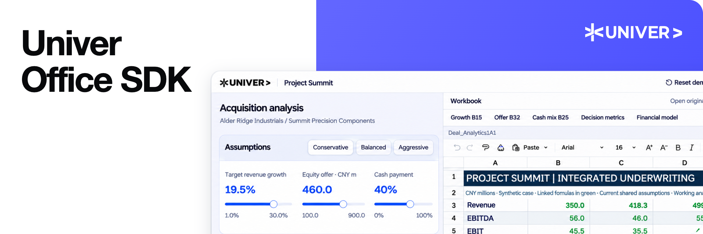</p>

需要更多可直接集成的能力时，可以组合相应的 **Univer Office SDK** 模块，包括更多内容类型、高级编辑插件、协作、文件转换和 Agent 工具。它们扩展上文介绍的同一套内容模型、插件架构、命令系统和 Facade 设计，因此可以在现有集成之上继续构建。

<div align="center" style="overflow-x: auto;">

<table align="center" style="display: table; width: auto; margin-left: auto; margin-right: auto;">
<thead>
<tr>
<th>组成</th>
<th>如何扩展开源基础</th>
</tr>
</thead>
<tbody>
<tr>
<td><strong>开源 Web SDK 核心 · 本仓库</strong></td>
<td>开源的模型、引擎、插件、UI 基础设施，以及 Sheets 和 Docs 能力，并提供相应的 Headless 内容操作。可依据 Apache-2.0 许可证用于商业应用。</td>
</tr>
<tr>
<td><strong>商业 Web SDK 插件</strong></td>
<td>遵循核心的 Plugin、依赖注入、Command/Mutation 和 Facade 扩展模式，为相应内容类型添加图表、形状、透视表、SmartArt 等功能。</td>
</tr>
<tr>
<td><strong>Server SDK</strong></td>
<td>基于相同的内容模型和 Mutation 约定，增加实时协作、版本历史和办公文件转换，并与应用的身份、权限和存储系统集成。</td>
</tr>
<tr>
<td><strong>AI SDK 扩展</strong></td>
<td>复用 Web SDK 的 Headless 与 Facade 能力，提供可组合的 Node.js API 和 CLI 基础模块，让 Agent 检查、编辑和验证内容，并集成协作与 Worktree 审阅。</td>
</tr>
</tbody>
</table>

</div>

<a id="scope-and-licensing"></a>

### 范围与授权

- **本仓库：** 采用 Apache-2.0 许可证的包，可依据该许可证用于商业应用，包括开源的 Headless 内容能力。
- **商业扩展：** 商业 Web SDK 插件、Server SDK 及超出开源基础的 AI SDK 能力单独分发和授权。**Freemium** 评估包含水印和功能限制。
- **参考应用：** Univer Workspace 等开源应用具有自己的源码许可证，其 SDK 依赖仍遵循各自的许可证。

详细覆盖范围请查看[功能对比](https://univer.ai/compare/)，其中提供 **Open source only（仅开源）** 筛选；商业选项请查看[方案与授权](https://univer.ai/pricing/)。

<details>
<summary>共享内容模型如何连接编辑、协作与文件</summary>

这些能力操作可序列化的 **Unit 快照**，包括 Sheets 的 `IWorkbookData`、Docs 的 `IDocumentData`、Slides 的 `ISlideData`，以及画布的 `IBoardData`（API 中称为 **Boards**）。这些类型来自 core 和相应产品包；当前 Slides 和 Boards 能力属于单独分发的商业产品。共享的 Unit 约定让浏览器编辑器、后端服务和 Agent 能够处理同一份内容。

Command 编排编辑，**Mutation 描述内容变更**。协作将 Mutation 打包为 **changeset（变更集）**，通过**操作转换（OT）**处理并发变更，并管理已确认的版本和快照。历史功能可以从快照及后续变更集重建某个版本。参阅[协作设计](https://docs.univer.ai/blog/ot)和 [Collaboration SDK 概览](https://docs.univer.ai/server/collaboration/overview)。

**Exchange** 在办公文件结构与 Univer 内容快照之间进行转换。对于 **XLSX、DOCX 和 PPTX** 等 OOXML 格式，它将文件解析为对应的 Sheet、Doc 或 Slide 数据，并在导出时生成文件表示。转换后的内容可以进入同样的编辑、计算、协作和 Agent 工作流程。参阅[办公文件导入导出](https://docs.univer.ai/server/import-export/node)。

</details>

<details>
<summary>AI SDK 如何向 Agent 提供相同的内容能力</summary>

AI SDK 建立在 Web SDK 的 **Headless 内容模型、命令、计算和 Facade API** 之上，提供结构化的 TypeScript API 及可选的 Commander 预设，供应用组合自己的 Office CLI 或 Agent 工具。

- **理解、发现和编辑。** 检查会返回结构化内容。API Reference 帮助 Agent 查找随 SDK 发布的 Facade 符号与签名。Facade 执行区分读写模式、捕获 Mutation，并提供明确的同步和提交结果。参阅[内容操作](https://docs.univer.ai/ai/content-operations)。
- **检查渲染结果。** 浏览器 Render Runtime 复用 Web SDK 渲染来生成截图。幻灯片布局检查会返回文字超出页面、重叠等问题的结构化结果，为 Agent 的下一轮编辑提供依据。参阅[视觉检查](https://docs.univer.ai/ai/visual-inspection)。
- **编辑草稿供人工审阅。** 配合相应的协作和 Web 能力，Agent 可以在隔离的 Worktree 草稿中进行多轮编辑与验证，再交给用户审阅、合并或重新打开。流程沿用相同的快照、Mutation 和版本约定。参阅 [Worktree](https://docs.univer.ai/ai/worktree)。

对于重复调用，可选的 [Worker 池和守护进程](https://docs.univer.ai/ai/runtime-architecture)可以复用已加载的内容实例，减少重复初始化。根 CLI、目标、授权和输出由应用负责。请通过 [AI SDK 包目录](https://docs.univer.ai/ai/packages)选择所需能力。

</details>

<p align="right"><a href="#readme-top"></a></p>

<a id="application-patterns-and-ecosystem"></a>

## 🌐 应用模式与生态

<p align="center">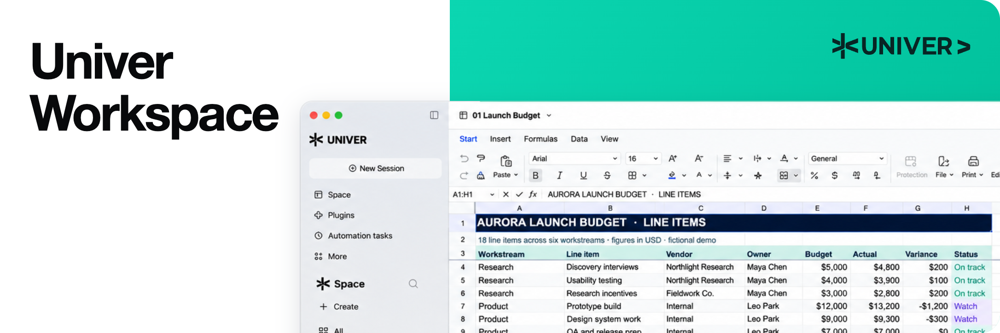</p>

<a id="univer-workspace-an-office-sdk-reference-application"></a>

### Univer Workspace：Office SDK 参考应用

需要完整应用参考时，可以从 [Univer Workspace](https://github.com/dream-num/univer-workspace) 开始。它展示了如何将 Univer Office SDK 编辑器、协作、文件能力、现有 Agent 和人工审阅组合成可自行托管的工作空间。构建自己的办公应用或 Agent 工作空间时，可以参考其集成模式。

<div align="center" style="overflow-x: auto;">

<table align="center" style="display: table; width: auto; margin-left: auto; margin-right: auto;">
  <tr>
    <td width="50%" valign="top">
      <a href="https://space.univer.ai/">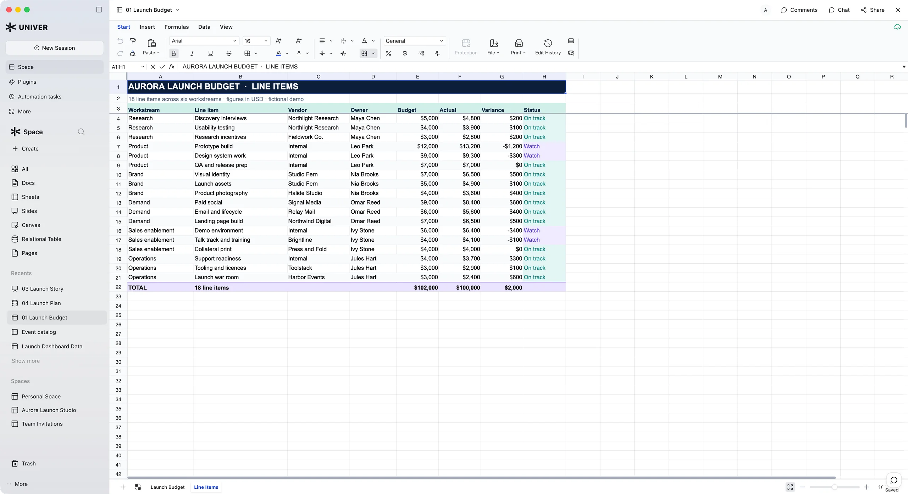</a>
    </td>
    <td width="50%" valign="top">
      <a href="https://univer.ai/demo/web-app">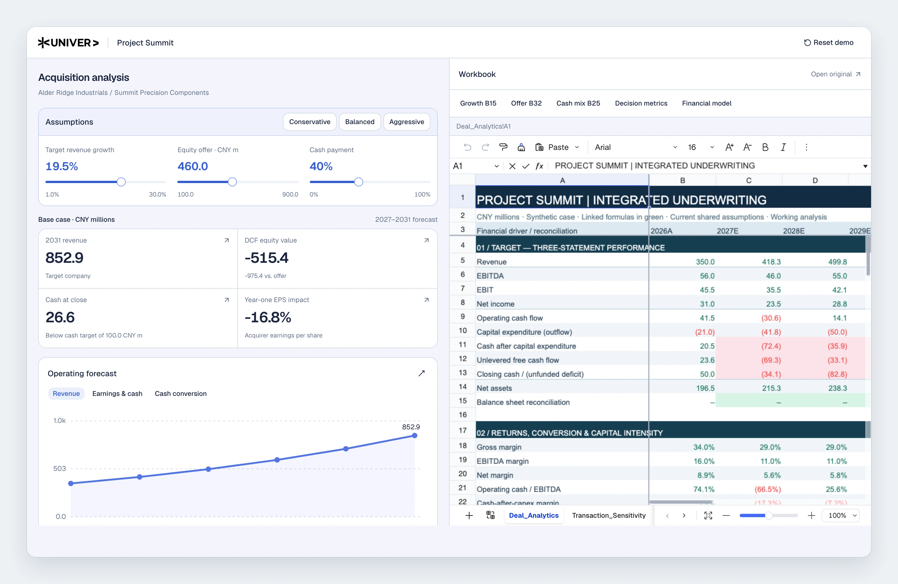</a>
    </td>
  </tr>
  <tr>
    <td width="50%" valign="top">
      <strong>Agent 与可编辑的办公内容</strong><br />
      将对话、电子表格编辑和办公内容放在同一工作空间中。<br />
      <a href="https://space.univer.ai/">体验 Workspace</a> · <a href="https://github.com/dream-num/univer-workspace">Workspace 源码与配置</a>
    </td>
    <td width="50%" valign="top">
      <strong>Web App × Sheet · 实验性功能</strong><br />
      将控件绑定到单元格：应用写入表格，表格变更更新应用。<br />
      <a href="https://univer.ai/demo/web-app">体验表格驱动的应用演示</a>
    </td>
  </tr>
</table>

</div>

Workspace 是开源应用，其 SDK 依赖遵循各自的许可证。关联应用和审阅流程请参阅 [Workspace 概览](https://univer.ai/workspace/)。

<p align="center"><a href="https://www.youtube.com/watch?v=1p-SMEiK6Kg">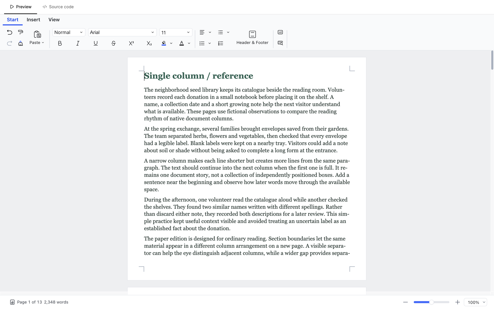</a></p>

[观看 SDK 集成演示](https://www.youtube.com/watch?v=1p-SMEiK6Kg)

<a id="cli-agent-integrations-and-developer-skills"></a>

### CLI、Agent 集成与开发技能

同样的 SDK 能力也可以组合进你已经使用的 Agent 和工具中：

<div align="center" style="overflow-x: auto;">

<table align="center" style="display: table; width: auto; margin-left: auto; margin-right: auto;">
<thead>
<tr>
<th>项目</th>
<th>提供的能力</th>
</tr>
</thead>
<tbody>
<tr>
<td><a href="https://github.com/dream-num/univer-cli">Univer CLI</a></td>
<td>用于创建、编辑、检查和交付办公内容的本地命令行工作空间。</td>
</tr>
<tr>
<td><a href="https://github.com/dream-num/dsh-univer-office">Univer Office for DeepSeek Harness</a></td>
<td>关联内容、结果验证、版本化变更和隔离的 Worktree 协作。</td>
</tr>
<tr>
<td><a href="https://github.com/dream-num/workbuddy-univer-office">Univer Office for WorkBuddy</a></td>
<td>本地 Office 集成、MCP 预览和草稿审阅，目前为开发者预览版。</td>
</tr>
<tr>
<td><a href="https://github.com/dream-num/openclaw-univer-office">Univer Office for OpenClaw</a></td>
<td>用于创建、审阅和交付办公内容的工具。</td>
</tr>
<tr>
<td><a href="https://github.com/dream-num/univer-sdk-skills">Univer SDK Skills</a></td>
<td>帮助编码 Agent 集成 SDK、开发插件和实现后端工作流程的指令。</td>
</tr>
</tbody>
</table>

</div>

各仓库均提供配置说明和 SDK 依赖说明。可浏览[生态](https://univer.ai/ecosystem/)了解 Agent 入口，或参考[文档](https://docs.univer.ai/)构建自己的集成。

<p align="right"><a href="#readme-top"></a></p>

<a id="documentation-and-contributing"></a>

## 📚 文档与贡献

感谢所有参与构建和改进 Univer 的[贡献者](https://github.com/dream-num/univer/graphs/contributors)。欢迎贡献引擎、插件、测试、文档和示例。

<p align="center"><a href="https://docs.univer.ai/guides/sheets">🧩 Web SDK</a> · <a href="https://docs.univer.ai/server">🖥️ Server SDK</a> · <a href="https://docs.univer.ai/ai">🤖 AI SDK</a> · <a href="https://docs.univer.ai/reference/classes/univer">🔧 API 参考</a> · <a href="https://office.univer.ai/">🎮 在线示例</a></p>

<div align="center" style="overflow-x: auto;">

<table align="center" style="display: table; width: auto; margin-left: auto; margin-right: auto;">
  <tr>
    <th align="center"><br />Edge</th>
    <th align="center"><br />Firefox</th>
    <th align="center"><br />Chrome</th>
    <th align="center"><br />Safari</th>
    <th align="center"><br />Electron</th>
  </tr>
  <tr>
    <td align="center"><code>&gt;=88</code></td>
    <td align="center"><code>&gt;=90</code></td>
    <td align="center"><code>&gt;=88</code></td>
    <td align="center"><code>&gt;=14.1</code></td>
    <td align="center"><code>&gt;=12</code></td>
  </tr>
</table>

</div>

<p align="center">Univer 以 Chrome 88 为编译目标，旨在支持上表所列版本。</p>

<a id="runtime-compatibility"></a>

### 运行环境兼容性

- **Polyfill**：Univer 依赖 `Intl.Segmenter`。如果目标浏览器或运行时未提供该 API，请添加 `@formatjs/intl-segmenter` 等 Polyfill。
- **构建工具**：推荐 Vite、esbuild 或 Webpack 5。如果构建工具不支持 `package.json` 中的 `exports` 字段（常见于 Webpack 4），可能需要额外的路径映射。
- **React**：Univer 的视图层基于 React 18 构建，支持 React 18 和 19，并为 React 16.9+ 和 17 提供最低限度的兼容支持。
- **Node.js 环境**：Headless Univer 支持 Node.js `>=18.17.0`，开发本仓库需要 Node.js `>=22.18`。

<details>
<summary>在本仓库中开发</summary>

### 仓库结构

```text
.
├── packages/      Core packages, engines, document types, UI plugins, and feature plugins
├── examples/      All-in-one Vite workbench used for local browser development
├── common/        Shared internal tooling, storybook, and utilities
├── tests/         Additional integration test projects
└── docs/          Architecture notes, images, and repository-local documentation
```

各包的 README 位于 [`packages/`](../../packages) 下对应包的目录中。

### 本地开发

环境要求：

- Node.js `>=22.18`
- pnpm：使用 `package.json` 中 `packageManager` 声明的版本。

```bash
git clone https://github.com/dream-num/univer.git
cd univer
pnpm install
pnpm dev
```

常用命令：

<div align="center" style="overflow-x: auto;">

<table align="center" style="display: table; width: auto; margin-left: auto; margin-right: auto;">
<thead>
<tr>
<th>命令</th>
<th>用途</th>
</tr>
</thead>
<tbody>
<tr>
<td><code class="notranslate">pnpm dev</code></td>
<td>启动 Sheets 和 Docs 开发工作台。</td>
</tr>
<tr>
<td><code class="notranslate">pnpm build</code></td>
<td>构建工作区包，不包括内部 common 包。</td>
</tr>
<tr>
<td><code class="notranslate">pnpm test</code></td>
<td>通过 Turbo 运行单元测试。</td>
</tr>
<tr>
<td><code class="notranslate">pnpm typecheck</code></td>
<td>通过 Turbo 运行 TypeScript 检查。</td>
</tr>
<tr>
<td><code class="notranslate">pnpm lint</code></td>
<td>运行 ESLint。</td>
</tr>
<tr>
<td><code class="notranslate">pnpm storybook:dev</code></td>
<td>启动 Storybook 进行 UI 组件开发。</td>
</tr>
</tbody>
</table>

</div>

提交 Pull Request 前，请阅读 [CONTRIBUTING.md](../../CONTRIBUTING.md)。

</details>

<details>
<summary>架构与贡献参考</summary>

- [仓库中的包](../../packages)、[预设](../../presets)和[示例](../../examples)。
- [构建同构 Univer](../../docs/ISOMORPHIC.md)。
- [Facade API 贡献指南](../../docs/CONTRIBUTING-FACADE.md)。
- [API 稳定性策略](../../docs/API_STABILITY.md)。
- [命名规范](../../docs/NAMING_CONVENTION.md)和[内存泄漏修复](../../docs/FIX_MEMORY_LEAK.md)。
- [架构 TLDR](../../docs/tldr)和 [OLE 附件说明](../../packages/drawing/docs/ole-attachments.md)。

</details>

<p align="right"><a href="#readme-top"></a></p>

<a id="community"></a>

## 💬 社区

在 [GitHub Discussions](https://github.com/dream-num/univer/discussions) 提问，加入 [Discord](https://discord.gg/z3NKNT6D2f)，并关注 [X](https://twitter.com/univerhq) 或 [YouTube](https://www.youtube.com/@dreamNum)。请阅读[行为准则](../../CODE_OF_CONDUCT.md)。

微信扫码加入 Univer 交流群：


<p align="right"><a href="#readme-top"></a></p>

<a id="security"></a>

## 🔒 安全

如果你认为发现了安全问题，请遵循 [安全政策](../../SECURITY.md)。

<p align="right"><a href="#readme-top"></a></p>

<a id="sponsors"></a>

## ❤️ 赞助

Univer 由社区和赞助者共同支持。你可以通过 [Open Collective](https://opencollective.com/univer) 支持这个项目。

<p>
  <a href="https://opencollective.com/univer/sponsor/0/website"></a>
</p>

<p>
  <a href="https://opencollective.com/univer/backer/0/website"></a>
  <a href="https://opencollective.com/univer/backer/1/website"></a>
  <a href="https://opencollective.com/univer/backer/2/website"></a>
  <a href="https://opencollective.com/univer/backer/3/website"></a>
  <a href="https://opencollective.com/univer/backer/4/website"></a>
  <a href="https://opencollective.com/univer/backer/5/website"></a>
  <a href="https://opencollective.com/univer/backer/6/website"></a>
</p>

<p align="right"><a href="#readme-top"></a></p>

<a id="license"></a>

## 📄 许可证

Copyright (c) 2021-present DreamNum Co., Ltd.

本仓库的开源包采用 [Apache-2.0](../../LICENSE) 许可证。商业 SDK 模块单独分发和授权。

<p align="right"><a href="#readme-top"></a></p>
