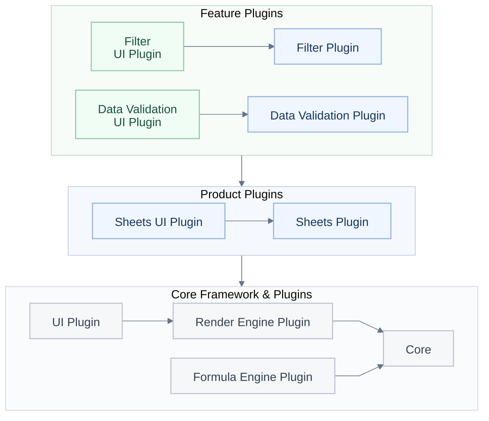
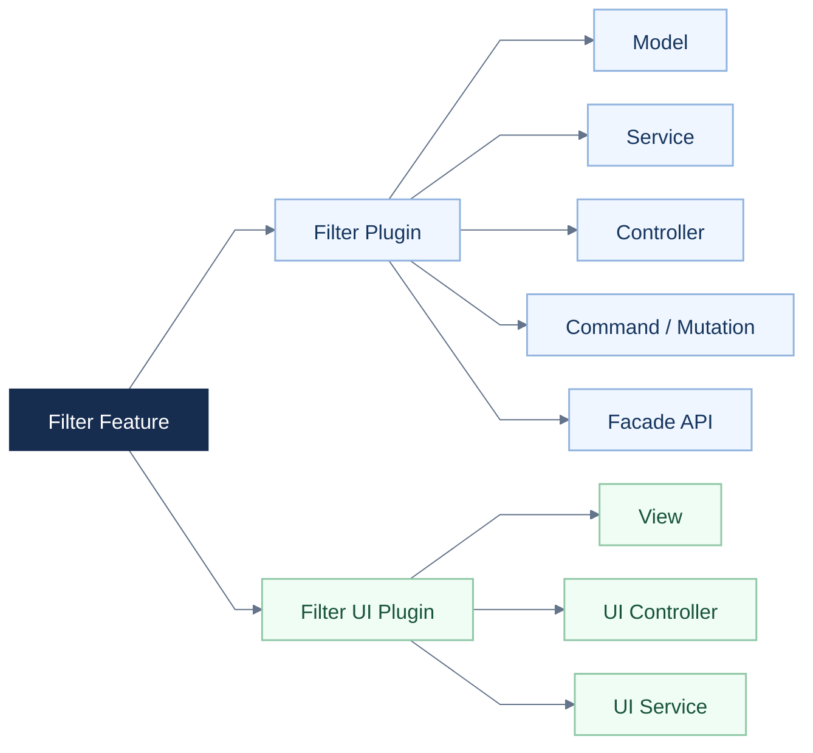
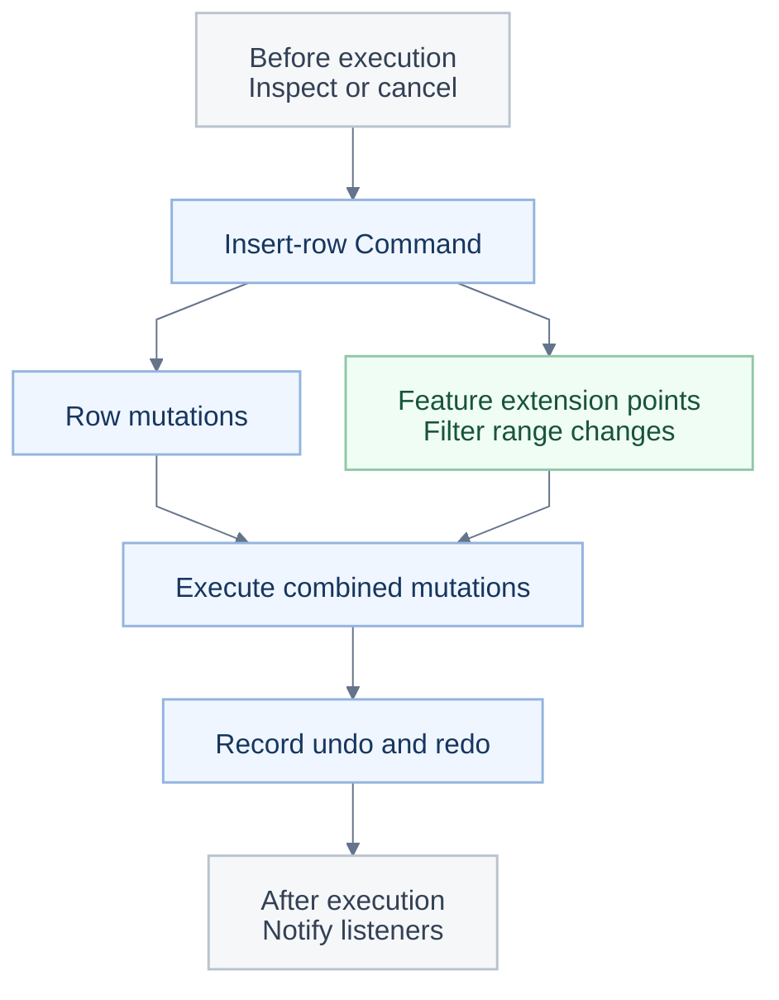

<a id="readme-top"></a>

<p align="center"></p>

<h1 align="center">用 Univer Office SDK 建置你的 AI 辦公產品</h1>

<p align="center">從開源的 Sheets 和 Docs 開始，再連線你自己的應用或 Agent。</p>

<p align="center"><a href="#quick-start">🚀 快速開始</a> · <a href="https://docs.univer.ai/">📚 開發文件</a> · <a href="https://univer.ai/compare/">⚖️ 功能對比</a> · <a href="https://univer.ai/">🌐 官網</a> · <a href="https://docs.univer.ai/showcase">🎮 示例</a> · <a href="https://docs.univer.ai/reference/classes/univer">🔧 API 參考</a> · <a href="https://docs.univer.ai/blog">📝 部落格</a></p>

<p align="center"><a href="../../README.md">English</a> · <a href="../../docs/readme/fr-FR.md">Français</a> · <a href="../../docs/readme/de-DE.md">Deutsch</a> · <a href="../../docs/readme/es-ES.md">Español</a> · <a href="../../docs/readme/zh-CN.md">简体中文</a> · <strong>繁體中文</strong> · <a href="../../docs/readme/ja-JP.md">日本語</a> · <a href="../../docs/readme/ko-KR.md">한국어</a></p>

<p align="center">
  <a href="https://github.com/dream-num/univer/releases"></a>
  <a href="../../LICENSE"></a>
  <a href="https://github.com/dream-num/univer/actions/workflows/build-packages.yml"></a>
  <a href="https://www.codefactor.io/repository/github/dream-num/univer/overview/dev"></a>
  <a href="https://codecov.io/gh/dream-num/univer"></a>
</p>

<p align="center">
  <a href="https://github.com/dream-num/univer"></a>
  <a href="https://github.com/dream-num/univer/graphs/contributors"></a>
  <a href="https://github.com/dream-num/univer/issues"></a>
  <a href="https://github.com/dream-num/univer/commits/dev/"></a>
</p>

<p align="center">
  <a href="https://discord.gg/z3NKNT6D2f"></a>
  <a href="https://twitter.com/univerhq"></a>
  <a href="https://opencollective.com/univer"></a>
</p>

<p align="center">
  <a href="https://trendshift.io/repositories/4376"></a>
</p>

<details>
<summary>目錄</summary>

- [💡 Univer 是什麼？](#what-is-univer)
  - [開源能力](#open-source-capabilities)
- [🚀 基於開源基礎建置](#what-you-can-build)
  - [快速開始：開源試算表編輯器](#quick-start)
  - [將應用連線到可編輯內容](#connect-your-application-to-editable-content)
- [🏗️ 探索開源架構](#open-source-architecture)
  - [為自訂功能劃分清晰邊界](#give-custom-features-clear-boundaries)
  - [組合跨功能編輯與復原／取消復原](#compose-cross-feature-edits-and-undoredo)
  - [透過 Facade API 和事件連線應用與 Agent](#connect-applications-and-agents-through-facade-apis-and-events)
- [🧩 使用 Univer Office SDK 擴展應用](#open-source-and-commercial-extensions)
  - [範圍與授權](#scope-and-licensing)
- [🌐 應用模式與生態](#application-patterns-and-ecosystem)
  - [Univer Workspace：Office SDK 參考應用](#univer-workspace-an-office-sdk-reference-application)
  - [CLI、Agent 整合與開發技能](#cli-agent-integrations-and-developer-skills)
- [📚 文件與貢獻](#documentation-and-contributing)
  - [執行環境相容性](#runtime-compatibility)
- [💬 社區](#community)
- [🔒 安全](#security)
- [❤️ 贊助](#sponsors)
- [📄 授權條款](#license)

</details>

<a id="what-is-univer"></a>

## 💡 Univer 是什麼？

<p align="center"></p>

**Univer** 是一套 Office SDK，用於在你自己的產品中建置辦公應用。它基於你的資料和權限，為使用者和現有 Agent 提供辦公編輯、計算、協作及檔案處理能力。產品系列覆蓋試算表、文件、示範文稿、關聯表格、畫布和 PDF。

Univer Office SDK 由三部分組成：

- **Web SDK** 是基礎，包含內容模型、編輯、渲染、公式計算和 Facade API（面向應用的 API）。透過組合外掛，可以建置嵌入式編輯器或自己的辦公應用，也可以在沒有互動式編輯器的情況下，重用內容模型、命令和計算能力進行 Headless 處理。
- **Server SDK** 提供即時協作、編輯歷史和辦公檔案匯入匯出的後端服務。
- **AI SDK** 透過內容工具、執行和審閱整合，將辦公能力連線到現有 Agent 和工作流程。

**本倉庫以 Apache-2.0 授權條款提供 Web SDK 的核心架構和引擎實現**，包括內容模型與快照格式、外掛與依賴管理、命令系統、公式與渲染引擎、Facade API、UI 基礎設施，以及 Sheets 和 Docs 編輯能力。商業 Web SDK 外掛、Server SDK 和商業 AI SDK 擴展單獨散布和授權。

Agent 可以使用同樣的開源 API，模型和工具編排由你的應用提供。[報價單範例](#connect-your-application-to-editable-content)展示了不依賴 AI SDK 的編輯、計算和保存流程。

<a id="open-source-capabilities"></a>

### 開源能力

<div align="center" style="overflow-x: auto;">

<table align="center" style="display: table; width: auto; margin-left: auto; margin-right: auto;">
<thead>
<tr>
<th>領域</th>
<th>部分能力</th>
</tr>
</thead>
<tbody>
<tr>
<td><strong>Sheets · 編輯與佈局</strong></td>
<td>儲存格樣式、合併儲存格、儲存格內富文字、凍結窗格、浮動圖片，以及復原／取消復原。</td>
</tr>
<tr>
<td><strong>Sheets · 資料與計算</strong></td>
<td>公式、定義名稱、篩選、排序、資料驗證、條件格式、超連結、評論，以及查找替換。</td>
</tr>
<tr>
<td><strong>Docs</strong></td>
<td>富文字編輯、段落格式、列表、超連結、評論和繪圖整合。</td>
</tr>
</tbody>
</table>

</div>

功能透過外掛和預設組合；[快速開始](#quick-start)僅使用 **Sheets Core 預設**。圖片需要相應的繪圖外掛。詳細的開源和商業能力範圍請參閱[功能對比](https://univer.ai/compare/)。

以下示範展示更完整的 **Univer Office SDK**，包括商業能力，其範圍超出預設開源設定；具體請參閱[開源與商業擴展](#open-source-and-commercial-extensions)。

<div align="center" style="overflow-x: auto;">

<table align="center" style="display: table; width: auto; margin-left: auto; margin-right: auto;">
<tbody>
<tr>
  <td width="50%"><a href="https://univer.ai/demo/spreadsheets"></a></td>
  <td width="50%"><a href="https://univer.ai/demo/docs"></a></td>
</tr>
<tr>
  <td width="50%"><a href="https://univer.ai/demo/web-app"></a></td>
  <td width="50%"><a href="https://univer.ai/demo/universe"></a></td>
</tr>
<tr>
  <td width="50%"><a href="https://univer.ai/demo/slides"></a></td>
  <td width="50%"><a href="https://univer.ai/demo/relational-tables"></a></td>
</tr>
<tr>
  <td width="50%"><a href="https://univer.ai/demo/canvases"></a></td>
  <td width="50%"><a href="https://univer.ai/demo/pdf"></a></td>
</tr>
</tbody>
</table>

</div>

<p align="right"><a href="#readme-top"></a></p>

<a id="what-you-can-build"></a>

## 🚀 基於開源基礎建置

<p align="center"></p>

<div align="center" style="overflow-x: auto;">

<table align="center" style="display: table; width: auto; margin-left: auto; margin-right: auto;">
<thead>
<tr>
<th>你的目標</th>
<th>使用開源基礎</th>
<th>從這裡開始</th>
</tr>
</thead>
<tbody>
<tr>
<td><strong>嵌入 Sheets 或 Docs</strong></td>
<td>為應用或 Agent 產品新增可編輯的辦公界面，並透過 Facade API 連線資料。</td>
<td><a href="#quick-start">快速開始</a></td>
</tr>
<tr>
<td><strong>在沒有編輯器的情況下處理內容</strong></td>
<td>在 Node.js 中重用內容外掛、模型、命令和計算能力，用於編輯、快照和自動化任務。</td>
<td><a href="https://docs.univer.ai/guides/sheets/getting-started/node">Headless 指南</a></td>
</tr>
<tr>
<td><strong>開發自訂功能或編輯器</strong></td>
<td>重用引擎、UI 元件、外掛邊界、依賴注入及命令／復原系統。參考現有功能擴展 Sheets 和 Docs，或開發自己的編輯器。</td>
<td><a href="#open-source-architecture">開源架構</a></td>
</tr>
</tbody>
</table>

</div>

**協調跨功能的編輯與復原／取消復原。** 在篩選範圍內插入一行，會同時改變基礎內容和篩選範圍，復原時也需要同時恢復兩者。各功能提供自己的變更和復原資料，由命令組合執行並記錄歷史。架構介紹會說明如何擴展這些編輯流程。

<a id="quick-start"></a>

### 快速開始：開源試算表編輯器

在使用 Vite 等建置工具的瀏覽器應用中：

```bash
pnpm add @univerjs/presets @univerjs/preset-sheets-core
```

初始化 Univer 前，先建立容器：

```html
<div id="app" style="height: 100vh"></div>
```

```ts
import { UniverSheetsCorePreset } from '@univerjs/preset-sheets-core'
import UniverPresetSheetsCoreEnUS from '@univerjs/preset-sheets-core/locales/en-US'
import { createUniver, LocaleType, mergeLocales } from '@univerjs/presets'
import '@univerjs/preset-sheets-core/lib/index.css'

const { univerAPI } = createUniver({
  locale: LocaleType.EN_US,
  locales: {
    [LocaleType.EN_US]: mergeLocales(UniverPresetSheetsCoreEnUS),
  },
  presets: [
    UniverSheetsCorePreset({
      container: 'app',
    }),
  ],
})

univerAPI.createWorkbook({})
```

現在，頁面中已經有了試算表編輯器。使用傳回的 `univerAPI` 操作其內容。本範例使用開源套件，無需商業 Univer 授權條款或 Server SDK。

對於元件框架，請保留 `createUniver` 傳回的 `univer` 執行個體，並在元件卸載時呼叫 `univer.dispose()`。參閱[生命週期指南](https://docs.univer.ai/guides/sheets/getting-started/lifecycle)。

預設會組合外掛並註冊其 Facade API。如需手動控制，請參閱下方的[外掛模式範例](#manual-plugin-composition)。[安裝指南](https://docs.univer.ai/guides/sheets/getting-started/installation)涵蓋兩種模式、對等依賴和框架整合。

需要配套使用的 `@univerjs/*` 套件應保持同一版本。商業套件必須匹配相應的發佈系列；圖示等獨立發佈的套件遵循各自聲明的相容性。參閱 [API 穩定性策略](../../docs/API_STABILITY.md)。

<a id="connect-your-application-to-editable-content"></a>

### 將應用連線到可編輯內容

Facade API 是面向應用的活頁簿、工作表和範圍介面。繼續快速開始的範例，填入報價單，從應用程式碼更新數量，並讀取重新計算後的總額：

```ts
// Wait for formula controllers before editing a newly created workbook.
await new Promise<void>((resolve) => {
  if (univerAPI.getCurrentLifecycleStage() >= univerAPI.Enum.LifecycleStages.Steady) {
    resolve()
    return
  }
  const listener = univerAPI.addEvent(univerAPI.Event.LifeCycleChanged, ({ stage }) => {
    if (stage === univerAPI.Enum.LifecycleStages.Steady) {
      listener.dispose()
      resolve()
    }
  })
})

const workbook = univerAPI.getActiveWorkbook()!
const sheet = workbook.getActiveSheet()

sheet.getRange('A1:D4').setValues([
  ['Item', 'Quantity', 'Unit price', 'Amount'],
  ['Seats', 2, 25, '=B2*C2'],
  ['Support', 1, 100, '=B3*C3'],
  ['Total', '', '', '=SUM(D2:D3)'],
])

// An application control or agent can make the same edit.
sheet.getRange('B2').setValue(4)

univerAPI.getFormula().onCalculationResultApplied().then(() => {
  console.log(sheet.getRange('D4').getValue()) // 200
  localStorage.setItem('quotation', JSON.stringify(workbook.save()))
}).catch(console.error)
```

編輯器與應用操作同一份活頁簿，公式變更會自動重新計算。`workbook.save()` 傳回包含活頁簿及已註冊外掛資料的 JSON 快照。持久化由你的應用負責，本範例使用瀏覽器儲存。之後再次載入頁面時，在初始化後恢復快照，**而不是建立空白活頁簿**：

```ts
const saved = localStorage.getItem('quotation')
if (saved) {
  univerAPI.createWorkbook(JSON.parse(saved))
}
```

此流程僅使用開源套件。快照持久化與 XLSX 匯入匯出是不同的能力，後者需要單獨散布的檔案轉換能力。應用整合應使用公開的 Facade API；下方原始碼連結說明內部實現和擴展點。依賴擴展點前，請參閱 [API 穩定性策略](../../docs/API_STABILITY.md)。

<a id="manual-plugin-composition"></a>

<details>
<summary>進階：手動組合外掛（外掛模式）</summary>

當你需要精確控制外掛選擇、依賴或載入方式時，可以使用外掛模式。上方的預設會代你完成這些組合工作。

這套替代初始化方式使用相同的 `app` 容器和 Sheets Core 預設的瀏覽器外掛棧，不使用 Worker。請用它**替代**預設初始化，然後使用傳回的 `univerAPI` 執行同一份報價單範例。

```bash
pnpm add @univerjs/core @univerjs/design @univerjs/docs @univerjs/docs-ui \
  @univerjs/engine-formula @univerjs/engine-render @univerjs/network \
  @univerjs/sheets @univerjs/sheets-ui @univerjs/sheets-formula \
  @univerjs/sheets-formula-ui @univerjs/sheets-numfmt \
  @univerjs/sheets-numfmt-ui @univerjs/ui
```

```ts
import { LocaleType, mergeLocales, Univer } from '@univerjs/core'
import { FUniver } from '@univerjs/core/facade'
import DesignEnUS from '@univerjs/design/locale/en-US'
import { UniverDocsPlugin } from '@univerjs/docs'
import { UniverDocsUIPlugin } from '@univerjs/docs-ui'
import DocsUIEnUS from '@univerjs/docs-ui/locale/en-US'
import { UniverFormulaEnginePlugin } from '@univerjs/engine-formula'
import FormulaEnUS from '@univerjs/engine-formula/locale/en-US'
import { UniverRenderEnginePlugin } from '@univerjs/engine-render'
import { UniverNetworkPlugin } from '@univerjs/network'
import { UniverSheetsPlugin } from '@univerjs/sheets'
import SheetsEnUS from '@univerjs/sheets/locale/en-US'
import { UniverSheetsFormulaPlugin } from '@univerjs/sheets-formula'
import SheetsFormulaEnUS from '@univerjs/sheets-formula/locale/en-US'
import { UniverSheetsFormulaUIPlugin } from '@univerjs/sheets-formula-ui'
import SheetsFormulaUIEnUS from '@univerjs/sheets-formula-ui/locale/en-US'
import { UniverSheetsNumfmtPlugin } from '@univerjs/sheets-numfmt'
import { UniverSheetsNumfmtUIPlugin } from '@univerjs/sheets-numfmt-ui'
import SheetsNumfmtUIEnUS from '@univerjs/sheets-numfmt-ui/locale/en-US'
import { UniverSheetsUIPlugin } from '@univerjs/sheets-ui'
import SheetsUIEnUS from '@univerjs/sheets-ui/locale/en-US'
import { UniverUIPlugin } from '@univerjs/ui'
import UIEnUS from '@univerjs/ui/locale/en-US'
import '@univerjs/design/lib/index.css'
import '@univerjs/ui/lib/index.css'
import '@univerjs/docs-ui/lib/index.css'
import '@univerjs/sheets-ui/lib/index.css'
import '@univerjs/sheets-formula-ui/lib/index.css'
import '@univerjs/sheets-numfmt-ui/lib/index.css'
import '@univerjs/network/facade'
import '@univerjs/docs/facade'
import '@univerjs/docs-ui/facade'
import '@univerjs/engine-formula/facade'
import '@univerjs/sheets/facade'
import '@univerjs/ui/facade'
import '@univerjs/sheets-ui/facade'
import '@univerjs/sheets-formula/facade'
import '@univerjs/sheets-numfmt/facade'
import '@univerjs/sheets-formula-ui/facade'

const univer = new Univer({
  locale: LocaleType.EN_US,
  locales: {
    [LocaleType.EN_US]: mergeLocales(
      DesignEnUS,
      DocsUIEnUS,
      FormulaEnUS,
      SheetsEnUS,
      SheetsFormulaEnUS,
      SheetsFormulaUIEnUS,
      SheetsNumfmtUIEnUS,
      SheetsUIEnUS,
      UIEnUS,
    ),
  },
})

univer.registerPlugin(UniverNetworkPlugin)
univer.registerPlugin(UniverDocsPlugin)
univer.registerPlugin(UniverRenderEnginePlugin)
univer.registerPlugin(UniverUIPlugin, { container: 'app' })
univer.registerPlugin(UniverDocsUIPlugin)
univer.registerPlugin(UniverFormulaEnginePlugin)
univer.registerPlugin(UniverSheetsPlugin, {
  onlyRegisterFormulaRelatedMutations: false,
})
univer.registerPlugin(UniverSheetsUIPlugin, {
  protectedRangeShadow: true,
})
univer.registerPlugin(UniverSheetsNumfmtPlugin)
univer.registerPlugin(UniverSheetsNumfmtUIPlugin)
univer.registerPlugin(UniverSheetsFormulaPlugin)
univer.registerPlugin(UniverSheetsFormulaUIPlugin)

const univerAPI = FUniver.newAPI(univer)
univerAPI.createWorkbook({})
```

Docs 外掛支援試算表中的富文字編輯。新增功能時，請同時引入對應的 Facade 擴展、語言套件和 UI 樣式。容器卸載時應銷毀 `univer`。

</details>

<p align="right"><a href="#readme-top"></a></p>

<a id="open-source-architecture"></a>

## 🏗️ 探索開源架構

<p align="center"></p>

<a id="give-custom-features-clear-boundaries"></a>

### 為自訂功能劃分清晰邊界

Univer 使用不同的外掛組織內容邏輯與 UI 互動。功能外掛管理規則和內容變更，UI 外掛提供界面及使用者互動。例如，`sheets-filter` 管理篩選範圍與規則，`sheets-filter-ui` 提供面板、選單和快速鍵。



**圖 1：三層外掛結構。** 功能外掛建立在產品外掛之上，產品外掛重用核心框架與外掛。分組箭頭表示對下一層的依賴；Core 提供內容模型、命令、依賴注入和生命週期管理。圖中省略了部分外掛與依賴。

新功能將規則保留在自己的外掛中，透過公開服務、命令和明確的擴展點協作。UI 外掛建立在共享的 UI 服務與元件之上。

依賴關係在兩個層面明確聲明：

- **外掛之間：** `DependentOn` 聲明執行時外掛依賴。外掛服務對其排序，生命週期階段將依賴註冊、內容初始化和 UI 初始化分開。
- **外掛內部：** 依賴注入透過聲明的依賴連線控制器與服務。受支援的覆蓋機制允許應用替換實現、適配平台服務或提供測試替身。執行個體級注入器將不同 Univer 執行個體的應用狀態隔離。

可釋放的註冊機制也讓命令、監聽器、元件和圖示在所屬物件銷毀時得到清理。

[篩選外掛](../../packages/sheets-filter/src/plugin.ts)及其 [UI 外掛](../../packages/sheets-filter-ui/src/plugin.ts)在實際程式碼中展示了這些邊界。

<details>
<summary>功能內部：Model、Controller、Service 和 UI 基礎設施</summary>

在篩選功能中，`sheets-filter` 負責內容邏輯，`sheets-filter-ui` 負責 UI 互動，每個模組各司其職。



**圖 2：程式碼組織。箭頭表示“包含”。** 兩種外掛都可以包含 Controller 和 Service：邏輯 Controller 協調內容變更與相關功能；UI Controller 連線選單、快速鍵和互動，UI Service 管理面板狀態。這些職責為新功能的實現與測試提供一致的結構。

UI 基礎設施採用相同的職責劃分。**`@univerjs/design`** 提供共享元件和樣式，**`@univerjs/ui`** 提供選單、快速鍵、面板和元件註冊等工作台服務，**`@univerjs/icons`** 提供圖示。功能透過這些擴展點註冊元件和圖示、新增選單並接入渲染。團隊可以在重用應用 UI 基礎設施的同時新增面板或工具欄功能。參閱 [UI 概覽](https://docs.univer.ai/guides/sheets/ui/overview)和篩選外掛的[元件與圖示註冊](../../packages/sheets-filter-ui/src/controllers/components.controller.ts)。

</details>

<a id="compose-cross-feature-edits-and-undoredo"></a>

### 組合跨功能編輯與復原／取消復原

例如，在篩選範圍內插入行時，篩選外掛提供相應的範圍變更及復原資料。插行命令組合基礎編輯和參與功能的變更，執行它們，並統一記錄復原／取消復原資訊。插行功能可以使用共享的擴展機制，篩選外掛則負責自身的範圍更新規則。

命令系統區分三種操作：

- **Command** 編排業務操作及其所需的變更。
- **Mutation** 以可序列化參數修改保存在快照中的內容。
- **Operation** 修改臨時狀態，例如打開的面板或滾動位置。

**統一的復原／取消復原結構。** 對於可復原的編輯，功能實現提供正向 Mutation 和對應的逆向 Mutation，Command 透過 `IUndoRedoService` 記錄它們。當一個操作影響多個功能時，Command 可以將它們的變更與復原資料合併為一條記錄，使使用者能夠完整地復原和取消復原該操作。參閱[擴展命令](https://docs.univer.ai/blog/custom-command)。

功能之間仍然需要協作。**攔截器與引用範圍處理器為這種協作提供明確的位置。** 在受支援的擴展點，外掛提供檢查或相關 Mutation；在 API 定義的範圍內，攔截器優先級控制執行順序。

<details>
<summary>範例：命令、回呼、功能協作與復原／取消復原</summary>



此圖簡化了插行流程。嵌套命令有各自的執行回呼；圖中未展示全部事件，也未展示獨立的 Operation 路徑。參閱[行命令](../../packages/sheets/src/commands/commands/insert-row-col.command.ts)、[篩選控制器](../../packages/sheets-filter/src/controllers/sheets-filter.controller.ts)和[攔截器服務](../../packages/sheets/src/services/sheet-interceptor/sheet-interceptor.service.ts)。

</details>

這些邊界支援實用的測試策略：獨立測試模型和服務，透過依賴注入替換外部依賴，並為組合操作與復原／取消復原補充回歸用例。[篩選控制器測試](../../packages/sheets-filter/src/controllers/__tests__/sheets-filter.controller.spec.ts)覆蓋行列變更及其對篩選的影響。

<a id="connect-applications-and-agents-through-facade-apis-and-events"></a>

### 透過 Facade API 和事件連線應用與 Agent

本倉庫包含編輯器背後的內容模型、公式引擎，以及 Canvas 渲染與佈局引擎。它們是共享的基礎模組；例如，試算表的富文字會重用文件的佈局和渲染。自訂功能可以基於這些引擎建置，無需另行實現內容技術棧。參閱[公式引擎架構](https://docs.univer.ai/blog/formula)和[渲染引擎架構](https://docs.univer.ai/blog/rendering)。

瀏覽器編輯器、Node.js 中的 Headless 任務，以及合理組合的 Worker，都可以重用相應的內容外掛、模型、命令和計算能力。參閱 [Headless Univer](https://docs.univer.ai/guides/sheets/getting-started/node)和[同構架構](../../docs/ISOMORPHIC.md)。

`ICommandService` 提供執行回呼，使外掛能夠在命令執行前後進行觀察。Facade API 將底層能力封裝為 `FWorkbook`、`FWorksheet` 和 `FRange` 等面向應用的物件。

各外掛提供自己的 Facade 擴展、**透過 `univerAPI.Event` 暴露的具型別的事件**，以及**透過 `univerAPI.Enum` 暴露的列舉**。應用程式碼可以從統一入口查找事件名與常數，無需匯入私有服務或重複編寫字串。例如，`BeforeCommandExecute` 可以檢查並取消執行，`CommandExecuted` 向監聽器報告執行情況。監聽器傳回可釋放物件，取消僅在事件支援時生效。

Facade 擴展隨各自的功能套件提供，因此內容 API 不必引入無關的 UI API。參閱 [Facade 設計](https://docs.univer.ai/blog/facade)、[命令回呼與事件橋接](../../packages/core/src/facade/f-univer.ts)和 [Enum 入口](../../packages/core/src/facade/f-enum.ts)。

本倉庫提供可用的功能實現及擴展模式。完整範例請閱讀[篩選功能實現解析](https://docs.univer.ai/blog/anatomy)；依賴擴展點前，請參閱 [API 穩定性策略](../../docs/API_STABILITY.md)。

<p align="right"><a href="#readme-top"></a></p>

<a id="open-source-and-commercial-extensions"></a>

## 🧩 使用 Univer Office SDK 擴展應用

<p align="center"></p>

需要更多可直接整合的能力時，可以組合相應的 **Univer Office SDK** 模組，包括更多內容類型、高級編輯外掛、協作、檔案轉換和 Agent 工具。它們擴展上文介紹的同一套內容模型、外掛架構、命令系統和 Facade 設計，因此可以在現有整合之上繼續建置。

<div align="center" style="overflow-x: auto;">

<table align="center" style="display: table; width: auto; margin-left: auto; margin-right: auto;">
<thead>
<tr>
<th>組成</th>
<th>如何擴展開源基礎</th>
</tr>
</thead>
<tbody>
<tr>
<td><strong>開源 Web SDK 核心 · 本倉庫</strong></td>
<td>開源的模型、引擎、外掛、UI 基礎設施，以及 Sheets 和 Docs 能力，並提供相應的 Headless 內容操作。可依據 Apache-2.0 授權條款用於商業應用。</td>
</tr>
<tr>
<td><strong>商業 Web SDK 外掛</strong></td>
<td>遵循核心的 Plugin、依賴注入、Command/Mutation 和 Facade 擴展模式，為相應內容類型新增圖表、形狀、樞紐分析表、SmartArt 等功能。</td>
</tr>
<tr>
<td><strong>Server SDK</strong></td>
<td>基於相同的內容模型和 Mutation 約定，增加即時協作、版本歷史和辦公檔案轉換，並與應用的身份、權限和儲存系統整合。</td>
</tr>
<tr>
<td><strong>AI SDK 擴展</strong></td>
<td>重用 Web SDK 的 Headless 與 Facade 能力，提供可組合的 Node.js API 和 CLI 基礎模組，讓 Agent 檢查、編輯和驗證內容，並整合協作與 Worktree 審閱。</td>
</tr>
</tbody>
</table>

</div>

<a id="scope-and-licensing"></a>

### 範圍與授權

- **本倉庫：** 採用 Apache-2.0 授權條款的套件，可依據該授權條款用於商業應用，包括開源的 Headless 內容能力。
- **商業擴展：** 商業 Web SDK 外掛、Server SDK 及超出開源基礎的 AI SDK 能力單獨散布和授權。**Freemium** 評估包含浮水印和功能限制。
- **參考應用：** Univer Workspace 等開源應用具有自己的原始碼授權條款，其 SDK 依賴仍遵循各自的授權條款。

詳細覆蓋範圍請查看[功能對比](https://univer.ai/compare/)，其中提供 **Open source only（僅開源）** 篩選；商業選項請查看[方案與授權](https://univer.ai/pricing/)。

<details>
<summary>共享內容模型如何連線編輯、協作與檔案</summary>

這些能力操作可序列化的 **Unit 快照**，包括 Sheets 的 `IWorkbookData`、Docs 的 `IDocumentData`、Slides 的 `ISlideData`，以及畫布的 `IBoardData`（API 中稱為 **Boards**）。這些類型來自 core 和相應產品套件；當前 Slides 和 Boards 能力屬於單獨散布的商業產品。共享的 Unit 約定讓瀏覽器編輯器、後端服務和 Agent 能夠處理同一份內容。

Command 編排編輯，**Mutation 描述內容變更**。協作將 Mutation 打包為 **changeset（變更集）**，透過**操作轉換（OT）**處理併發變更，並管理已確認的版本和快照。歷史功能可以從快照及後續變更集重建某個版本。參閱[協作設計](https://docs.univer.ai/blog/ot)和 [Collaboration SDK 概覽](https://docs.univer.ai/server/collaboration/overview)。

**Exchange** 在辦公檔案結構與 Univer 內容快照之間進行轉換。對於 **XLSX、DOCX 和 PPTX** 等 OOXML 格式，它將檔案解析為對應的 Sheet、Doc 或 Slide 資料，並在匯出時生成檔案表示。轉換後的內容可以進入同樣的編輯、計算、協作和 Agent 工作流程。參閱[辦公檔案匯入匯出](https://docs.univer.ai/server/import-export/node)。

</details>

<details>
<summary>AI SDK 如何向 Agent 提供相同的內容能力</summary>

AI SDK 建立在 Web SDK 的 **Headless 內容模型、命令、計算和 Facade API** 之上，提供結構化的 TypeScript API 及可選的 Commander 預設，供應用組合自己的 Office CLI 或 Agent 工具。

- **理解、發現和編輯。** 檢查會傳回結構化內容。API Reference 幫助 Agent 查找隨 SDK 發佈的 Facade 符號與簽名。Facade 執行區分讀寫模式、捕獲 Mutation，並提供明確的同步和提交結果。參閱[內容操作](https://docs.univer.ai/ai/content-operations)。
- **檢查渲染結果。** 瀏覽器 Render Runtime 重用 Web SDK 渲染來生成截圖。投影片佈局檢查會傳回文字超出頁面、重疊等問題的結構化結果，為 Agent 的下一輪編輯提供依據。參閱[視覺檢查](https://docs.univer.ai/ai/visual-inspection)。
- **編輯草稿供人工審閱。** 配合相應的協作和 Web 能力，Agent 可以在隔離的 Worktree 草稿中進行多輪編輯與驗證，再交給使用者審閱、合併或重新打開。流程沿用相同的快照、Mutation 和版本約定。參閱 [Worktree](https://docs.univer.ai/ai/worktree)。

對於重複呼叫，可選的 [Worker 池和守護程序](https://docs.univer.ai/ai/runtime-architecture)可以重用已載入的內容執行個體，減少重複初始化。根 CLI、目標、授權和輸出由應用負責。請透過 [AI SDK 套件目錄](https://docs.univer.ai/ai/packages)選擇所需能力。

</details>

<p align="right"><a href="#readme-top"></a></p>

<a id="application-patterns-and-ecosystem"></a>

## 🌐 應用模式與生態

<p align="center"></p>

<a id="univer-workspace-an-office-sdk-reference-application"></a>

### Univer Workspace：Office SDK 參考應用

需要完整應用參考時，可以從 [Univer Workspace](https://github.com/dream-num/univer-workspace) 開始。它展示了如何將 Univer Office SDK 編輯器、協作、檔案能力、現有 Agent 和人工審閱組合成可自行代管的工作空間。建置自己的辦公應用或 Agent 工作空間時，可以參考其整合模式。

<div align="center" style="overflow-x: auto;">

<table align="center" style="display: table; width: auto; margin-left: auto; margin-right: auto;">
  <tr>
    <td width="50%" valign="top">
      <a href="https://space.univer.ai/"></a>
    </td>
    <td width="50%" valign="top">
      <a href="https://univer.ai/demo/web-app"></a>
    </td>
  </tr>
  <tr>
    <td width="50%" valign="top">
      <strong>Agent 與可編輯的辦公內容</strong><br />
      將對話、試算表編輯和辦公內容放在同一工作空間中。<br />
      <a href="https://space.univer.ai/">體驗 Workspace</a> · <a href="https://github.com/dream-num/univer-workspace">Workspace 原始碼與設定</a>
    </td>
    <td width="50%" valign="top">
      <strong>Web App × Sheet · 實驗性功能</strong><br />
      將控件綁定到儲存格：應用寫入表格，表格變更更新應用。<br />
      <a href="https://univer.ai/demo/web-app">體驗表格驅動的應用示範</a>
    </td>
  </tr>
</table>

</div>

Workspace 是開源應用，其 SDK 依賴遵循各自的授權條款。關聯應用和審閱流程請參閱 [Workspace 概覽](https://univer.ai/workspace/)。

<p align="center"><a href="https://www.youtube.com/watch?v=1p-SMEiK6Kg"></a></p>

[觀看 SDK 整合示範](https://www.youtube.com/watch?v=1p-SMEiK6Kg)

<a id="cli-agent-integrations-and-developer-skills"></a>

### CLI、Agent 整合與開發技能

同樣的 SDK 能力也可以組合進你已經使用的 Agent 和工具中：

<div align="center" style="overflow-x: auto;">

<table align="center" style="display: table; width: auto; margin-left: auto; margin-right: auto;">
<thead>
<tr>
<th>專案</th>
<th>提供的能力</th>
</tr>
</thead>
<tbody>
<tr>
<td><a href="https://github.com/dream-num/univer-cli">Univer CLI</a></td>
<td>用於建立、編輯、檢查和交付辦公內容的本地命令行工作空間。</td>
</tr>
<tr>
<td><a href="https://github.com/dream-num/dsh-univer-office">Univer Office for DeepSeek Harness</a></td>
<td>關聯內容、結果驗證、版本化變更和隔離的 Worktree 協作。</td>
</tr>
<tr>
<td><a href="https://github.com/dream-num/workbuddy-univer-office">Univer Office for WorkBuddy</a></td>
<td>本地 Office 整合、MCP 預覽和草稿審閱，目前為開發者預覽版。</td>
</tr>
<tr>
<td><a href="https://github.com/dream-num/openclaw-univer-office">Univer Office for OpenClaw</a></td>
<td>用於建立、審閱和交付辦公內容的工具。</td>
</tr>
<tr>
<td><a href="https://github.com/dream-num/univer-sdk-skills">Univer SDK Skills</a></td>
<td>幫助編碼 Agent 整合 SDK、開發外掛和實現後端工作流程的指令。</td>
</tr>
</tbody>
</table>

</div>

各倉庫均提供設定說明和 SDK 依賴說明。可瀏覽[生態](https://univer.ai/ecosystem/)瞭解 Agent 入口，或參考[文件](https://docs.univer.ai/)建置自己的整合。

<p align="right"><a href="#readme-top"></a></p>

<a id="documentation-and-contributing"></a>

## 📚 文件與貢獻

感謝所有參與建置和改進 Univer 的[貢獻者](https://github.com/dream-num/univer/graphs/contributors)。歡迎貢獻引擎、外掛、測試、文件和範例。

<p align="center"><a href="https://docs.univer.ai/guides/sheets">🧩 Web SDK</a> · <a href="https://docs.univer.ai/server">🖥️ Server SDK</a> · <a href="https://docs.univer.ai/ai">🤖 AI SDK</a> · <a href="https://docs.univer.ai/reference/classes/univer">🔧 API 參考</a> · <a href="https://office.univer.ai/">🎮 在線範例</a></p>

<div align="center" style="overflow-x: auto;">

<table align="center" style="display: table; width: auto; margin-left: auto; margin-right: auto;">
  <tr>
    <th align="center"><br />Edge</th>
    <th align="center"><br />Firefox</th>
    <th align="center"><br />Chrome</th>
    <th align="center"><br />Safari</th>
    <th align="center"><br />Electron</th>
  </tr>
  <tr>
    <td align="center"><code>&gt;=88</code></td>
    <td align="center"><code>&gt;=90</code></td>
    <td align="center"><code>&gt;=88</code></td>
    <td align="center"><code>&gt;=14.1</code></td>
    <td align="center"><code>&gt;=12</code></td>
  </tr>
</table>

</div>

<p align="center">Univer 以 Chrome 88 為編譯目標，旨在支援上表所列版本。</p>

<a id="runtime-compatibility"></a>

### 執行環境相容性

- **Polyfill**：Univer 依賴 `Intl.Segmenter`。如果目標瀏覽器或執行時未提供該 API，請新增 `@formatjs/intl-segmenter` 等 Polyfill。
- **建置工具**：推薦 Vite、esbuild 或 Webpack 5。如果建置工具不支援 `package.json` 中的 `exports` 字段（常見於 Webpack 4），可能需要額外的路徑映射。
- **React**：Univer 的視圖層基於 React 18 建置，支援 React 18 和 19，並為 React 16.9+ 和 17 提供最低限度的相容支援。
- **Node.js 環境**：Headless Univer 支援 Node.js `>=18.17.0`，開發本倉庫需要 Node.js `>=22.18`。

<details>
<summary>在本倉庫中開發</summary>

### 倉庫結構

```text
.
├── packages/      Core packages, engines, document types, UI plugins, and feature plugins
├── examples/      All-in-one Vite workbench used for local browser development
├── common/        Shared internal tooling, storybook, and utilities
├── tests/         Additional integration test projects
└── docs/          Architecture notes, images, and repository-local documentation
```

各套件的 README 位於 [`packages/`](../../packages) 下對應套件的目錄中。

### 本地開發

環境要求：

- Node.js `>=22.18`
- pnpm：使用 `package.json` 中 `packageManager` 聲明的版本。

```bash
git clone https://github.com/dream-num/univer.git
cd univer
pnpm install
pnpm dev
```

常用命令：

<div align="center" style="overflow-x: auto;">

<table align="center" style="display: table; width: auto; margin-left: auto; margin-right: auto;">
<thead>
<tr>
<th>命令</th>
<th>用途</th>
</tr>
</thead>
<tbody>
<tr>
<td><code class="notranslate">pnpm dev</code></td>
<td>啓動 Sheets 和 Docs 開發工作台。</td>
</tr>
<tr>
<td><code class="notranslate">pnpm build</code></td>
<td>建置工作區套件，不包括內部 common 套件。</td>
</tr>
<tr>
<td><code class="notranslate">pnpm test</code></td>
<td>透過 Turbo 執行單元測試。</td>
</tr>
<tr>
<td><code class="notranslate">pnpm typecheck</code></td>
<td>透過 Turbo 執行 TypeScript 檢查。</td>
</tr>
<tr>
<td><code class="notranslate">pnpm lint</code></td>
<td>執行 ESLint。</td>
</tr>
<tr>
<td><code class="notranslate">pnpm storybook:dev</code></td>
<td>啓動 Storybook 進行 UI 元件開發。</td>
</tr>
</tbody>
</table>

</div>

提交 Pull Request 前，請閱讀 [CONTRIBUTING.md](../../CONTRIBUTING.md)。

</details>

<details>
<summary>架構與貢獻參考</summary>

- [倉庫中的套件](../../packages)、[預設](../../presets)和[範例](../../examples)。
- [建置同構 Univer](../../docs/ISOMORPHIC.md)。
- [Facade API 貢獻指南](../../docs/CONTRIBUTING-FACADE.md)。
- [API 穩定性策略](../../docs/API_STABILITY.md)。
- [命名規範](../../docs/NAMING_CONVENTION.md)和[記憶體洩漏修復](../../docs/FIX_MEMORY_LEAK.md)。
- [架構 TLDR](../../docs/tldr)和 [OLE 附件說明](../../packages/drawing/docs/ole-attachments.md)。

</details>

<p align="right"><a href="#readme-top"></a></p>

<a id="community"></a>

## 💬 社區

在 [GitHub Discussions](https://github.com/dream-num/univer/discussions) 提問，加入 [Discord](https://discord.gg/z3NKNT6D2f)，並關注 [X](https://twitter.com/univerhq) 或 [YouTube](https://www.youtube.com/@dreamNum)。請閱讀[行為準則](../../CODE_OF_CONDUCT.md)。

<p align="right"><a href="#readme-top"></a></p>

<a id="security"></a>

## 🔒 安全

如果你認為發現了安全問題，請遵循 [安全政策](../../SECURITY.md)。

<p align="right"><a href="#readme-top"></a></p>

<a id="sponsors"></a>

## ❤️ 贊助

Univer 由社群和贊助者共同支援。你可以透過 [Open Collective](https://opencollective.com/univer) 支援這個專案。

<p>
  <a href="https://opencollective.com/univer/sponsor/0/website"></a>
</p>

<p>
  <a href="https://opencollective.com/univer/backer/0/website"></a>
  <a href="https://opencollective.com/univer/backer/1/website"></a>
  <a href="https://opencollective.com/univer/backer/2/website"></a>
  <a href="https://opencollective.com/univer/backer/3/website"></a>
  <a href="https://opencollective.com/univer/backer/4/website"></a>
  <a href="https://opencollective.com/univer/backer/5/website"></a>
  <a href="https://opencollective.com/univer/backer/6/website"></a>
</p>

<p align="right"><a href="#readme-top"></a></p>

<a id="license"></a>

## 📄 授權條款

Copyright (c) 2021-present DreamNum Co., Ltd.

本倉庫的開源套件採用 [Apache-2.0](../../LICENSE) 授權條款。商業 SDK 模組單獨散布和授權。

<p align="right"><a href="#readme-top"></a></p>
